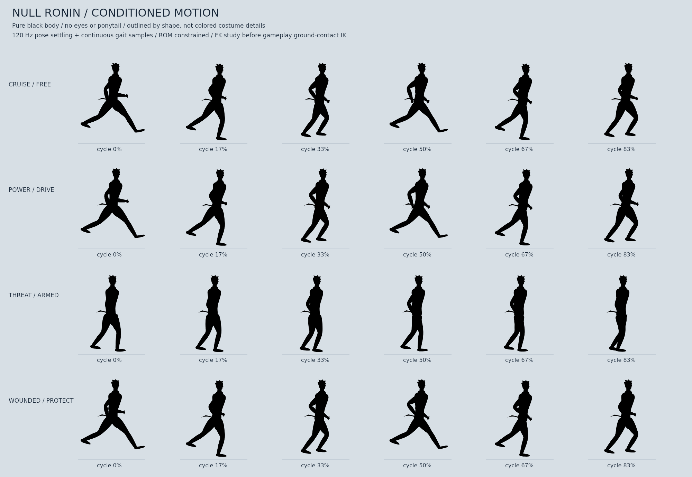

# ⚔️ Stickman Rising

A fast, kinetic **2D wave-survival combat game** with a pseudo-3D stickman warrior — blade combos, lightning-charged dashes, parries, executions, and six unlockable elemental swords. Built as a fully custom canvas game engine inside Next.js.


## 🎮 Features

- **Custom canvas game engine** — no game libraries; hand-rolled pseudo-3D character rig (XYZ-projected limbs), constrained IK legs, ROM-limited arm solver, shadow system, camera, waves, and particles
- **6 elemental swords**, each with a unique ability and ultimate:
  | # | Sword | Ability | Ultimate |
  |---|-------|---------|----------|
  | 1 | ⚔️ Energy Katana | Blade Storm — rapid multi-dash slash storm | Thousand Cuts |
  | 2 | 🔥 Inferno Blade | Inferno Wave — rolling ground firestorm | Supernova |
  | 3 | ⚡ Thunder Blade | Thunder Rush — lightning dash that chains between enemies | Gigavolt |
  | 4 | 🕳️ Void Blade | Void Step — teleport into the densest cluster and implode it | Event Horizon |
  | 5 | 🪐 Gravity Blade | Gravity Crush — drag foes in, suspend, crush | — |
  | 6 | 👻 Phantom Blade | — | — |
- **Combat system**: light/heavy attack chains, parry, executions, combo counter, dash i-frames
- **Wave survival** with escalating enemy hordes
- **Persistent leaderboard** (SQLite + Prisma 7) and unlock progression saved locally
- **Character sheet / QA harness** under `research/` — frame-by-frame VLM-verified animation iteration

## 🕹️ Controls

| Action | Keys |
|--------|------|
| Move | `WASD` / Arrows |
| Light attack | `J` / `Z` |
| Heavy attack | `K` / `X` |
| Dash | `L` / `C` / `Shift` |
| Jump | `Space` |
| Parry | `O` / `F` |
| Ability | `U` |
| Ultimate | `I` |
| Execute | `E` |
| Sheathe sword | `Q` |
| Cycle sword | `Tab` / `1`–`6` |
| Pause | `P` / `Esc` |

On touch devices, use the on-screen DRAW and SWORD buttons to draw/sheathe and
cycle unlocked swords. Flick the joystick in a direction, release, then hold it
in the same direction within 280 ms to sprint.

## 🛠 Tech Stack

- **Next.js 16** (App Router, Turbopack) + **React 19** + **TypeScript 6**
- **Tailwind CSS 4** + **shadcn/ui** (New York) + **lucide-react**
- **Prisma 7** + SQLite via the `better-sqlite3` driver adapter
- **Bun** as the package manager / script runner; **Node.js 22.12+** for the Next.js server (required by the SQLite adapter)
- Game engine: pure TypeScript + Canvas 2D (`src/game/`)

## Momentum dash and double-tap sprint

- **Hold A / D:** normal movement, up to **350 px/s**.
- **Tap A, release, tap and HOLD A** (or D): sprint up to **480 px/s**.
  The two presses must be within **280 ms**. Release stops the sprint intent;
  friction still slows the character naturally. Repeats cannot trigger it.
- **Shift / L:** force-driven dash: load → thrust → coast → catch. Existing
  directional/combat variants remain, with a new **inertia-reversal pivot**.
- Incoming momentum survives entry, exit and a follow-up leap. Reversal takes
  force/time, air dashes keep gravity, and walls absorb horizontal momentum.
- Dash poses follow the force-phase clock. Sprint has a new accelerating
  power-stride cycle, then transitions to a steady cruising sprint.

[Watch normal run → sprint → carry dash → pivot dash](research/dash-physics-gameplay.webp)
(half-speed actual gameplay). See [physics/animation design and verification](research/DASH_PHYSICS.md).

### Ninja styling and natural hands

Sprint now uses a stronger supported ninja lean, with a deeper diagonal during
dash push and a balanced head—not a folded waist. Arms pump oppositely, wrists
follow through softly, and fingers curl around the palm/grip instead of sticking
out as straight spikes. The held sword grip remains stable.

[Watch the latest ninja sprint/dash](research/ninja-lean-gameplay.webp) ·
[Light-background pose study](research/ninja-lean-study.png) ·
[Implementation and 62-test verification](research/NINJA_MOTION.md)

### 10 Hz sprint arm direction

Sprint now uses deliberate **100 ms upper-body/hand exposures** with re-composed
arm arcs, tapered muscle shapes, angular palms and relaxed finger recovery.
Movement, feet and final weapon/contact solvers remain full-rate—not a 10 FPS
limit on the game. Dash/attack/stop interrupt the held pose immediately.

[Watch real-speed 10 Hz sprint acting](research/sprint-10hz-gameplay.webp) ·
[Power reference sheet](research/arm-sheet-01-power.png) ·
[Arc/timing sheet](research/arm-sheet-02-rhythm.png) ·
[Hand design sheet](research/arm-sheet-03-hands.png)

[Reference provenance, design decisions and 68-test validation](research/SPRINT_10HZ_ARMS.md).

## Player model and animation sheets

The player is a **pure `#000000` Shadow Ronin silhouette, including the face**:
no white eyes, colored body details, character glow or ponytail. A compact swept
head, raised collar, split hems and short obi ends add style through the outline.
Katana/scabbard and scene effects remain separate props/effects.

The actual reference MP4 was located on this repository's GitHub HEAD and decoded
at its native **720×1280 / 30 FPS**. See the [30-frame study](research/runner-reference-frames.jpg)
and [reference analysis + three implementation passes](research/RUNNER_REFERENCE.md).



[Watch actual free-run → wounded-run gameplay](research/runner-conditioned-gameplay.webp)
(half speed; captured from a 120 Hz simulation, not a claim of device frame rate).
Variation responds to momentum, acceleration, armed/free hands, threat formation,
health, air travel, impact speed and counter state. Each family keeps its authored
choreography; bounded contextual pose/finger layers run before weapon and contact IK.
The animation inspector can read `player.animationVariation`.

Twelve periodic hand-arc landmarks get shape-preserving continuous in-betweens.
The shared gait clock, fixed-length limbs, contact locks and actual blade endpoints
are preserved. Stops retain seven exposures; actual landing contact now plays its
recovery clip, which was previously suppressed by a stale grounded flag.

Run `bun run art:player`, `node --import tsx scripts/render-context-study.ts`, or
`node --import tsx scripts/render-stop-study.ts` to regenerate the production-rig studies.
[Earlier silhouette/shadow passes](research/SILHOUETTE_MOTION.md),
[motion research](research/RONIN_MOTION.md), and
[visual iterations](research/SHADOW_RONIN.md) remain historical references.

## Dependency maintenance

Use **Bun 1.4.4** (recorded in `package.json`) and commit `bun.lock` with dependency changes.
For reproducible installs, run `bun install --frozen-lockfile`. To refresh dependencies
within the declared version ranges, run `bun update`.

TypeScript stays on **6.x** because the current `typescript-eslint` integration does
not support TypeScript 7. Prisma stays on **7.x**. ESLint 9 is used for plugin peer
compatibility; the scoped minimatch override addresses GHSA-g3hv-75wg-m249. Check
both `npm audit` and `bun audit` when updating either lockfile.

## 🚀 Getting Started

```bash
# 1. Install dependencies
bun install

# 2. Configure the database
cp .env.example .env
bun run db:generate   # generate the Prisma client
bun run db:push       # create/sync the SQLite schema

# 3. Play
bun run dev           # http://localhost:3000
```

## Verification and production

```bash
bun run check          # types, lint, SQLite/API regression tests, animation audits
bun run build          # production build with TypeScript checks enabled
HOSTNAME=0.0.0.0 bun run start
```

- Fonts are bundled through `geist`; builds no longer contact Google Fonts.
- `start` and the deployment launcher use **Node**, not Bun: `better-sqlite3`
  is a native Node module and is not supported by the Bun runtime.
- Run `db:generate` and `db:push` before first use. Client generation may need
  access to Prisma's engine download host; schema synchronization requires it.
- If the native SQLite binding is missing after an install with scripts disabled,
  run `npm rebuild better-sqlite3` with Node and a C++ build toolchain installed.
  In restricted build environments with local Node headers, use
  `npm_config_nodedir=/usr/local npm rebuild better-sqlite3 --build-from-source`.
- Scores API returns `400` for invalid data, `413` for bodies over 4 KiB, `415`
  for unsupported content types, and `503` when the database is unavailable.
  A UUID `Idempotency-Key` header makes retries safe; the game reuses it per run.
  Reusing a key with different score data returns `409` rather than silently
  accepting a different submission.
- Score POSTs have a SQLite-backed, atomic global limit of 120 requests per minute.
  Optionally set `SCORES_TRUSTED_IP_HEADER=x-real-ip` to additionally limit each
  client to 20 requests per minute. Enable this only behind a trusted proxy that
  overwrites the configured header and blocks direct access to the app; arbitrary
  forwarded headers are otherwise ignored. Limits are shared only by processes
  using the same SQLite file. Use a shared rate-limiting service for independent
  databases or multiple hosts. The limiter fails closed if SQLite is unavailable.
- Mount the SQLite database on persistent storage and set `DATABASE_URL` to its
  absolute `file:` path in production. A packaged database or local preview file
  alone does not survive replacement of the deployment or its storage.
- Corrupt saves/settings recover safe defaults. Failed storage writes and network
  requests show warnings instead of reporting success. Scores remain client-reported;
  rate limiting reduces spam but cannot verify gameplay. A cheat-resistant ranking
  requires trusted server-side simulation or verification and a suitable identity
  system.
- Python deployment helper tests require `uv`; the container test additionally
  requires Docker and the configured runner image.

## 📁 Project Structure

```
src/
  app/           # Next.js app router (single-page game shell + scores API)
  game/
    core/        # types, input, camera, utils
    anim/        # skeleton, pose, clips, ROM limits, arm solver, leg IK
    entities/    # player, enemies, projectiles
    combat/      # swords, attacks, dash
    fx/          # lightning, particles
    render/      # renderer, lighting, HUD
    world/       # waves, background
    audio/       # sound
  components/ui/ # shadcn/ui components
prisma/          # database schema
research/        # animation research, QA harnesses, character sheets, VLM audits
```

## License

All rights reserved — © 2026 coders786

### Dramatic dash drive

Lower, harder iai launch and momentum carry, faster forward dash timings,
compact trailing hand, propulsion-timed speed cuts/dust/camera bite, and a
force-driven braking catch. Sprint remains 10 Hz acting; dash stays full-rate.
[Gameplay](research/dramatic-dash-gameplay.webp) ·
[Reference interpretation and 70-test validation](research/DRAMATIC_DASH.md).

### Jump, sword draw and switching in-betweens

Recomposed jump/leap passing poses, contact→compression→rebound landing,
short-arc sword extraction and follow-through. Shared clip switching now has
three non-endpoint samples and starts from the constrained visible pose.
[Gameplay](research/jump-draw-gameplay.webp) ·
[Three sprite sheets, research and 74-test validation](research/JUMP_DRAW_TRANSITIONS.md).

### Nine-key anime dash overhaul

Four new forward-dash breakdowns, longer visible drive, independent fast motor
pulse, and a deeper sprint lean with a curved continuous torso silhouette.
[Real-speed gameplay](research/anime-dash-gameplay.webp) ·
[Nine-key sprite sheet](research/anime-dash-nine-keys.png) ·
[Design and 77-test validation](research/ANIME_DASH_OVERHAUL.md).

### Sword rituals and breathing idle

Six extra authored breakdowns **per** sword action: 11-key sheathe and 12-key
unsheathe. Seven-key breathing idle with delayed hand settling and less frequent
flourishes. [Gameplay](research/ritual-idle-gameplay.webp) ·
[Pose sheet](research/ritual-idle-key-sheet.png) ·
[Design and 80-test validation](research/RITUAL_IDLE.md).

### Motion-aware transition correction

Replaces the old frozen-pose/sample-count blending with velocity-matched
hand-space transitions, living-action anatomical tracking, planted support
through stationary sword rituals, and a gradual draw→relaxed-carry handoff.
[Gameplay review](research/motion-aware-gameplay.webp) ·
[Implementation, limits and 86-test validation](research/MOTION_AWARE_TRANSITIONS.md).

### Sheathed / drawn movement and combat

**Q selects equipment mode.** Sheathed J/K/air/dash/counter attacks now use real
empty-hand poses and short fist/elbow hit volumes, not a hidden sword. Guard,
charge, ability and finisher preserve mode. Drawn play retains sword combat with
reworked movement carries and proper rear-blade occlusion.
[Gameplay](research/dual-stance-gameplay.webp) ·
[Movement sheet](research/dual-stance-movement.png) ·
[Combat sheet](research/dual-stance-combat.png) ·
[Plan, research, implementation and 95-test validation](research/DUAL_STANCE.md).
