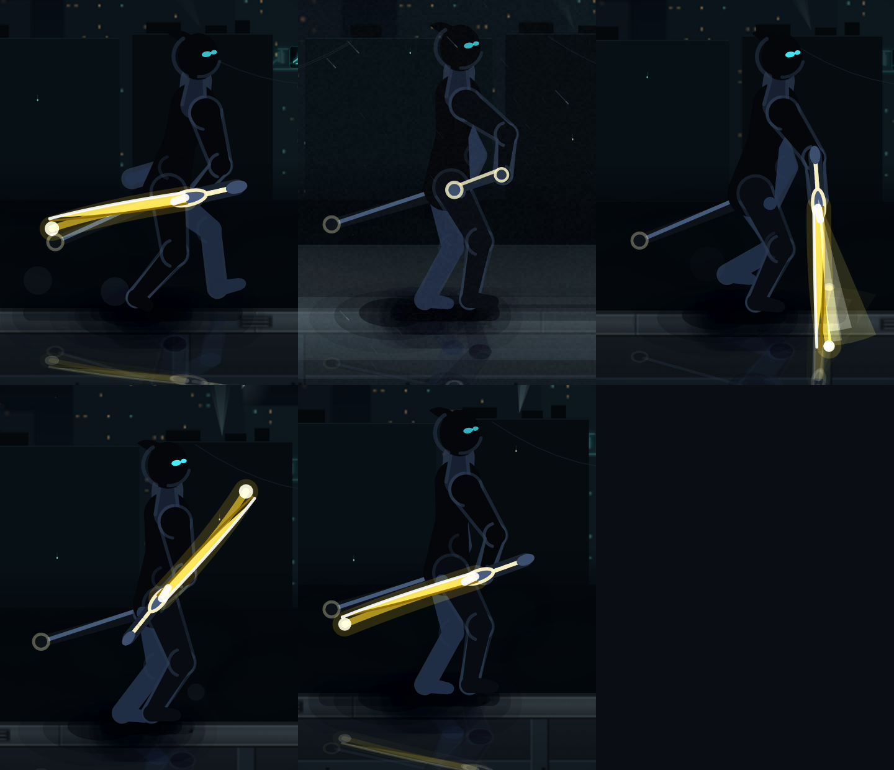

# ⚔️ Stickman Rising

A fast, kinetic **2D wave-survival combat game** with a pseudo-3D stickman warrior — blade combos, lightning-charged dashes, parries, executions, and six unlockable elemental swords. Built as a fully custom canvas game engine inside Next.js.



## 🎮 Features

- **Custom canvas game engine** — no game libraries; hand-rolled pseudo-3D character rig (XYZ-projected limbs), constrained IK legs, ROM-limited arm solver, shadow system, camera, waves, and particles
- **6 elemental swords**, each with a unique ability and ultimate:
  | # | Sword | Ability | Ultimate |
  |---|-------|---------|----------|
  | 1 | ⚔️ Energy Katana | Blade Storm — rapid multi-dash slash storm | Thousand Cuts |
  | 2 | 🔥 Inferno Blade | Inferno Wave — rolling ground firestorm | Supernova |
  | 3 | ⚡ Thunder Blade | Thunder Rush — lightning dash that chains between enemies | Gigavolt |
  | 4 | 🕳️ Void Blade | Void Step — teleport into the densest cluster and implode it | Event Horizon |
  | 5 | 🪐 Gravity Blade | Gravity Crush — drag foes in, suspend, crush | — |
  | 6 | 👻 Phantom Blade | — | — |
- **Combat system**: light/heavy attack chains, parry, executions, combo counter, dash i-frames
- **Wave survival** with escalating enemy hordes
- **Persistent leaderboard** (SQLite + Prisma 7) and unlock progression saved locally
- **Character sheet / QA harness** under `research/` — frame-by-frame VLM-verified animation iteration

## 🕹️ Controls

| Action | Keys |
|--------|------|
| Move | `WASD` / Arrows |
| Light attack | `J` / `Z` |
| Heavy attack | `K` / `X` |
| Dash | `L` / `C` / `Shift` |
| Jump | `Space` |
| Parry | `O` / `F` |
| Ability | `U` |
| Ultimate | `I` |
| Execute | `E` |
| Sheathe sword | `Q` |
| Cycle sword | `Tab` / `1`–`6` |
| Pause | `P` / `Esc` |

## 🛠 Tech Stack

- **Next.js 16** (App Router, Turbopack) + **React 19** + **TypeScript 6**
- **Tailwind CSS 4** + **shadcn/ui** (New York) + **lucide-react**
- **Prisma 7** + SQLite via the `better-sqlite3` driver adapter
- **Bun** as the package manager / script runner
- Game engine: pure TypeScript + Canvas 2D (`src/game/`)

## 🚀 Getting Started

```bash
# 1. Install dependencies
bun install

# 2. Configure the database
cp .env.example .env
bun run db:generate   # generate the Prisma client
bun run db:push       # create/sync the SQLite schema

# 3. Play
bun run dev           # http://localhost:3000
```

## 📁 Project Structure

```
src/
  app/           # Next.js app router (single-page game shell + scores API)
  game/
    core/        # types, input, camera, utils
    anim/        # skeleton, pose, clips, ROM limits, arm solver, leg IK
    entities/    # player, enemies, projectiles
    combat/      # swords, attacks, dash
    fx/          # lightning, particles
    render/      # renderer, lighting, HUD
    world/       # waves, background
    audio/       # sound
  components/ui/ # shadcn/ui components
prisma/          # database schema
research/        # animation research, QA harnesses, character sheets, VLM audits
```

## License

All rights reserved — © 2026 coders786
