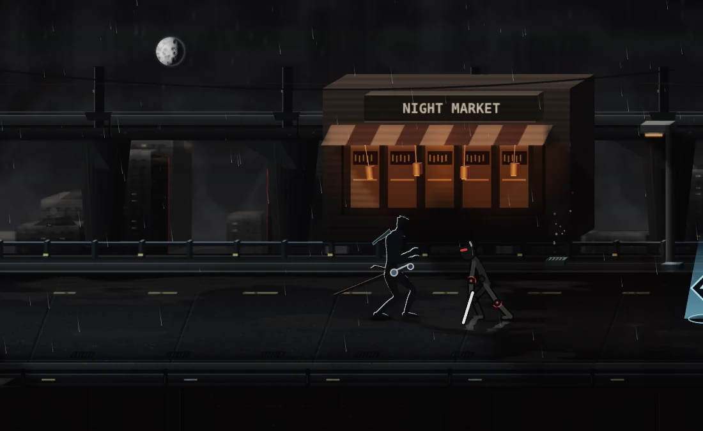

# Bridge — Master / Mobile High-Opt · SACR v4.0

The playable preview is the continuous Bridge. The previous [Noir Bridge](BRIDGE-NOIR.md) remains a separate comparison build and gallery. Distance and encounter geometry still use game units; **48 world pixels per optical metre** is the renderer conversion, while the HUD uses **10 units per travelled metre**.

> The preset labels and sky captures below describe the original v4.0
> release. See [Bridge atmosphere and graphics presets](BRIDGE-ATMOSPHERE.md)
> for the current controls and optics, [Bridge post-processing](BRIDGE-POSTPROCESSING.md)
> for the current tier-specific blur/bloom/grade graph, and [Bridge download and frame-time update](BRIDGE-FAST.md)
> for release assets. The SACR v4.0 transport remains live.

## Original v4.0 renderer controls

- **Master** requests a locked **1.25×** backing. When admitted, it uses RGBA16F, native road shading, two shadow directions, HDR emission and four bloom levels. The quality request is not a hardware override.
- **Mobile High-Opt** requests the Mobile renderer. It uses RGBA8, a half-resolution road and visibility pass plus a full-resolution resolve, a single shadow direction and one transient impact light. It does not allocate Master bloom or a cast framebuffer. The active Mobile backing is independently capped at 1920×1080 (1080×1920 in portrait), even when falling back from a locked Master request.
- **Canvas** remains playable with the same route, shelter boundaries and HUD. It uses baked lit cards when available, bounded painted shadow/contact and weather, and an approximate optical response rather than the GPU reflection evaluator. A denied worker, render allocation or lost context does not change the chosen preset or advance play during repair.
- **Settings** reports requested quality and the active path. Back stays at the top of the settings sheet on short viewports; FPS is an independently drawn HUD toggle. Adaptive resolution is opt-in and picking a preset turns it off. The historical `ultra` and `high` save values still load.

## Transport and lighting

- 1,152-unit spans supply opaque section geometry and distinct world/road receiver rows. A span bakes 512×96 world samples plus 32 road rows. It keeps lunar/sky/AO/storm visibility in RGBA8, local irradiance in RGB9_E5, and two attenuated directions per vector-grid cell. The 24-tile worker cache uses LZ4 blocks. The assembled rolling window is transferred as raw, pre-sized mip data, not decompressed per frame. Raster and optics tasks run on separate bounded worker lanes.
- Two GPU slots stage the 1024×128 optical window and 512×16 direction grid, three irradiance mips and four curb/portal mips. Nine quiet uploads complete a window. At commit, the same frame swaps the seed, origins, textures and architecture words. Hitstop and parry retain the previous committed group. On a seed change, an old group cannot supply the new run's lighting. An out-of-range sample fails dark rather than stretching the previous span.
- The 3,584-byte std140 packet describes contacts, crossing caster bins, blockers, portals and raised supports. Boots use the actual support height. Road shadows attenuate eligible light without muting independent sky or emissive return. Explicit combat light comes from the hit/arc/bolt record, passes through the same opaque blocker test, and expires in a fraction of a second; it is not a bloom extraction from white scene pixels.
- Sector grade blends across the roadway, with an eave-local tungsten grade and an arena-local GEMINI look. Seeded city cards, the lunar disc and cloud field share their clock; the four rail archetypes have their own depth, timetable and local wake. Canvas and Mobile keep fewer samples and layers than Master. Reduced Motion suppresses decorative motion rather than pausing the game.
- Art sources are shipped as KTX2. The bake also exports native GPU mips in KTX wrappers; WebGL requests one supported variant per asset instead of running a transcoder in the frame loop. WebP skyline and procedural ripple remain available. Deck mask and look LUTs are lossless Brotli with deterministic local fallbacks. Native uploads share the quiet window budget and swap only after the last mip.

## Matched gallery

These are release-build scene captures with seed 42, the same authored camera and pose, and the same weather clock on each path. Backing dimensions differ by path. The old Noir gallery is the preserved reference; its span addresses are not a pixel-identical baseline for the v4 route.



| Scene | Master | Mobile WebGL2 | Canvas |
| --- | --- | --- | --- |
| Transit | [Master](../research/master-v4/master-transit.webp) | [Mobile](../research/master-v4/mobile-transit.webp) | [Canvas](../research/master-v4/canvas-transit.webp) |
| Sodium pocket | [Master](../research/master-v4/master-sodium.webp) | [Mobile](../research/master-v4/mobile-sodium.webp) | [Canvas](../research/master-v4/canvas-sodium.webp) |
| Catwalk | [Master](../research/master-v4/master-catwalk.webp) | [Mobile](../research/master-v4/mobile-catwalk.webp) | [Canvas](../research/master-v4/canvas-catwalk.webp) |
| Sheet lightning | [Master](../research/master-v4/master-sheet-lightning.webp) | [Mobile](../research/master-v4/mobile-sheet-lightning.webp) | [Canvas](../research/master-v4/canvas-sheet-lightning.webp) |
| Service bay | [Master](../research/master-v4/master-service-bay.webp) | [Mobile](../research/master-v4/mobile-service-bay.webp) | [Canvas](../research/master-v4/canvas-service-bay.webp) |
| Night Market | [Master](../research/master-v4/master-market.webp) | [Mobile](../research/master-v4/mobile-market.webp) | [Canvas](../research/master-v4/canvas-market.webp) |
| GEMINI / same pose on hit | [Neutral](../research/master-v4/master-gemini.webp) · [Hit](../research/master-v4/master-gemini-hit.webp) | [Neutral](../research/master-v4/mobile-gemini.webp) · [Hit](../research/master-v4/mobile-gemini-hit.webp) | [Neutral](../research/master-v4/canvas-gemini.webp) · [Hit](../research/master-v4/canvas-gemini-hit.webp) |

Rail: [Express](../research/master-v4/master-rail-express.webp) · [Freight](../research/master-v4/master-rail-freight.webp) · [Armored security](../research/master-v4/master-rail-security.webp) · [Opposite pass](../research/master-v4/master-rail-opposite.webp). Mobile captures cover [express](../research/master-v4/mobile-rail-express.webp) and [freight](../research/master-v4/mobile-rail-freight.webp).

## Verification

- Production build and TypeScript passed; **175/175** focused checks and **17** offline ES 3.00 program links passed. The broad suite passed **559/564**. The five failures are the same cleave and animation checks recorded by the frozen Noir reference.
- Chromium linked **15** runtime programs and passed **14** shader-probe reads per check. Both WebGL paths matched the tested live GPU and CPU optical/vector/irradiance texels exactly. A delayed Worker reply left the previous window intact; hitstop and parry uploaded no optical level; nine quiet uploads committed the next window and its portal words together.
- The measured hit-light patch was unchanged behind the catwalk and brightened when the slab was removed from the blocker packet. The impulse decayed at 68 ms and was absent by 144 ms. Both WebGL paths rebuilt the correct seed after a real context loss. Float and surface denial kept the scene visible; the locked 1.25× request survived each fallback.
- A 0.09-rad rolled-eave read found **zero** sheltered rain changes on all three paths and **zero** sheltered wet-resolve changes on both WebGL paths, including the first two logical pixels inside the eave. The same-pose GEMINI hit changed at least 15 channel levels in 730 Master, 485 Mobile and 712 Canvas pixels, adding **zero** pixels with all RGB channels at least 225.
- The release loaded **716,688 B** of native block mips on Master and **711,200 B** on Mobile in Chromium. The measured variants were BC7 for L1, ASTC for L2, and BC5 for the Master ripple. Brotli responses decoded to the exact baked deck and LUT data. Denying packed assets retained the WebP skyline and local deck/LUT with a nonblank WebGL scene.
- The 400×844 settings check kept Back accessible with an **88×44 CSS px** hit target. Twenty portrait Canvas Retries each covered at least **10,630 world units**; the run opened 42 gates in total, peaked at 14 tracked surfaces / 11,804,672 B, and released all tracked surfaces on teardown.

[Portrait FPS HUD](../research/master-v4/touch-live.webp) · [Portrait Settings and Back](../research/master-v4/touch-settings.webp) · [Verification receipt](../research/master-v4/verification.json)

The receipt records build IDs, data ranges, image hashes, timings and the unchanged regression list. In the Node bake run, the 24-tile LZ4 archive was **19.95%** of raw size. A new tile took **11.83 ms median / 47.04 ms p95**; creating views over a transferred window took **0.021 ms median / 0.095 ms p95**. These are distinct operations, not frame timings.

The 120-frame **software** WebGL runs did **not** meet the 16.6 ms p99 frame-interval target. Real GPU measurements are still required for hardware sign-off.

## Reproduce

```sh
npm run check:bridge
npm run check:webgl:offline -- --require-compiler
npm run build:iso
node --import tsx .qa/bridge-v4-bake.mts
```

Set `BASISU=/path/to/basisu` and run `npm run art:bridge-ktx` only to regenerate the checked-in packed art. A normal build consumes the shipped assets. For browser checks, set `SR_QA_URL` to the standalone preview and `SR_BROWSER_TOOLS` to a directory with `puppeteer-core` and the Chromium package, or set `SR_BROWSER_EXECUTABLE` for an installed Chromium. Run the software diagnostics serially to avoid mixing their CPU loads.

| Check | Command or preview |
| --- | --- |
| Program links, CPU/GL readbacks and 120-frame intervals | `/?verifyGraphics=1` → Engage; or `node .qa/slasher-sacr.mjs --force-gl`, add `--touch` for Mobile |
| Transport, live FX receiver, seed and context restore | `node .qa/slasher-v4-stream.mjs`; add `--touch` for Mobile, `SR_SOFTWARE=1 … --touch --denied` for denied Worker fallback |
| Packed asset admission and fallback | `node .qa/slasher-v4-assets.mjs` and again with `--deny` |
| Rolled eave / hardware fallback lifecycle | `node .qa/slasher-bridge-finish.mjs --v4`; optionally `--deny=float` or `--deny=surface` |
| Matched seed-42 scenes | `SR_SHOTS=… node .qa/slasher-noir.mjs --v4 --compact`; add `--touch --force-gl` for Mobile, or use `SR_SOFTWARE=1 … --touch` for Canvas |
| Retry, gates and resource teardown | `SR_SOFTWARE=1 node .qa/slasher-route-soak.mjs --touch` |

The frame-interval diagnostic includes the browser and driver; **it is not GPU execution time**. Software WebGL validates the shaders, texture formats and readbacks but does not establish a 16.6 ms p99 on desktop hardware, a Mobile-device frame-rate guarantee, or resident GPU memory. The tracked surface ledger, transport bytes and block-texture payloads are reported separately.
