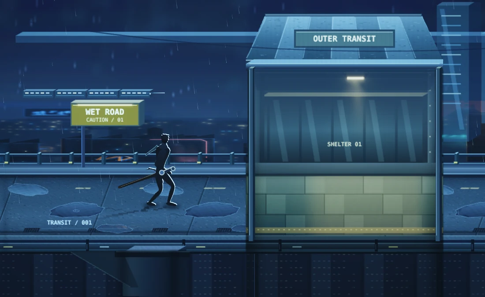
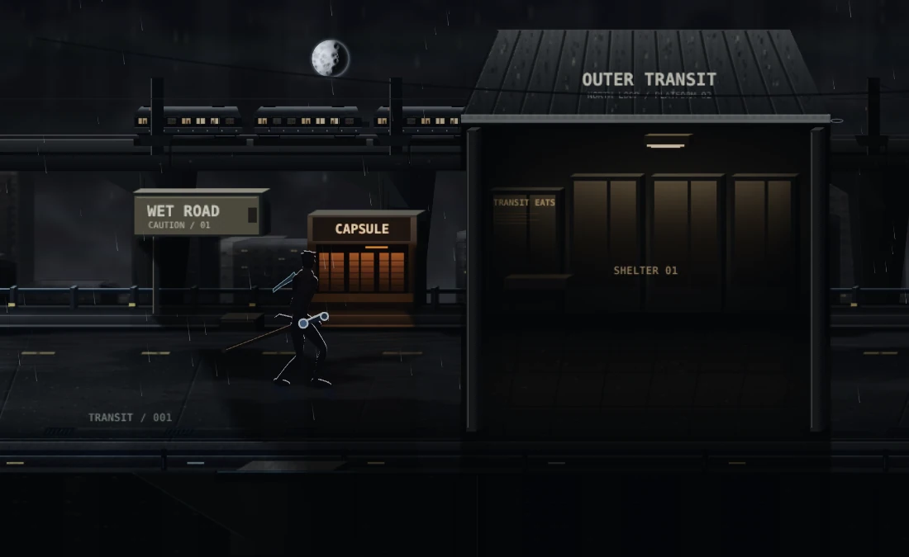

# Dark Cinematic Realism — Bridge

The continuous bridge now uses separate surfaces for masonry, steel, asphalt, water and emitters. Sodium street lamps and shaded tungsten interiors give the warm contrast; sky and mercury fixtures stay neutral to cool. The wet lane has irregular drainage, fine roughness and intermittent reflections instead of outlined puddle stamps. The black player silhouette, combat cues, and the route's geometry remain intact.

## Matched frames

All comparisons use seed 42 with the same camera, roll, character pose, weather inputs and clock. The control is the previously deployed SACR lighting build, not the clean Git base. These are scene-layer captures so HUD and touch controls do not obscure the comparison.

| Scene | Previous Bridge | Noir Bridge |
| --- | --- | --- |
| Transit / Wet Road |  |  |
| Sodium pocket | [Before](../research/noir/before-sodium.webp) | [After](../research/noir/sodium.webp) |
| Catwalk / sheet lightning | [Before](../research/noir/before-catwalk.webp) | [Catwalk](../research/noir/catwalk.webp) · [Sheet lightning](../research/noir/sheet-lightning.webp) |
| Service Bay | [Before](../research/noir/before-service-bay.webp) | [After](../research/noir/service-bay.webp) · [Canvas](../research/noir/canvas-service-bay.webp) |
| Night Market | [Before](../research/noir/before-market.webp) | [After](../research/noir/market.webp) |
| GEMINI | [Before](../research/noir/before-gemini.webp) | [Neutral](../research/noir/gemini.webp) · [Hit, same pose](../research/noir/gemini-hit.webp) |

## How light reaches a surface

- **Baked visibility, not tinted cones.** A route chunk supplies section geometry for the catwalk slab, eaves, jambs, lintels, cargo faces and kiosks. Each point/spot has a radius, scope, spectrum and finite aperture. Seven rays become projected row intervals; unioned blocker bits prevent two overlapping solids from counting twice. Skylight has its own angular paths through the near geometry and skyline. The shutter and Capsule kiosk have a low-energy local diffuse return rather than an unoccluded fill.
- **Separate road and structure rows.** The 512 × (128 + 32) per-chunk cache holds RGBA8 lunar/sky/AO/storm access and RGB9_E5 irradiance; the rolling 1024 × 160 upload is camera-relative. Sun/moon/cloud motion does not rebake the route. The road's lower 32 rows use the oblique cross-section so a rolled camera doesn't move a shadow out from under a curb. Eaves use a half-open bound on the final wet resolve, not an interpolated coverage ID.
- **Moving atmosphere and depth.** The moon disc is 27–36 CSS pixels with parallax, a crater/phase basis and cloud transmission. The same transmission drives the actor rim and lunar cast weight. Two tower cards are independent of the near bridge, with a separate raised rail plane; the four-car headlight terminates against opaque rail piers. Sheet lightning adds light within the bank and on exposed surfaces, not via a white screen flash.
- **Contact, cast, then return.** Boots use a tight sole lobe and a widening, fading contact lobe. A raised pose casts onto its actual support and separately onto the road. A stable lunar direction blends to a stronger local source. Casts darken diffuse before specular and SACR; they attenuate the reflected sky, not the local or posed reflection. Live beams and impulses use the actual section blockers; opaque actor pixels do not receive a screen-space halo.
- **Hit read stays on the edge.** GEMINI keeps dark plate interiors, a narrower blade core and a directional, roughly 2 CSS-pixel impact edge. Short impact lights feed the same blocked receiver path, not a full-white recolor of the body. HUD is painted after the scene and isn't graded.

| Path | Scene / sky | Ground | Bounded transient work |
| --- | --- | --- | --- |
| Master WebGL2 | RGBA16F, 256×64 sky refreshed on submit, 32³ look LUT | Native road, K8 SACR, R8 cast ink | Four admitted impulses; explicit HDR emitters and four bloom levels |
| Mobile WebGL2 | RGBA8, 128×32 companded sky held on alternate submits except on changes like lightning; 16³ LUT | Half-resolution K4 radiation + full-resolution dry/contact resolve, reduced R8 cast target | Two admitted impulses, two full-size Canvas source uploads, optional glazing tile, no bloom buffers |
| Canvas fallback | Small CPU sky and lunar disc, streamed lit route cards, separate rail and city | Mask-clipped wet accents, bounded pose/contact draw; no SACR or HDR | At most two impulse treatments; no full-scene lighting readback |

The fallback shares the geometry and color intent, not every GPU operation. Its cached diffuse is a fixed estimate; live cloud transmission still changes the sky, actor rims and projected casts. Reduced Motion removes sheet flashes, moving traffic and scarf/landing accents. Backing denial and context failure repair the scene without advancing simulation or changing the selected preset.

## Verification

- Production build and TypeScript passed. The focused Bridge suite passed **168/168**. Offline glslang linked **18** ES 3.00 programs; Chromium linked the **16** live Bridge programs and passed **10** SACR readbacks on each WebGL tier.
- Both WebGL paths read back the RGBA8 and RGB9_E5 samples without a byte-level mismatch. The catwalk test produced no change on its shielded road patch until the slab was removed from the blocker packet. A separate Master readback found that adding ink did not change the isolated local/posed return.
- The rolled-eave raster test found **zero** dry-side rain changes on all three paths, and zero wetness changes inside either GL road resolve, including the first two pixels inside the eave. Context loss, restored context, float denial, backing denial, and same-paint repair were exercised in the packaged app.
- The hit state visibly changes GEMINI's rim. Compared against the neutral pose, it added **zero** neutral-white pixels on all three paths. On Master, the number of pixels changing by at least 15 levels fell from **1,998 to 718**.
- The portrait Canvas soak used real Engage and **20 Retries**. Each seeded run covered more than **10,630 world units** and opened two gates. It peaked at 14 tracked surfaces and returned to zero stores on teardown. Touch settings, the locked Ultra request, the FPS toggle and the Back target were also exercised.

[Native Master market still (1475 × 825)](../research/noir/native-market.webp) · [Mobile WebGL catwalk](../research/noir/mobile-catwalk.webp) · [Canvas sodium pocket](../research/noir/canvas-sodium.webp)

## Reproduce

```sh
npm run art:bridge-webp
npm run art:bridge-lighting
npm run check:webgl:offline -- --require-compiler
npm run check:bridge
npm run build:iso
node --import tsx .qa/bridge-noir-bake.mts
```

For a running packaged preview, set `SR_QA_URL` and `SR_BROWSER_TOOLS` as described in [the graphics guide](SACR-GRAPHICS.md). Use `.qa/slasher-noir.mjs --compact` for Master captures, `--touch --force-gl` for Mobile WebGL captures, and `SR_SOFTWARE=1 … --touch` for ordinary Canvas. Set `SR_SHOTS` to write PNGs. `.qa/slasher-noir-transport.mjs` reads the actual transport textures and checks a live source against the catwalk; `--touch` selects Mobile. `.qa/slasher-bridge-finish.mjs` exercises loss, restoration, blocked allocation and pixels at rolled eaves.

The [verification receipt](../research/noir/verification.json) records build `Qcjd_L8Y3O8GalhD3VDQr` and the measurements. The full suite passed **552/557**; all five failures reproduce in the control and are listed in the receipt.

On the sandbox CPU, warmed new tiles took **3.50 ms median / 10.17 ms p95** across 36 chunks. The median meets the 2–4 ms bake target, but the p95 and cold initialization do not. Rolling atlas shifts were 10.70 ms median, including missing tile work; held atlas frames took less than 0.1 ms each in this run. Chromium uses SwiftShader for the explicit WebGL tests, so these receipts don't establish hardware frame rates.
