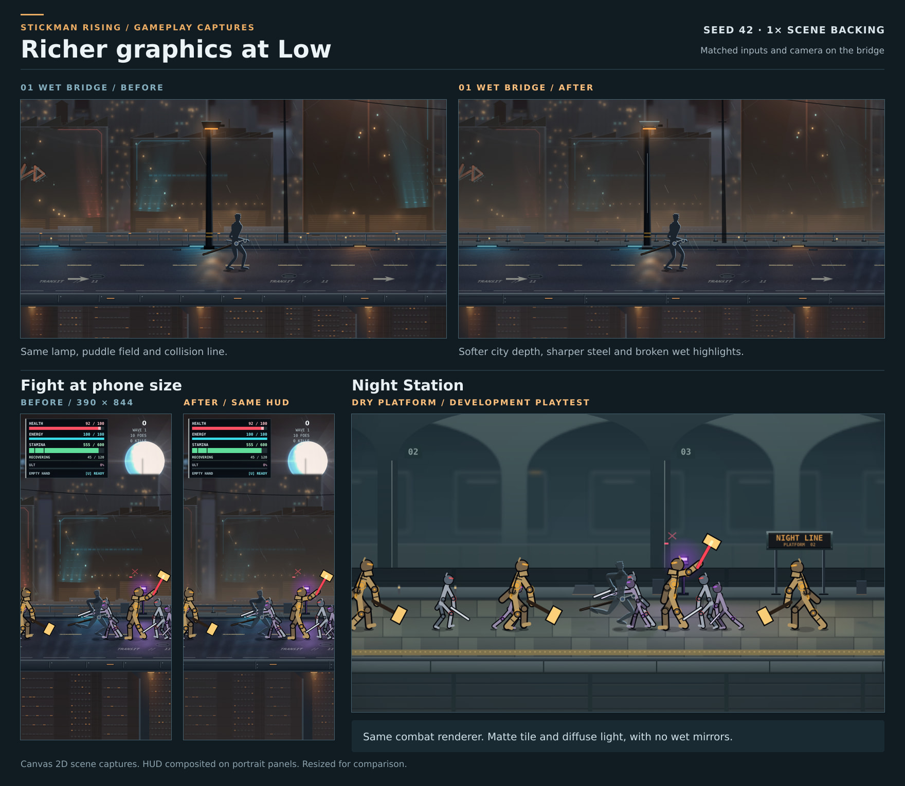

# Mobile visual upgrade — playtest build

> Historical render study. For current presets and Engage, see [Continuous Bridge](PROCEDURAL-BRIDGE.md).

**The Wet Bridge upgrade is in the game.** Use **Settings → Visual Quality → Low** and **Engage** to see the base art with the 1× scene DPR cap. The existing governor can still lower resolution under load. The game does not need High or Ultra to draw this art.



In the development server or [embedded preview build](../README.md#embedded-live-preview), **Settings → Try Night Station** (or `/?stage=station`) opens the dry art proof. This reloads at the title rather than changing the arena during a run. It does not change `LevelId`, the saved quality ceiling, the control scheme or the default bridge. Use **Return to Wet Bridge** to leave. Station is not a new production stage selection.

## What changed in the game

- **Depth:** the distant city tones converge toward cool haze; near silhouettes keep their definition, but the glare and small window edges behind heads and weapons fall off toward the deck. This is aerial perspective painted into the existing four bands, not a live blur over the fight. [1](https://www.nationalgallery.org.uk/paintings/glossary/aerial-perspective)
- **Materials and practicals:** steel and enamel get a narrow lit edge; concrete gets broad shading, cut joints and dark bases. Asphalt is matte between puddles, with broken curb-light highlights concentrated by the existing water field. Lamp glass and advisory hardware are repainted on their mount points; emitter gains, blockers, permanent pools and warm bridge airlight stay intact. The contrast in highlight width borrows from roughness in the Filament material model, not a new shader. [2](https://google.github.io/filament/Filament.md.html)
- **Work placement:** these details are baked into the same city plates, fixtures and span atlas, drawing on MDN’s recommendation to pre-render repeated Canvas work. The bridge adds no steady-state pass, backing surface or DPR cost. The shared [bake helpers](../src/game/stage/baked-finish.ts) describe tone and material response, while [the scene recipe](../src/game/world/art-grade.ts) supplies the actual palette. [1](https://developer.mozilla.org/en-US/docs/Web/API/Canvas_API/Tutorial/Optimizing_canvas)
- **Reuse proof:** [station painters](../src/game/stage/station-art.ts) replace the content of those bands and the section atlas with arches, a matte tile platform and a dark track recess. The lamp and sign still feed the same light field and floor receiver, now diffuse only. The interior skips sky baking and rain; the dry floor skips wet guide highlights, prop/actor mirrors and captured deck reflection. Cast/contact shadows stay. Both stages share the same flat collision line, camera and spawns. This does not generalize the engine to slopes or a second geometry layout.

## Matched evidence

Control: `9d27d2b25e4ef0e0a5ca100d7e0f365cc3a66520` **plus the pre-upgrade working tree**, not pristine `main`. Frozen tracked patch SHA-256: `6537a18a6a536da4364ccad261a300f974c46769aa2df988968d1fdb21ed1ed4`; full control source also includes the then-untracked files. Chromium 153, software rendering requested; the sky recipe still reported a GPU bake. [Compact capture and timing receipt](../research/graphics-upgrade/verification.json).

Seven paired bridge captures at seed 42, settled drizzle, fixed inputs, exactly 1×, 30 warm-up + 72 sampled frames:

| View | Fixtures | Backing result |
|---|---|---|
| 1000×560 Low, capture | Crowd, idle, moving pan, lamp-centered still | **58 → 58** tracked surfaces, **24.02 → 24.02 MiB** tracked RGBA |
| 390×844 Low, capture | Crowd, sign-centered still | **57 → 57** tracked surfaces, **22.21 → 22.21 MiB** tracked RGBA |
| 1000×560 Medium, capture | Crowd | **59 → 59** tracked surfaces, **24.03 → 24.03 MiB** tracked RGBA |

Every pair changed the scene image but matched the HUD PNG hash, event digest, sampled player/enemy/prop state digest, backing dimensions, wet state and final tier. The crowd still reached ten enemies and the same attack/echo frames. No additional dropped simulation debt. Tracked surfaces emptied on destroy. Output canvases are separate: 4.27 MiB wide or 2.51 MiB portrait, equally on both sides. These are raw RGBA estimates, not driver residency.

Separate bridge probes at Medium/capture (portrait) and Ultra/forward (wide) matched the instrumented phase call counts and the same state/backing checks. Their timings are diagnostic only.

The station’s Low portrait crowd kept the same combat events and sampled simulation state with **28** tracked surfaces (**12.45 MiB**). The dry Medium/capture and Ultra/forward probes did not enter the reflection pass or retain a reflection backing. The dry preview’s smaller ledger is specific to that scene because it skips exterior art and wet optics.

### Pacing smoke, separate from capture

Three alternating A/B runs of 360 sampled frames each, after 60 warm-up frames, at Low 1× in the portrait wet crowd. No screenshots, state history or stage instrumentation during these samples. Each pair had the same inputs, 388 simulated ticks, ten maximum enemies, no >250 ms visible intervals and no dropped simulation seconds.

| Signal | Control → upgrade across three pairs | Median paired change |
|---|---|---|
| Game frame JS/Canvas submission p95 | 11.4→11.4, 12.9→11.6, 11.9→12.3 ms | **0.0 ms** |
| rAF interval p95 | 16.7→16.7, 16.7→16.7, 16.8→16.8 ms | **0.0 ms** |
| rAF interval p99 | 16.8→16.8 ms in all pairs | **0.0 ms** |

Synchronous bundle `bakeMs` ranged 632–744 ms control, 640–666 ms upgrade. These short runs did not show a steady-state regression; their noisy bake samples do not demonstrate faster real Engage or Retry. No preparation scheduling, tier policy or default optics route was changed in this slice. rAF measures callbacks, not actual screen presentation. **Android/iPhone sustained FPS, thermal behavior, cold starts and touch latency are not verified.** Use the [physical-device gates](MOBILE-VISUAL-UPGRADE-PLAN.md#performance-and-visual-release-gates) before changing mobile defaults.

## Checks and reproduction

- **143/143** focused checks passed, including five new regressions for depth without filled-in gaps, material falloff, unchanged wet masks and backing dimensions, dry diffuse light and dry lifecycle. The legacy viaduct fallback atlas hashes also matched for seeds 42–44.
- Desktop settings and desktop/emulated-touch gameplay gestures passed. The touch Station preview survived a tier shed/recovery, reload and Retry; returning to Wet Bridge kept the saved ceiling.
- `npm run build:iso` passed. `npm run gate`: **475/480**; the same five combat failures as the post-tier control (two cleave, a joint constraint, ritual key count, strike contact). No combat assertion was changed.

```sh
# Browser tools are external to the game: puppeteer-core plus a Chromium
# executable or @sparticuz/chromium. Set SR_BROWSER_TOOLS to that install.
# Run twice with SR_SOURCE pointing at the frozen control/src and the current src.
node .qa/slasher-replay.mjs --fixed --wet --route=capture --tier=low \
  --fixture=crowd --width=390 --height=844 --scale=1 --warmup=30 --frames=72 \
  --trace-state --empty-teardown --pixels=.cache/visual-upgrade/portrait
# For a local inspection use --fixture=idle --at-x=880 (lamp) or --at-x=1755 (sign).
# For the station use SR_SOURCE=src, --scene=station and drop --wet.
node --import tsx --test tests/stage-art.test.ts
# Dev-server switch, touch controls preset, persistence and Retry smoke:
node .qa/slasher-quality.mjs --touch --station-preview
```
