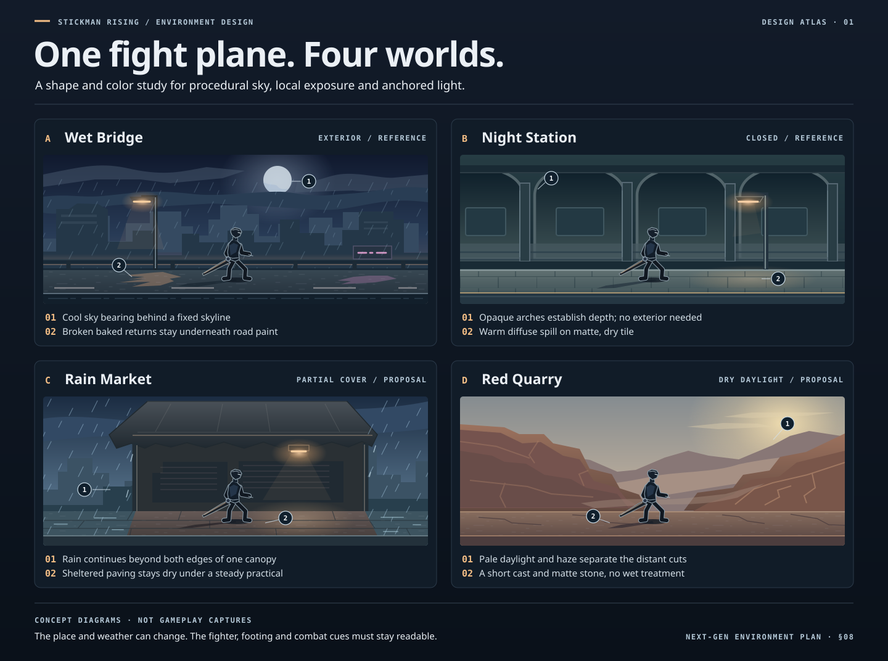

# Next-generation environments

**Stickman Rising · Universal graphics rules, procedural skies, weather, and lighting**

**Status:** Design specification and history. The separate [environment pilot](ENVIRONMENT-PILOT.md) was superseded by [one procedural bridge run](PROCEDURAL-BRIDGE.md); the level catalog below is not the current player path.

**Starting point:** The accepted [Practical Optics](PRACTICAL-OPTICS.md) build, not the older mirror or post-processing experiments.

> The level tells you where you are. The weather tells you what is changing.
> The light tells you where to look. None of them should tell you the wrong thing about a fight.



The atlas is a color, shape, and placement sketch, not a screenshot or a commitment to new levels.
For actual shipped imagery, use the [Bridge comparison](../research/practical-optics/before-after.jpg),
[dry Station comparison](../research/practical-optics/station.jpg), and [touch check](../research/practical-optics/touch.jpg).
The goal is to make that existing level of craft reusable, not to put another visual stack on top of it.

## Contents

| Read for | Section |
| --- | --- |
| What we are and are not building | [01 Scope and decisions](#01-scope-and-decisions) |
| Rules every future level inherits | [02 Universal graphics rules](#02-universal-graphics-rules) |
| Scene data, coordinates and shared frame flow | [03 The level contract](#03-the-level-contract) |
| Repeatable generation and active-time behavior | [04 Seeds and clocks](#04-seeds-and-clocks) |
| Procedural skyboxes, cloud layers and horizons | [05 Procedural sky system](#05-procedural-sky-system) |
| Fronts, shelter, rain, wind, fog and special events | [06 Weather system](#06-weather-system) |
| Why every shadow, glow and wet surface has an owner | [07 Light and materials](#07-light-and-materials) |
| Current scenes, future presets and shot design | [08 Level recipes and visual studies](#08-level-recipes-and-visual-studies) |
| Budgets, fallbacks and lifecycle | [09 Performance and accessibility](#09-performance-and-accessibility) |
| What counts as proof | [10 Verification](#10-verification) |
| How to build it in safe increments | [11 Delivery roadmap](#11-delivery-roadmap) |
| Decisions an artist, engineer, or level designer can review | [12 Detailed visual questions](#12-detailed-visual-questions) |
| Author handoff | [13 New level checklist](#13-new-level-checklist) |

## 01 Scope and decisions

### North star

A player should recognize the same arena in still air, in rain, and on Low.
A screenshot can have beautiful weather and fail at normal speed. The test is whether the player can read a foot plant, the weapon hand, and the direction of a threat while the place still feels alive.
The next generation is a system for authoring **different places**, not a system for making all places brighter, foggier, or more reflective.

Three scales of change make an environment convincing:

1. **Place:** Terrain, architecture, contact plane, key direction, and one recognizable landmark. These are authored and stable.
2. **Run:** The same place gets a coherent sky, light mixture, and plausible weather itinerary. A replay can recreate this choice.
3. **Moment:** Clouds drift, rain reaches the open side of a canopy, light catches a weapon, or a curtain moves in a gust. Those details use a shared timeline and capped work.

A sunset and a fluorescent station may both have clear depth, selective bloom, and readable fighters. They do not need the same hue, moon, rain, or texture.

### Product scope

| In this plan | Not assumed by this plan |
| --- | --- |
| Procedural **2.5D skyboxes** made from a vault and ordered depth bands | A 3D cubemap, a hemispheric ray marcher, or a renderer rewrite |
| Authored level, climate and material contracts | Procedurally generated collision, waves, loot, or level layout |
| Steady practical lights plus bounded temporal response | A dynamic light for every window, particle, prop, or sword trail |
| Outdoor, enclosed, and partially covered recipes | Weather indoors without a visible opening/source and receiver |
| Weather that changes the picture, ambience, and sense of shelter | Random friction changes, lightning damage, shortened visibility of hazards, or weather-weighted scores |
| Palette variants and slowly evolving fronts | A mandatory accelerated day/night cycle in every arena |
| Graphic rules, test gates, and future ticket order | A promise of a particular FPS on devices not yet tested |

If we eventually want “weather changes how this level plays,” author it as a separate game rule.
For example, a clearly marked wind hazard would need collision and cue design, timing accessible on every preset, a scope in replay/score rules, and independent approval.
A decorative gust on a market pennant must never become hidden input drift.
Design the environment API so that an authored gameplay rule can publish a cue later, not so that the environment renderer becomes an authority over the game.

### What exists today and what changes later

| Area | Read the existing owner | Take forward | Gap to plan for |
| --- | --- | --- | --- |
| Scene selection | [`Game`](../src/game/game.ts), [`page.tsx`](../src/app/page.tsx), [`LevelId`](../src/game/core/types.ts) | Current rooftop/Bridge path and optional Night Station preview | `LevelId` still says `rooftop`; preview art choice is not a saved level catalog |
| Scene assembly | [`CyberBackground`](../src/game/world/background.ts), [`art-grade.ts`](../src/game/world/art-grade.ts) | Baked plates, palette roles, stage kit vs. run data | Many anchors, build recipes and policies still live in the Bridge-shaped background implementation |
| Lane and receiver | [`ROAD`](../src/game/stage/road-section.ts), [`Viaduct`](../src/game/stage/viaduct.ts) | One known flat fight plane and retained opaque span | Split gameplay layout from its rear rail, shoulder, face and weather-access geometry before introducing new layouts |
| Generation | [`EnvironmentProfile`](../src/game/world/profile.ts), [`PROFILE_CONSUMERS`](../src/game/world/consumers.ts) | Seeded axes, mapped consumers and novelty history | New scenes need a versioned resolution rule about which axes exist or are deliberately unused |
| Weather | [`WeatherFront`](../src/game/world/weather.ts), [`StormEngine`](../src/game/world/storm.ts), [`Wind`](../src/game/world/wind.ts) | Slow easing, fixed-cap simulation, rain response and shelter-free Bridge weather | Separate climate/front semantics from precipitation drawing and give cover a data contract |
| Sky | [`NightLayer`](../src/game/world/night.ts), [`clouds.ts`](../src/game/world/clouds.ts), [`sky.ts`](../src/gpu/sky.ts), [`SkyVaultCache`](../src/game/render/bhst.ts) | CPU sky fallback, reusable plates and conservative hidden-row rejection | Non-moon skies, enclosed rooms, portals and coherent lighting over a weather change |
| Lighting | [`light.ts`](../src/game/world/light.ts), [`lightfield.ts`](../src/game/world/lightfield.ts), [`ribbons.ts`](../src/game/lighting/ribbons.ts) | One key, bounded practical transfer, target-space shadows and probes | Fixture art/receiver origin and exterior/interior contributions should come from declared data |
| Optical finish | [`baked-finish.ts`](../src/game/stage/baked-finish.ts), [`sheet-water.ts`](../src/game/stage/sheet-water.ts) | Sharp cores, local glow, matte/wet materials, fixed pools | Declarative admission for a future accent without putting live mirrors back in the game |
| Play loops | [`Renderer`](../src/game/render/renderer.ts), [`graphics.ts`](../src/game/render/graphics.ts), [`quality.ts`](../src/game/render/quality.ts) | One Canvas 2D play pipeline, fixed combat steps, independent HUD | Feed common environment facts to existing slots; no per-level copy of the governor |
| Ownership & launch | [`ledger.ts`](../src/game/render/ledger.ts), [Game Loading](GAME-LOADING.md) | Scoped releases, CPU-only title, cancellable optional sky bake | Split measured long city/span prep pieces and admit optional work before activating a complete scene |

Bridge already uses baked figure-free wetness and local fixture stamps. Do not benchmark a hypothetical removal of whole-scene bloom as if it were still active on Bridge.
Station is already dry and quiet. Reuse it as a proof that “no exterior” and “no rain” are ordinary cases, not errors.
Older [V5/V6 sketches](RENDER-ROADMAP-V5-PLUS.md) and the [master package](master/README.md) explain design history.
Proposals in those documents that call for extra full-frame crossfades, moving glass, unbounded layer growth, or a renderer change are **not requirements** for this plan.

### Decision markers

- **Rule**: A constraint for every supported level and tier. A change needs explicit review, not a recipe override.
- **Default**: The proposed first implementation; can be tuned with the prescribed proof.
- **Trial**: Not enabled by default until art and target-device evidence agree.
- **Deferred**: Out of the critical path, with no stubs or live assets required today.
- Numbers are **starter authoring ranges and prototype gates**, unless a linked receipt explicitly measured them.
- Example ids, file paths in pseudotypes, values and palettes are proposed; only links in the current-owner column describe existing code.

### What “done” would mean

- We can define an open, a closed and a partially covered scene without a new renderer or a `switch` for that level in the hot draw loop.
- The accepted Bridge and Station remain the compatibility fixtures; extracting data is a behavior-preserving change before new weather is tried.
- Low looks like the same world during a storm, not a cue-poor version or another random seed.
- A cloud front visibly changes the sky, depth and reflected/diffuse balance without dimming the HUD or moving a real collider.
- A new level author can tell which values belong to layout, climate, sky, fixtures, materials, play cues and quality.
- A performance receipt names the work it adds, its fallback, and retained/transient bytes. It includes a quiet frame and a hard crowd frame.
- Proof distinguishes software browser timing, physical-device testing, and visual approval. No numerical target is reported as achieved by this document.

## 02 Universal graphics rules

These rules describe a shared visual language, independent of the weather type or era of the location.
Each has a concrete failure signature. Use those signatures as review checkboxes, not as an invitation to tune the threshold until an effect passes.

### R01. Fight first, landmark second, atmosphere third

- The brightest *sustained* accent may be a practical, but do not put that peak on top of a critical pose, telegraph or HUD corner.
- The active limb, weapon side, nearest threat, ground contact and aimed projectile must stay distinguishable at actual phone size.
- A short, legitimate impact accent can outrank all scenery. Atmosphere yields during that peak, not the other way around.
- Preserve cues by shape, outline, value and timing, not hue alone. Do not turn a red threat mark into another blinking city accent.
- Review frame pairs at idle, anticipation, contact, recovery, and crowd overlap in color and grayscale.
- **Reject:** A more photogenic still that requires watching the HUD or increasing brightness to know who is striking.

### R02. Art belongs to a plane

- Distinguish world geometry, projected receiver art, distant parallax, atmosphere, and UI; name the space in data and interfaces.
- Cache defocused distance at its useful content density. The figure, floor edge, hazard icon and text stay sharp at their intended scale.
- Tune depth with relative value, edge softness and parallax before adding translucency.
- Rear decor can occlude rain at its depth; it does not become a foreground collision wall.
- Any mask is derived from a declared shape/plane or baked asset, never from reading the completed scene.
- **Reject:** A roof leak, rippling horizon seam, shadow crossing a platform edge, or crisp far fog that looks like a dirty screen.

### R03. Every light has an address

- Name the source, transport shape and receiver. Relate source position and direction across the lamp, hull edge, figure rim and shadow.
- Use one dominant exterior directional reference, or an explicit indoor ambient/key substitute; local sources retain stable ids and attachments.
- A sky crop can move at the edge of the phone without changing a world-space shadow.
- Model cover as reduced access to exterior light, not as a change in which side the sun or moon is on.
- A fixture that is painted bright should illuminate something nearby; spill remains present at Low.
- **Reject:** A fighter gets a warm rim on the unlit side when the camera moves, or a lamp cone glows without a lamp.

### R04. Material explains the highlight

- Matte masonry has broad diffuse lift and recesses; painted metal has creased edges; polished enamel has small hot accents; wet aggregate has irregular angular return.
- A floor is not wet because a global blue filter is applied. Choose a receiver family, slope, drainage, base reflectance and where the marks survive.
- A dry platform can take diffuse warm light without the underfoot picture of a lamp. Only wet/exposed materials may accumulate water response.
- Paint, grates, seams and tire wear sit in front of the diffuse/specular treatment in the material bake. Projection never glues a copy over them.
- **Reject:** A dry tile looks like water, or a rough bridge becomes a glass floor in a crowd.

### R05. Bloom is local, gloom is authored

- Bloom means a bright core and fine scatter around a named emitter, inside a bounded, feathered sprite, not every high pixel getting a blur.
- Gloom means an authored value range in distant bands, shadow colors and recesses, not darkening the entire scene after combat and fog have been painted.
- Opacity, saturation and contrast changes on world art may not re-grade the HUD, touch controls or critical battle markers.
- If the core and skirt can be one precomposed stamp, keep them in the same stamp. Don't add “a little extra glow” with a second copy on every tier.
- A fixture's strongest plate should be its readable sign/glass; its long color aura should not explain more than the emitter itself.
- **Reject:** Full-scene bloom, a viewport vignette for a level mood, a global blur, or moving CSS backdrop filters for scenery polish.

### R06. Preserve the accepted optical budget

- Wet Bridge already gets its image from baked road response. Use the approved approach as the default for new wet receivers.
- No live actor/prop mirrors, scene-canvas captures, motion-blurred deck samples or full-frame optical readbacks in authored play.
- High/Ultra may refine fixture hardware, small environment accents or shading; they do not buy a larger wash covering the fight.
- “We can avoid a CPU readback” is not enough. Rotated copies, overdraw and hidden textures still cost frame time.
- A visual effect that cannot be removed without breaking the scene identity was authored in the wrong layer.
- **Reject:** Using the legacy capture diagnostics as the design target or calling a reduction in their work a shipping improvement.

### R07. Motion belongs to a cause

- One wind sample drives rain drift, pennant lean, near mist and far cloud drift with different scales and inertia, not unrelated per-frame noise.
- An attached accent follows world coordinates; changing DPR may sharpen the same contour but not move the highlight.
- Keep large forms in motion slow; use brief, small detailed signals to show a gust or drop hitting a beam.
- Tile edges, respawns and version swaps must not reset phase visibly. Distinguish smooth movement from an intentionally animated flicker.
- **Reject:** Moving quieter details on every pixel of the screen with no direction, or giving background motion more contrast than a fast attack.

### R08. The same location should survive tier changes

- The base layout, palette family, landmarks, steady illumination, shelter boundary, weather semantic state and feedback stay across tiers and routes.
- Tier decides draw admission, sampling of decoration and resolution. It cannot change RNG, geometry, key direction, event times or pacing of a front.
- Essential weather reads through at least one required cue: a dark bank plus a few streaks, a hazy horizon, a sheltered dry patch, or an audible ambience where permitted.
- Absolute Ultra remains a locked 2.25× world render option, not a separate weather database or reason to bypass local work caps.
- **Reject:** Selecting Low changes a storm into clear weather, or a tier step synchronously rebuilds a skyline.

### R09. No level may smuggle game rules through picture data

- Exposure and material influence the visual response. They don't determine damage, your movement or the rules for score submission.
- A painting that shows a railing or shelter must not imply an unknown collision. Distinguish playable, adjacent and inaccessible visual planes.
- Art edits cannot move sockets used by game hazards without an explicit layout change and fixture migration.
- The atlas is not a level generator; early new scenes share the flat-lane rules and have authored bounds.
- **Reject:** On a lower preset, the player experiences a gameplay-weather change they cannot see or that has no deterministic event record.

### R10. Accessibility is a graphics constraint

- Offer a quiet presentation for reduced motion/photosensitivity: preserve weather meaning with stable color/shape/audio cues and avoid rapid pulses.
- Respect existing OS and in-game preferences; do not introduce a device-specific override that quietly turns effects back on.
- Make focus rings, text, action surfaces and safety cues readable over bright and dark scene patches without filtering the DOM backdrop.
- Test aggregate weather plus combat flashes on frames people can see, including accessibility modes and overlaps. One effect by itself passing is not sufficient.
- **Reject:** Conflating reduced motion with frame-rate quality, or replacing every visible cue with audio only.

### R11. Changes in weather are events, not repaints

- Desired direction and onset are planned ahead. Painting samples a compact state; it doesn't pick the next front or request asset bakes.
- Enter a weather band gradually through visibility, light attenuation, wind and precipitation. Give wetness its own slower response.
- A door, overhang or window can transform the view abruptly as a physical occluder, but the underlying sky/weather state stays continuous.
- Preparation stages and safe transitions can publish a new scene; crossing a cover boundary in a fight does not require a load.
- **Reject:** Newly jagged shadows, a noisy shader compiling, a pop of global exposure, or three new atlases as a rain band arrives.

### R12. Spend pixels where the player can see them

- Frustum and receiver-clip first. Draw work outside the viewport, behind provably opaque surfaces, or under a closed roof has zero optional value.
- Measure the number of blended destination pixels as well as draw calls and source bytes. Wide blends cost at 2.25× even with a tiny texture.
- The required composition must work with all optional accents denied. An optional job needs an owner, hard cap and fallback.
- New textures or fades cannot keep two almost identical full scene stores just to avoid an art decision about which layers should change.
- **Reject:** A quiet looking frame consumes as much optional raster work as a packed visible effect set off camera.

### R13. Preserve ownership and teardown

- The stage owns invariant art; the run owns its generated immutable choices and plates; the view owns a bounded cache; scratch owns nothing after preparation.
- Cache ids contain recipe/data identity and stable composition inputs. Do not key world art on DPR or time if the world art doesn't change.
- Replace an invalid viewport store rather than keeping its entire resize history. One canceled job cannot evict the active stage's art.
- Local debugging and reference captures may sample pixels after a run. Production gameplay does not synchronously inspect itself.
- **Reject:** Retry gets steadily larger, hidden windows keep their plates forever, or a stale asynchronous completion activates the wrong stage.

### R14. Prove the picture and the cost together

- Capture the same scene, seed, action, camera, layout, tier and render scale for art A/B. Compare at play size and in motion, then zoom in for craft.
- Measure pacing separately without readback, per-draw wrappers or screenshots. Sample quiet, pan, crowd, weather transition and device warm state.
- Use A/A noise checks, then paired trials. A cheaper JS hook alone is not proof of file-size, raster, compositor or display improvement.
- Record an understandable verdict for the intended visual difference: what got clearer, what remains stable, and what we chose not to ship.
- **Reject:** A faster build that quietly uses a smaller backing, lowers the tier, shrinks the visible crowd, or fails only on a handset we never tried.

## 03 The level contract

### Ownership diagram

```text
AUTHORING                       PREPARATION                      GAMEPLAY

Layout + art + climate        validated, versioned           fixed combat clock
       + cue policy     --->  CompiledLevelPlan              positions/cue events
                                  |                             |
                       resolve run seed and make tape            |
                                  |                             v
         bounded CPU / optional sky bake -----------> active scene snapshot
      required plates, static spill and portal clips      /      |       \
                 publish only when ready           weather   lighting   pass plan
                                                      |         |           |
                                               one projected world ---> HUD / DOM
```

No box on the render side makes RNG, collision or spawn rules for the boxes above it.
No level-specific script can add a pass to the plan without declaring its slot, work cap, and owner.
A tool can view any piece in isolation, but the shipping painter consumes a complete validated snapshot.

### Coordinate glossary and transforms

| Space | Meaning | Example writer | Example consumer |
| --- | --- | --- | --- |
| `world` | Game x, y down; the first adapter keeps the lane at y=0, with jump height negative | Layout, poses, fixture mounts | Camera, collision, source sampling |
| `receiver` | Parametric strip or polygon covering an art surface in world projection; normal/material are declared | Layout segment and art recipe | Pool bake, material, splash clip |
| `layer` | Art texels with an anchor and a parallax/lift rule; not collision positions | Sky band, silhouette tile, arches | One layer projector |
| `direction` | Stage-relative light basis independent of where the camera currently places the disc | Key/sky definition | Probe, cast, cable rim, low-frequency grade |
| `css` | Projection, viewport, physical touch exclusion and measured effect area | Shared frame view | Compositor/clipping/HUD layout |
| `backing` | Render texels after applying explicit world or HUD scale, including integer rounding | Canvas sizing | Raster receipts and output only |

- Positional light queries use world coordinates even when the fixtures are painted on a rear offset. Define the attachment transform once, including the height relative to the receiver.
- Under camera roll, world arcs, cover polygons, feet and splash clips use the same world matrix. Far parallax may use damped motion but never ownership of those coordinates.
- Compute inverse camera bounds conservatively for culling. Cropping can keep two guard rows for fractional filtering if tests demonstrate that is enough.
- Use actual backing/CSS ratios for raster projections rather than assuming `DPR * CSS` was integral. Negative camera x uses Euclidean wrap, not signed `%` at a repeating seam.
- Never use a pixel read, sprite shadow shape, or glow radius to infer a gameplay bounding box.
- The current Bridge's decorative rear/front bounds (`ROAD.rear=-52`, `front=52`) describe projected asphalt, not a second height axis for the fighter.
- New materials may change strip thickness in the picture if the layout/receiver agreement is preserved. The gameplay plane cannot move because the tile has more rows.

### Manifest sketch (documentation only)

```ts
type LevelBlueprint = Readonly<{
  id: LevelId
  schema: number                 // reader compatibility
  artRevision: string            // cache invalidation, not a difficulty id
  layout: LayoutRef              // required, initially FlatSlasherLane
  palette: PaletteRoleRef
  skyline: SkyRecipeRef          // Exterior / Room / Portal variant
  climate: ClimateRecipeRef      // legal states and transitions
  exposure: readonly ExposureZone[]
  key: KeyRecipeRef              // binding to sky direction or interior basis
  emitters: readonly PracticalSpec[]
  receivers: readonly ReceiverSpec[]
  ornament: readonly AccentSpec[]
  cuePolicy: SharedCuePolicyRef  // cannot override action meanings
  proof: ProofManifestRef
}>

type ReceiverSpec = {
  id: LocalId
  shape: SurfaceClipRef
  material: MaterialRef
  exposureZone: LocalId
  accepts: readonly ('diffuse' | 'baked-specular' | 'splash' | 'dry-dust')[]
}

type ExposureZone = {
  id: LocalId
  region: WorldIntervalOrPolygon
  exteriorLight: UnitScalar
  precipitation: UnitScalar
  wind: UnitScalar
  outsideAudio: UnitScalar
  edgeBlendWu: number            // local cue handoff, not porous collision
  clipAt: readonly DepthOccluderRef[]
}
```

Primitives above are conceptual. Choose concrete names once the parity extraction shows which fields are actually needed.
`UnitScalar` means finite and clamped to `[0,1]` at authoring/bake validation, not a future excuse for per-frame schema parsing.
Use one versioned data validator in tool/prepare paths. Report ids, units and offending fields when a recipe is invalid.

### What is authored vs. resolved vs. live

| Lifetime | Examples | Cannot depend on |
| --- | --- | --- |
| Level recipe | Clamps, layout, cover apertures, light sockets, art palette, graph and target footprints | Run random draws, screen size, momentary load |
| Resolved run | Seed labels, cloud family and tile offsets, approved variant of key warmth, planned climate itinerary | RAF count, quality preference, allocation success |
| Owned bakes | Opaque span, receiver transfer, trim, practical stamps, skylight plates | Current visible actor positions or instantaneous weather alpha |
| Active sample | Front fraction and fields, world wind, source envelope, sky drift offset | Scene pixel colors, pointer type, unfinished async jobs |
| View plan | Clipped admitted items, camera transform, opaque coverage, exact sizes | Mutating climate/user settings or generating new run choices |
| Gameplay | Collision, timing, attacks, spawn and score rules | Optional optics, precipitation sprite cap or art recipe hue |

Choose **the smallest data shape that proves reuse**. A global editor/serialization format or scripting language is a separate product.
Registered art builders may still draw distinctive trim or arches, but the renderer calls the same stage interfaces.
If a content author wants new geometry, they first fill out bounds/height/spawn/camera and receiver tests; they don't modify the weather transition table to compensate.

### Manifest rejection cases

- Duplicate or unstable ids: a fixture key must not be its array index, sprite dimensions, or current world x alone.
- Missing anchor: sign art, its light transport, and reflected origin would have divergent positions; fail the recipe instead of silently centering on 0.
- Missing opaque fallback for a closed room or outside viewport beyond the painting's seasonal coverage.
- Climate tags that have no legal transition or fallback, or request sky/moon work in a `Room` with no exterior visibility.
- Unbounded ornaments or a portal clip declared as “read alpha from scene.”
- A high-only source that the stage needs to make the floor or threat readable at Low.
- Mixed layer/receiver coordinate anchors without a declared transform or occlusion order.
- Future mechanical parameters put into a graphics-only manifest.

### Frame paint slots

```text
0. Freeze view/canvas scale and take one common EnvSample for this frame.
1. Opaque base: projected sky or room fill; distant sky/cloud strata behind silhouettes.
2. City or interior depth bands; sparse fog belongs between named planes.
3. World receiver and fixtures: roads/tiles, baked spill, contact beneath objects.
4. Behind-action splashes/near weather if the clip permits; then actor contacts and casts.
5. Bodies, attack silhouettes, projectiles, occluding front detail, localized combat accents.
6. Light foreground weather only in its admitted clip; protected cues and impact feedback.
7. Independent HUD, touch controls and menus; never in a world optics sample.
```

This is the target ordering by dependency, not permission to reorder the existing slasher painter during parity work.
For the first migration, use the existing `drawSky`, `drawArena`, `drawFront` and `drawWeather` hooks, preserving present combat order.
Splitting precipitation depth between slots is a later A/B, not an incidental change because the recipes moved files.
Roof and portal coverage masks may feed slots 1–3; they do not cover out-of-world screen markers in slot 6 or UI in slot 7.

## 04 Seeds and clocks

### Recipe resolution

```text
identity = (levelId, schemaVersion, recipeRevision, runSeed)
  palette/         accent family and bounded chroma shift
  sky/             cloud morphology, offsets, horizon break, celestial variant
  background/      authored silhouette family and negative-space variations
  climate/         opening band, transition destinations and dwell variation
  event/           candidate gusts, distant lightning, optional ambience
  ornament/        prop placement within authored sockets; detail not collision
  precipitation/   stable visual indices; simulation representation can be thinned
```

- Keep the current independently salted axes in `makeProfile` for Bridge parity. Prove a sky-axis change does not reshuffle a prop socket or a front.
- For new recipes, define stable salts and use already-existing fixed-width deterministic arithmetic. Record salt and recipe versions; do not rely on object traversal, time, or platform RNG.
- Derive secondary details by stable role/id (e.g. `sky/cloud/far/2`), not by consuming the next draw in an unrelated loop.
- A roofed recipe can deliberately discard `sky/moonPhase` with reason `no-visible-sky`. Adding a window later must not disturb the stage's existing seed-to-practical mapping.
- Use `PROFILE_CONSUMERS` as precedent: every knob has a consumer and a proof, or a named opt-out. More sampled sliders do not create more visible variety.
- Diversity comes from a few readable differences: bank direction, top shape, floor age, warm/cool ratio and whether distance is legible. Don't randomize all simultaneously at full amplitude.
- Clamp dangerous combinations at resolution. Example: dense haze plus a bright flat overcast must not make the rest of the sky the same value as the floor.
- If a sampled combination is invalid, use a stable bounded correction, independent of device cost. Never reroll until an asset happens to load.

### Reproduction receipt

| Field | Why it matters |
| --- | --- |
| Build/source digest and level recipe revision | A later paint fix should not be mistaken for seed drift |
| Level id, resolved seed, climate graph version and optional scenario id | Identifies a random outlier or scripted visual storyboard |
| Front/event index, active scene tick and transition fraction | Seed 42 alone doesn't say whether drizzle has settled |
| Sky backend/fallback label and preparation receipt | CPU and GPU bakes may differ in pixels without changing the world |
| Tier, policy, route, scene/HUD sizes, viewport and DPR | Same semantic sample, different draw budgets |
| Pose/replay input, camera matrix, accessibility flags and audio mode | Needed to recreate the sight line and event suppression |

Default: Retry keeps today's run seed selection policy during parity. Dedicated replay and art inspection pin identity explicitly.
For a future “Retry this weather” button, copy the identity in a local test or results flow first; don't turn it into a save migration by accident.
Do not need server time, a random network asset, or a connection to obtain an environment.
A future daily seed may pick the identity outside the environment; the environment still receives a normal local input.

### Time ownership

| Clock | Advances when | Used for | Does not drive |
| --- | --- | --- | --- |
| Fixed play tick | Accepted combat substep | Combat, scoring and play cues | Texture generation or tier |
| Active environment tick (proposed) | Bounded fixed progression during active play | Climate tape, wetness envelope, candidate events | Input or replay simulation decisions |
| Render sample time | Interpolates the current tick interval | Parallax drift, small easing, render pose alignment | New fronts, thunder scheduling or RNG |
| Wall/prep time | Process/browser monotonic time | Cancel/deadline, governor and QA | Which weather you see after a pause |

- Today's background is ticked from the presentation loop; changing its clock must be a specific tested change after migration, not attributed to already-shipped determinism.
- Default after parity: derive environment progression from active play ticks; pause/hidden/terminal phases hold it. No catch-up through minutes of hidden-tab time.
- Use unscaled active time through short hit-stop **in the trial**, with tick mapping derived from the accepted play-session clock before hit-stop scaling, not RAF count. If parity/replay cannot support that mapping, advance with combat ticks instead and accept slight slowing over a visible desync.
- Title has an independent quiet sample. Waiting on Engage, completing a bake, or changing settings does not consume the authored opening for the run.
- At resume, continue the same front and water level. Rehydrate local particles to a bounded representative state without replaying seconds of hidden FX or thunder.
- On hitch catch-up, do not render each skipped event. Samples pick up at the current tick; suppress stale flash/audio candidates using their age and a shared presentation policy.
- Determinism means the tape and its numeric sample match at the same tick, not that two devices present every candidate cue or produce byte-identical compositing.

### Tape shape and bounded replay

```text
FrontEntry { index, transitionStartTick, durationTicks, fromId, toId }
Candidate { stableId, startTick, envelopeId, directionRef, soundProfile }
ActiveSample = evaluate(level + resolved run + tape slice, activeTick)
PresentationDecision = admit(active candidates, accessibility, visible clips, cue state)
```

- Use a bounded rolling front/candidate window or indexed chunks; keep the current state and enough previous state to evaluate lagged material response.
- A chunk extension derives from the semantic frontier tick/index, not from rendering a particular viewport or accepting a flash. Hold a bounded checkpoint only if a replay tool needs arbitrary seeks.
- Impose minimum dwell and per-event cooldown at schedule time. Validate monotone ticks, permitted transitions, and no unresolved material endpoints.
- A rejected candidate is still a consumed semantic event. Do not reroll its replacement, postpone thunder to a surprise later flash, or change the next squall because Low didn't draw it.
- Flash/front coordination must use the canonical **scheduled** window, not “did the renderer show flash?” In the new model, schedule a legal gap or let an already-running gradual transition continue; don't freeze half a front on one preset.
- Proof at 30/60/120 Hz replays the same input/tick record and checks tape entries, weather tuple and wetness tolerance. Control and candidate report absent vs. zero fields explicitly.

## 05 Procedural sky system

### What “skybox” means in this game

A skybox is a composed view behind the lane, not perspective-correct scenery for a free camera.
It defines color into the distance, the apparent position of large forms, directional references for lighting and transparent layers in front of the vault.
Project imperfectly like a painted backdrop if that is what makes the picture read; keep the rules consistent when the camera pans, jumps or rolls.

| Band | Content | Starter parallax vs. lane x | Target reading at play size |
| --- | --- | --- | --- |
| 0 | Opaque vault or room backplate | 0–0.02 | Continuous value and coverage, not a tiled image |
| 1 | Moon relief, twilight break or high cloud veil | 0.01–0.05 | One luminous bearing; retain negative space |
| 2 | Broad cloud banks/distant particulates | 0.03–0.12 | Soft drift, readable profiles, no bright noise |
| 3 | Ridge, distant city or through-window shapes | 0.12–0.32 | Reduced contrast, layer gap visible in motion |
| 4 | Rear architecture/rails and named foreground silhouettes | 0.35–1.00 | Local anchors stable against fight plane |

These are composition ranges, not an instruction to replace Bridge's current parallax numbers.
Room and portal painters can omit bands. “Five required layers” would punish minimal art and make Closed as expensive as Open.
Depth also controls vertical damping: far horizon y drifts less than lane y on jumps. During portrait framing don't lock a distant silhouette to the actor's head.

### Sky recipe inputs and outputs

| Input | Authored | Output/consumer |
| --- | --- | --- |
| `kind` | `Exterior`, `Room`, `Portals` | Chooses coverage strategy and which plates are ever admitted |
| `vaultRamp` | Zenith, shoulder, horizon and under-horizon stops, art color space | Opaque backing and scene ambient reference |
| `keyBearing` | Stage-relative azimuth/elevation proxy, hemisphere or indoor basis | Disc anchor, cloud lit side, probe, cast direction |
| `horizonBand` | Target position and permitted motion, with portrait alternative crop | Layer projection and silhouette visibility |
| `cloudSet` | Shape family, tileable aspect, puff size/spacing ranges, light/dark stops | Far sheet and optional nearer lip; stable seed choices |
| `horizonArt` | Authored silhouette grammar, cannot overlap fight silhouettes at equal contrast | Distance plate/room graphic, with opaque skirt |
| `apertures` | Visual openings, parent depth/occlusion, view bounds | Coherent view of one exterior and its admitted light patches |
| `fallback` | Palette and simple composed shapes | Never display a blank vault or missing room |

Separate **bearing** from **framing**. Use the bearing for transport. Art framing may offset the apparent disc within a bounded crop; document when it moves off-screen.
For an obscured source, leave a broad high value in the same sector of the vault. A cloud front never moves the exterior key to the opposite side.
A sunset class can omit stars and moon. Closed Station must not allocate a moon plate so it can “use zero opacity.”

### Composition recipe: generate with constraints

1. **Choose a sky family before choosing variation.** E.g. noir vault, low overcast, warm maritime dusk, bright winter, or indirect interior. Each has painted endpoints and a quiet fallback.
2. **Fix the largest shape.** Choose horizon height and one dominant bank/void/celestial region; start with a landmark silhouette that survives at 390 CSS px.
3. **Place depth with fixed sockets.** Use authored segmentation and constrained procedural heights for skylines/ridges. No tiny randomized towers across the quiet weapon-hand band.
4. **Add cloud structure.** Rasterize tileable low-frequency contours and edge luminance into a base sheet, with small stable families of detail baked into the sheet.
5. **Plan clear openings.** Leave an off-center breathing region near expected action; changes in cloud cover fill it slowly, not with a moving borehole of harsh contrast.
6. **Compose front response.** Select one reusable cloud family and adjust its cover/gain/distance contribution. Two endpoint accents may blend locally; do not crossfade two entire skies to change one bank.
7. **Verify limits before publishing.** Check coverage at camera extremes, rolls, wide/portrait rotations, and far-world pan wrapping. Fill below a clipped horizon with a compatible opaque base.
8. **Publish a stable plate set.** Do not change bake backends mid-fight. Key and silhouette geometry from CPU/GPU fallback must agree within the approved crop/appearance family.

### The picture before and after a bank arrives

```text
         CLEAR NIGHT                         LOW BANK FROM LEFT
          thin high cloud                       broad indigo shoulder
        . .      O       .                    _____       (pale break)
   ___horizon___/ \_____         --->       _/     \__ muted skyline __
   dim cool edge |    warm lamp              soft cool fill |  warm lamp
       gray road | amber scar                   gray road   | amber scar
```

- Keep the skyline outline fixed. A front reduces contrast between the far buildings and the sky, not the buildings' physical height.
- Lower the star/phase contrast earlier than the rain onset. Let the viewer see weather coming without reading a timer.
- At cloudy maximum, reduce the directional edge and its contrast; retain contact and the aimed shadow. The lamp's existing light has not increased merely because it now feels warmer in context.
- When the front clears, give back depth and the open arc of sky before the roadway fully dries.
- If the horizon is behind a tall Station window, use one exterior crop plus room frame. No animated star strip across a lintel.

### Tile, projection and cache rules

- Use periodic density contours or baked overlappable seam margins so scroll wraps don't jump in alpha or silhouette.
- For a repeated tile, ensure the largest motif is not at the wrap boundary or clearly duplicated inside one viewport. Use stable offsets and choose one repeat length analytically.
- Own gradient synthesis separately from a viewport-dependent crop. Key by recipe/seed/backend/content size, not `cameraX` on every step.
- The sky vault may reuse a ≤ CSS-resolution composite when its admitted contents are truly fixed; dynamic drift is a bounded overlay or falls back to simple strips.
- Do not rebake when opacity, weather state, scroll phase, or adaptive quality changes. Reuse semantic layers and meter recalculation only for actual invalidations.
- Adjacent portals share the exterior visual bearing and palette. First trial uses one or a few clip groups on a shared small plate, not one sub-scene render per window per frame.
- Don't assume a roof hides all sky while drawing a horizon under an ornamental opening. Opaque coverage must come from declared geometry, not skipped alpha by chance.
- On extremely wide view and cropped phone view compare figurative balance: a moon can be offscreen, but a cut at a skyline edge or a naked black hole behind the roof is an error.

### Sky bake admission and optional layers

| Content | Always allowed when visible | Optional trial | Not allowed in this plan |
| --- | --- | --- | --- |
| Clear exterior | Designed CPU ramp, silhouette and lit break | Approved hardware star/moon bake under existing bounded launch policy | Live ray marching or per-frame shader readback |
| Overcast exterior | Base ramp and one soft cloud bank | Second thin streak layer, denied if area/cost exceeds cap | Two full-resolution screen-sized fades for front progress |
| Closed room | Opaque frame, room art and practicals | Sparse named airborne accent in a local emitter | Exterior sky allocation/paint, outdoor precipitation |
| Covered portal | Shared outside crop, clip and occluder rim | A bounded outlet of backlit precipitation | Per-window scene capture or per-frame stencil rebuild |

Check the [current startup contract](GAME-LOADING.md) rather than reinterpreting the existing 96 ms moon/star deadline as a budget we can add again for every sky feature.
There is one optional sky preparation allowance per launch. If a CPU fallback looks acceptable and can be prepared productively, prefer it for new sky families.
If a new cloud look requires a robust GPU path to even read, it is not yet the cross-tier default art.

## 06 Weather system

### Climate is a permitted graph, not a deck of effects

A climate defines legal bands, adjacency, rarity, start weights, fade/dwell ranges and material lag.
It also declares which events and response fields the sky, audio, surface and cover may use.
The presence of snow in the engine does not mean a station rolls snow indoors or a desert goes from dust to torrential rain.

| Climate | Example legal route | Intentionally illegal in v1 |
| --- | --- | --- |
| Temperate wet | Clear ⇄ Haze ⇄ Drizzle ⇄ Rain ⇄ Squall; `Rain → Drizzle` a common exit | Clear → squall without an arrival; clouds rotating the key |
| Still enclosed | One steady room state or an explicitly visible exterior itinerary | Global interior weather switching; thunder from a wall without context |
| Dry windy | Clear ⇄ Haze ⇄ Dust drift ⇄ Dust gust | Rain/dust mixed counts, wet reflections or an opaque combat wall |
| Cold still | Clouded ⇄ Flurries ⇄ Snow veil (deferred) | Particle build-up becoming new geometry, footprints as required cues |
| Coastal covered | Temperate graph sampled separately for open and sheltered regions | Different clocks on each side of the shelter |

Current `WeatherFront` has 9 s fade and 20 s minimum between starts after its initial dwell; its clear band uses a small nonzero rain multiplier.
Keep those values/semantics through parity extraction. In new recipes, prefer **strict zero precipitation** in a named dry state.
Starter range for new rainy transitions: ease over 8–13 active seconds; at least 20 s start-to-start, with an opening hold long enough to notice the place.
A graph may choose to remain settled. Do not guarantee every run sees a storm, or schedule so many fronts that a quiet view becomes rare.

### One semantic sample, multiple responses

| Field | Meaning | Writer | Consumer / guard |
| --- | --- | --- | --- |
| `from`, `to`, `progress` | Current transition and eased progress | Front tape | Debug/review; readable names are not effect counters |
| `cloudCover` / `keyTransmittance` | Broad direct-light attenuation | Sky/climate binding | Sky, probe and directional cast strength agree |
| `distanceExtinction` | Distance contrast toward authored air hue by band | Climate interpolator | Never turns UI/foreground cue into fog |
| `precipKind`, `precipIntensity` | One v1 precipitation kind and normalized emission strength | Climate graph | Cull by exposed clip; count and near alpha per tier |
| `windWorld` and `gustEnvelope` | Direction plus smoothly eased strength in stage basis | Wind/front tape | Rigging/clouds/streaks use calibrated lag/scales |
| `surfaceDrive` | Hysteretic wetness target/response derived from arrival and exposure | Material envelope | Not a texture rewrite or a friction parameter |
| `candidateEvent` | Canonical start, direction, duration and type | Versioned schedule | Local light/audio subject to admission and accessibility |
| `quieting` | Presentation-only caps on motion/flash/noise | Player/cue policy | Cannot edit semantic schedule, environment history or score |

Advance semantic fields once, sample one front per frame. Depth and cover derive local values from this common snapshot.
Keep hot samples compact (numbers/ids/references), allocated during prep or reused in a fixed buffer.
Any plotted weather curve must label whether its value is an authored endpoint, semantic drive or effective pixel gain.

### Worked sample: one front, three receivers

Consider a rainy midpoint in a partially covered level. The sample has rain drive `0.60`, exterior direct transmission `0.55`, and rightward wind `0.40` on the recipe's normalized scale. It is the same sample through every opening.

| World patch | Access `(rain, direct, wind)` | Local drives before artistic calibration | Picture |
| --- | --- | --- | --- |
| Exposed road | `(1, 1, 1)` | `(0.60, 0.55, 0.40)` | Sparse slanted rain, cool rim and damp seams |
| Under the awning | `(0, 0.20, 0.35)` | `(0, 0.11, 0.14)` | Matte floor, shadowed outside edge and warm steady fixture |
| Inside a glass bay | `(0, 0.12, 0)` | `(0, 0.066, 0)` | Sealed room, soft cool wall patch and visible rain *behind* the glass |

These products express access, not pixels. A light probe adds the room/sky ambient floor and steady fixture afterward. Rain drive feeds a capped admission and a separate history-dependent wetness response, not an alpha over the floor.
With the same exposure values on the next tick, only semantic or authored local response evolves. Moving the camera does not change access at a fixed world point.

**Test this with four toggles, in order:**

1. Hide the rain sprites: all three surfaces still look distinct through material and geometry.
2. Hide exterior art behind the glass: the room composition and primary light still work.
3. Disable the weather front: the current exposure differences persist under a steady state.
4. Move the player across the awning edge: the next motion sample changes smoothly; the sky state and the distant streaks continue.

### Front choreography: do not move every knob together

| Phase (example at T) | Sky | Air and motion | Surface and lighting |
| --- | --- | --- | --- |
| T−4 to T | A dark shoulder arrives, high speckle fades | Distant bank moves slowly along the authored bearing | Steady light and cast shape; local practical remains readable |
| T to T+3 | Cloud shoulder crosses part of the key sector | First wind lean, a few visible rain paths from the same side | Slightly less exterior rim, no sudden glass effect |
| T+3 to T+9 | Veil thickens behind skyline, not across the whole frame | Drizzle or rain builds; nearby roof edge makes the carrier visible | Exposed patches slowly take broken glints, matte shelter retains identity |
| Settled | Clouds carry volume without new texture generation | Cap rain; gusts have attack/release; one good quiet gap | Stable silhouette and contact; drainage and seams break up highlights |
| Clearing | Bright edge or open horizon returns gradually | Wind settles with inertia; drops and drips end in the correct order | Wet sheen decays slowly; no repaint of whole floor on last drop |

This is a storyboard centered on the precipitation onset, not six texture swaps.
Start from a common eased envelope and evaluate small explicit delays for each axis; keep the total semantic transition inside the declared recipe window or declare pre-roll on the tape.
For new recipes, start with wet response rise ~4–10 s and release ~16–35 s, tested under repeat fronts and shelter. Use analytic/step-testable envelope integration, not one global alpha for both directions.
Practical Optics Bridge already bakes its strongest marks. The first trial may modulate only a low-gain local material accent or splash intensity. Do not reintroduce twinkling pool bakes to force a dynamic read.

### Exposure and shelter

```text
    outside       awning blocks rain       open again
      \\ \\    +==================+          \\ \\ \\
      \\ \\    |    quiet air     |           \\ \\
   wet grass __| dry paving tape |__ wet paving ____ y=0
                     ^ shaded under-edge and sparse drip line
```

- Exposure has independent channels. Glass blocks rain and wind but may transmit exterior light; a deep awning blocks direct rain but may admit side wind.
- Use authored intervals/convex clips in world/depth coordinates for v1. Resolve exposure at source/receiver/body sample points, not arbitrary full-screen overlay opacity.
- Derive precipitation path clips and floor legality from the same opening/roof shape. Clip diagonal paths against shelter even if the spawn was just outside.
- At a cover edge, feather a low-energy light/ambience handoff over a short authored world span (start 12–32 world units); hard roof geometry stays hard.
- Broken edge marks or a bounded drip source tell you why the sheltered ground is drier. An authored stain is allowed near the edge; splashes require an exposed eligible receiver.
- If a closed roof gives zero exposure at a depth, skip decorative precipitation there at admission. Near-vs-rear weather clips can't be shared if their geometry projects differently.
- Don't simulate collision for every drop. Precompute eligible intervals/clip groups and spawn splashes on known road/material eligibility, with explicit per-frame count caps.
- Use trial visual probes across the boundary at different pan speeds and angles. If art says dry and trace says exposed, fix the manifest or the art.

### Precipitation and air lexicon

| Kind | Silhouette/color | Motion | Where it belongs | What to cut first |
| --- | --- | --- | --- | --- |
| Mist/haze | Broad muted difference from the backdrop, no sharp floating edge | Slow drift only if the shape warrants it | Distant and middle strips; near dry fog only outside cue band | Animated wisps and any extra near pass |
| Rain | Tapered cool line; select fixture catch near the lamp, not a rainbow | Shared diagonal, length from fall rate; no streak accumulation | Outside depth and in sparse protected front cells | Very near streaks, tiny splashes, duplicate lit samples |
| Snow trial | Soft sparse dots and backlit clumps, held off white cue regions | Slow fall plus limited flutter, not screen noise | Outside; visible via warm dark edge and roofs | Bright near flakes; accumulation entirely deferred |
| Dust trial | Ochre desaturation with wide bands; no opaque brown wall | Low soft drift parallel to plane, a few surface crumbs | Open dry material and crevices; never at HUD | Foreground sheets, high-frequency particles |
| Gust | Change in coherent angle of two visible systems, not a new texture type | Smooth attack, short hold, slower release | Ropes, reeds, cloud edge and open rain | Micro ornament vibration |
| Thunder trial | Distant dull break in the cloud edge, rare and not a cue-colored full sky | One eased rise and decay; no forks close to fighter silhouette | Outside clip; low-pass audio under cover | Visual pulse first, then lower layer density; no reschedule |

Starter placement: one weather layer behind the fight band plus an optional sparse foreground layer. Keep enough near context to show weather but keep the primary cue band quiet by layout, bounded front alpha and depth.
Do not carve a crisp dry bubble tracking each fighter. Clip to declared occluders and use zoned/view-scoped caps near the central read, not per-body inverse masks.
Use composited air alpha by exposed area. Two individually faint overlapping veils can defeat contrast together; use an aggregate cap or choose one contributor.

### Audio and exceptional events

- A clipped sky still may support quiet outside audio. Model audio exposure separately, filter under cover and respect mute/volume without altering the event record.
- Begin with existing ambience plus one local fade for the exterior/interior boundary. Rain onset does not require a one-shot; sound state can crossfade at low rate.
- Avoid a storm transient resembling a parry/cancel confirmation. Combat/critical timing gets priority; ambient tails may be ducked without moving the next scheduled event.
- First new climate implementation uses **no new lightning pulse**. Preserve the current storm and accessibility behavior in compatibility runs; audit it with the aggregate test before enabling new events.
- Candidate lightning uses the same direction for distant veil, attenuated world response and delayed thunder by authored distance class. No bright world bolt crossing the play plane.
- If presentation forbids a pulse, convey “storm” with a steady bank, sparse rain and optional sound; it is acceptable to suppress the individual thunder cue entirely.
- No ambient event may trigger camera shake or hit-stop. Save that grammar for combat and explicitly authored hazards.

## 07 Light and materials

### Model enough cause to draw the consequence

Lighting for this project is an art-directed transfer model, not a physically based path tracer.
Solve large value/temperature relationships and local source/receiver alignment first. Fine highlights earn their place only if the fight reads without them.
Treat the scene as a sum of purposeful signals:

```text
ambient floor   = palette role + sky/room reference × exposure
exterior key    = one stable bearing × transmittance × local access
practical fill  = bounded world emitter falloff × steady gain
accent light    = admitted low-gain local envelope (optional)
contact/cast    = separable shapes, projected to a declared receiver
```

Do tone/value mapping in authored ranges, at compile/bake or in a small palette table. Keep the current Canvas 2D art conversion during parity.
For new palette interpolation, compare a controlled linear-light mix with authored intermediate stops. Pick the approach whose halfway swatches retain separation; don't repeatedly convert per sprite.
The drawing space may be sRGB even when the authored gains are linear scalars. Label which variables are values, gains and already-premultiplied alpha. Don't multiply occlusion and opacity twice.

### Palette by visual role

| Role | Responsibility | Travel during a front |
| --- | --- | --- |
| `void` / `horizon` | Establish time of day and distant temperature | Slow constrained move, fixed region/projection |
| `far_mass` / `mid_mass` | Two separate value steps behind the contact plane | Far mass can merge some; mid mass retains sharp enough anchors |
| `arena_base` / `arena_cut` | Broad receiver color and construction seams | Base remains legible under baked finish; known local lift only |
| `character_fill` / `character_rim` | Clear limbs and threat direction | Respect floor/ceiling, tighten the accent if distant contrast is lost |
| `emitter_core` / `emitter_air` | Source detail and restraint around it | Core stable by default; small visible air reaction in authored bounds |
| `cue_neutral` / `cue_channels` | Preserve meaning at play speed and color-vision differences | Owned by shared cue policy, never generated from climate |

Use a broad cool/warm balance if it tells the story, not a rigid pixel percentage.
A saturated pink storefront can read as a place without dyeing the entire sword fight pink. Give it a small bright core against a much wider low-chroma field.
If values need to change in an accessible mode, use approved alt treatments that retain dimensions and shape. Don't turn purple into red just because it appears brighter.

### Practical definition and transfer

| Field | Required consequence |
| --- | --- |
| `id`, `socket`, `depth` | One origin, aligned for hardware, visible emitter, probe and baked return |
| `emissionShape` | Glass/letter aperture, facing and fixed extent; not a circular air blob by default |
| `steadyLight` | Color/gain, bounded footprint, attenuation family, permitted exposure/receiver ids |
| `stamp` | Premade housing/bright core/scatter/short air with declared padded bounds |
| `opticsPolicy` | Allowed diffuse, baked specular, contact treatment; named static fallback |
| `temporalAccent` | Optional local channel and budget; cannot be the only player-readable light |

- Use a build artifact or one composite generated in prep for each fixture family. Reuse draw-sized variants only when a measured density or palette case warrants them.
- Fixture layout from world anchors decides where a return lands. Offset the texture's padded sprite origin without changing the source-space sampling point.
- Gather a small neighborhood of eligible practicals once per view; evaluate the actor probe for a bounded nearest set using distance/gain and deterministic tie-breaks.
- Bake steady contributions into shared receivers. When crossing between fixtures, use continuous falloffs or a stable handoff, not nearest-light hard switching.
- For the first pack, a lamp may have warm glass and a narrow lobe; a sign may have bright marks and wide low-opacity scatter, but neither requires per-frame on-canvas blur.
- If visible neutral air is almost absent, retain an opaque emitter and its nearby receiver. A darker tunnel needn't draw a moving cone to prove a bulb works.

### Characters and cues

- Sample a near-ground/source probe at stable world positions for body illumination. Use pose-correct basis (ground/torso near the capsule) without tying the value sample to the screen crop.
- Important silhouettes get an authored visibility floor via their fill/rim/stroke, not a separate post-process mask of each character.
- Directional rim accents evolve from key bearing and transmittance; local fills pick up a fixture hue. Preserve faction/cue meaning on both sides of a lamp.
- On clouded sky the key can soften and the diffuse balance grow; contact remains readable. Compare hands and blade endpoints with no combat FX, then with the whole feedback stack.
- Draw critical projectiles and attack timing cues with independent value/outline hierarchy. Do not make the expensive tier necessary for a warning to separate from rain.
- For pose-relative cast shadows, retain the current renderer's measured simplifications and admission policy. New light positions do not imply a cast from every practical.

### Contacts, casts and receiver truth

| Shape | Depends on | Rule when visibility changes |
| --- | --- | --- |
| Ground contact | Foot/prop ground point, receiver geometry, height | Strongest precisely at contact; softens on jump, never turns off because clouds arrived |
| Directional cast | Stable bearing, caster footprint/pose, visible receiver | Shift strength/softness within approved range; no opposite flip under a cloud |
| Local material occlusion | Baked seam, beam, grate or hardware join | Fixed unless owner geometry really changes |
| Pool/return | Source attachment, paint and receiver material | Baked and phase-stable by default; not a proxy for the shadow |

Clip casts at the receiver edge, including slope and crop. Compound receivers may cut a shape, but a strip's outer edge is not a new ledge in collision.
If a shelter masks the key, shorten/fade directional emphasis with a stable handoff and keep contact. Indoor anchor uses its declared direction rather than sampling the nearest portal frame.
Render inspection should show caster origin, projected direction, clip and contact point in wire mode. Reject a cast that lands on actor silhouette because it was attached to the wrong depth.

### Material library, v1 candidates

| Material | Diffuse behavior | Wet/air response | Authoring failure to watch |
| --- | --- | --- | --- |
| Bridge asphalt | Broken granularity and edge wear; retains lane markings | Existing baked warm scars; conservative splash mask; optional low-gain sheen only | Continuous mirror under fighter or hidden paint |
| Station tile | Large faceted rectangles and fine grout; warm diffuse pool | No wet/glint work; broad matte footprints of light | Repeating seams equal in contrast to a stance/guard cue |
| Canopy paving | Broken blocks; matte center, worn exposed entries | Fixed runoff edge marks; open edges accept sparse splashes | Sharp rectangle through a footprint that says “effect toggle” |
| Dry stone | Broad planes, reddish cracks, abrasion underfoot | Local edge dust; no faux specular puddles | Warm-brown foreground and background become one plane |
| Painted steel | Fine fainter scuffs, narrow grazes at folds | Small bounded highlight if source is near; control tint | High contrast repeated safety-looking stripes at weapon height |
| Frosted glass | Declared aperture and softened silhouette on far side | Transmits diffuse light, never foreground rain | Exterior weather over room fill or an invisible portal frame |

### Adding weather response without live reflections

1. Ship a single reviewed material base with bakes tied to fixtures, marks and lane edges.
2. Use splash counts and tiny edge highlights as first evidence that the weather changed that material.
3. If needed, trial one local gain controlled by material lag with opacity endpoints close enough to retain readability.
4. Compose into a bounded strip/patch identified by material and clipping ids, not a duplicate of the whole active road.
5. Protect paint and trim via asset ordering or bake, not drawing an “underlay” over the finished game with Multiply on full-screen actors.
6. Compare it off/on at a locked 2.25× backing and moving portrait camera. Kill the trial if players don't see an improvement at play size or if cost crosses the guardrail.

Avoid live temporal pool modulation in the existing routes. Bridge can tell a front story with distance, rain and splashes; it does not owe us a second water system.
For a future bright puddle scene, start with a painterly fixed environmental return and an exposed dry baseline. Defer accurate moving scene reflections unless renderer, art and device constraints fundamentally change.

### Three common lighting state changes

**Entering shelter:** Outside directional rim eases. The roof underside becomes the dark separator. A warm or neutral interior fixture raises the body from behind, and contact remains under the feet. The window keeps exterior light; the whole room does not inherit the latest front tint.

**Passing a practical:** The lamp appears first in the frame as a readable object. A step under it changes one side of the body and nearby ground. Leaving retains the baseline light; no line in the air turns on the instant the actor crosses the center x.

**Squall behind a crowd:** Far silhouettes merge downward in value. Mid rails still give a steady y reference. Near air keeps sparse streaks. The sky sector goes broad; body rim softens, but blades and threat cues keep their previous timings and visual dominance.

## 08 Level recipes and visual studies

### How to read these boards

- Recurring shot sizes: landscape 960×544 CSS for composition and **390×844 CSS** for crop/cue coverage; real hardware proof is separate.
- Shot descriptions use top/shoulder, middle/head band, hips/hands, and ground/feet. Place each at consistent pose height and test a vertical jump or camera roll before approving a framing.
- Hex chips are proposed **role swatches**, not sampled game pixels or new presets for the accepted scenes. Read them as relative hierarchy first.
- Capture one no-action pose, one step, one directional attack, one wide pan and one worst overlap. Plot where new shapes enter the cue band.
- Frame timelines after the parity rows are directed prototype/review scenarios, not a claim that current RNG emits those beats.
- Each scene must have a visual sentence the player understands without reading the seed label or knowing which render backend is running.

### A. Wet Bridge · the compatibility and exterior benchmark

**Sentence:** a city night through wet air; one amber streetlight and a sign tell you which way along the span you are moving.

- **Do not redesign the approved composition.** At the horizon, subdued cool masses. At the base of near facades, warm air. At the fight plane, irregular color from existing lamp/sign returns under dry-looking painted markings.
- The usable skyline occupies a band above the heads. Keep dark gradient steps, not tiny glowing windows at weapon height.
- Main contact reader is the lane strip, not a giant neon vanishing-point road. The low rail and deck face prove the plane survives a hop or pan.
- Fixture focus: streetlight at x=830, sign at x=1755. Review both separate and together. A single padded stamp per visible practical is the accepted live mechanism.
- Outdoor axes from the current profile stay active where consumed. Start with the exact same layout and prerun samples in a compatibility adapter.
- Choose a quiet dusk/noir endpoint that preserves Bridge identity; don't chase a new moon shape just to prove the generator is running.

| Role | Sketch chips | Placement constraint |
| --- | --- | --- |
| Sky and far mass | `#111b2d`, `#263950` | Cooler than nearest facade base; volume above rather than behind weapon hand |
| Mid air | `#384959`, `#70514b` | Shape near/horizon depth, not blanket orange tint |
| Deck and trim | `#29343e`, `#59646a` | Enough separation to read feet and road cuts at Low |
| Practical current logic, sketch hues | `#ffc381`, `#b487b7` | Tiny hot lamp/letter face, bounded return beneath each source |

#### A1. Compatibility shots (first milestone)

| Shot | Placement/action | Lock | Compare |
| --- | --- | --- | --- |
| A1a | Lane idle near lamp x=830, drizzle | Seed 42, settled weather not just seed; hands visible | No shift in lamp, feet, cast or stripe break |
| A1b | Walk across near lamp toward sign | Same active tick sequence and camera | Body lighting follows source; footprint pads don't pop |
| A1c | Sign-side crowd and one jump apex | Fixed combat replay and camera roll | Attack/feet reads still stable; bakes not duplicated |
| A1d | Portrait pan off and back onto lamp | Same HUD and lock | Visible edge admitted early, no whole-view gain jump |
| A1e | Low + Absolute Ultra at same CSS dimensions | Both routes, explicit HUD backing receipt | Same figure/sky relationship and weather meaning, no sample reads |

#### A2. Exterior front look-dev (after A1 parity)

- **00 s, Establishment:** thin cool relief at the sky shoulder. Lamp and sign marks are the two warmest fixed points. Let the wide crop hold without a new ambient event.
- **12 s, Approach:** left bank rises above the rail, covering faint stars if present. A cable leans from the same direction as cloud motion, on a shorter time constant.
- **16 s, Onset:** near lamp shows a handful of lit drops; an unlit part of the span receives the same weather but fewer visible highlights. No distant-window bloom jump.
- **22 s, Settle:** skyline layers are closer in value, seen from behind enough still shapes to know the deck isn't moving. White cue stays untouched near the hand.
- **34 s, Crowd proof:** pan through x=830 toward x=1755 during a pack of enemies. Accept the sharp practical footprint; reject a wet effect brighter than recognition of the next strike.
- **55 s, Release:** far silhouettes reappear before rain stops; asphalt retains authored wet character. No double exposure or new return from a walking enemy.
- **Fail loudly:** if a player says the arena light switched off instead of “clouds arrived,” widen the sky separation and reduce the material/front gain, not the visibility floor.

### B. Night Station · the compatibility and enclosure benchmark

**Sentence:** a silent tiled room with a line of warm lamps under cool arches; the outdoors is not necessary to the picture.

- The active Station art proof is dry and offered as a preview route, not yet a committed campaign level or a station-specific combat mode.
- Preserve the flattening cool blue-green vault/arch recesses and the segmentation of the tile surface. Use the column breaks to push depth behind action.
- Preserve the platform lamp's sharp warm source and soft, dry diffuse pool. No mirrored image of the housing, no underfoot rain splash, no theatrical fog on every shot.
- Its lighting basis comes from indoor ambience and anchored fixtures. `exteriorLight=0`, `precipitation=0`, `wind=0` for closed fight plane; sound sources may still be authored as room tone.
- No moon, cloud, or rain allocation just to reuse the old Bridge sky defaults. If today's code warms an unused option, isolate and measure the opportunity after parity.
- Protect parallel edge markings and floor seams: hazard/cue colors are not platform navigation decorations. A yellow safety edge shouldn't flash to celebrate a hit.

| Role | Sketch chips | Placement constraint |
| --- | --- | --- |
| Recess and wall | `#172931`, `#3c5357` | Stiffer upper edge, quiet mid-band |
| Floor and cuts | `#41565a`, `#25373c` | Large matte planes, contact over grout readable |
| Lamp and low air | `#f5c489`, `#675645` | Warm core near fixture and soft diffuse floor patch only |

#### B1. Dry station storyboard

1. **Single lamp frame:** foreground tile, upright pole or ceiling attachment, dark recess beyond the body. The side closer to the lamp warms a little; the other side remains readable.
2. **Move out of pool:** frame at crop edge. Diffuse light tapers physically, not on a hard sprite boundary. Arch remains the depth cue.
3. **Fight at inside edge:** put an enemy halfway under the pool and player in cool fill. Grayscale view still tells the two poses apart. Floor seams do not meet either active limb exactly at contact.
4. **Portrait turn:** far architecture can be cut off; lintel/arch remains enough station identity. A pinned HUD pane may obscure part of a lamp, never the fighter hand at its action height.
5. **Closed test:** hold for 60 active seconds. Texture and tone are not required to move; zero weather draw count and zero exterior bake are target invariants for the new room adapter.
6. **Opening experiment:** make a separate portal mock, not a modification of dry Station. One upper pane can show a distant band and give a cool patch on a wall. The floor stays dry and no weather crosses its frame.

### C. Rain Market · first new coverage proof

**Proposed, not a level addition.** Keep the flat lane. Author outer stalls, a central canopy, two exposed entries and one visible far street opening.

**Sentence:** the same front continues outside while you stand in a dry band under canvas.

- **Top:** canopy underside is a readable near silhouette; outside on either side has low blue cloud and one charcoal tower. A few fabric cuts have texture near the lit edges, not everywhere.
- **Middle:** dark stall walls and cloth give low contrast behind bodies. Use two static warm points with different core shapes; only one wins the current frame.
- **Floor:** pencil line of paving/runoff at each entry, cool channeled edges outside and a matte amber middle. Sparse drips at an authored edge explain shelter.
- **Motion:** two signs tilt from shared wind at distinct inertia. Canopy doesn't wobble at the same rate as combat. Show rain angled the same way at both ends.
- **Receivers:** rough paving at y=0; dry central polygon with wet boundary marks as bake; shutter and cloth surfaces accept diffuse only.
- **Exposure:** open entries see normal sky/key/rain; under canopy block rain above the play receiver, keep ambient and reduced sideways wind; far opening reveals exterior at its own depth.
- **Light:** put warm practical in the shadow of the awning so its source is visible. Don't make under-cover brightness just a `+0.25 exposure` on every pixel.

| Role | Sketch chips | Placement constraint |
| --- | --- | --- |
| Outside air and wall | `#30455f`, `#203248` | Cool frame at either edge of canopy |
| Canopy/cool recess | `#1c2730`, `#343c41` | Silhouette strong above heads, soft underneath |
| Dry paving and worn edge | `#514a43`, `#6e6255` | Matte planes plus little runoff line, not an image toggle |
| Practical and trim | `#ffc389`, `#a77056` | Warm core and texture only at attachments |

```text
 A exposed      B arrival seam       C dry sheltered       D exposed
 cool fills   | fabric corner      /---- warm core ----\ | cool opening
 rain paths   | sparse edge drops |   no near rain      | | rain paths
 wet paving  _| runoff marks ____|______ matte floor __|_| wet paving
            player's direction of travel --------------->
```

#### C1. Directed frame sequence

| View | Art note | Technical receipt |
| --- | --- | --- |
| C01 center looking toward canopy | At least one visible sky or street opening; don't explain cover with only an overlaid vignette | Both open and covered items visible in the same sample |
| C02 first foot crosses seam | Receiver edge stays put. Roof shadow and rim handoff are short but continuous | Exposure plotted by actor x and legible world boundary id |
| C03 dead center with crouched crowd | Dry quiet strip with clear footing. Rain visible only through opening | Covered near rain/splashes zero, distant clip bounded |
| C04 exiting, active gust | Drizzle leans outside and awning hem follows. Same front on both sides | Seed/tick unchanged; no particle reinitialization of the entire view |
| C05 reversed pan and portrait | Roof crop can hide front, not change material or light basis | Same clips aligned at each backing; no viewport-generated leak |
| C06 repeat at Low/reduced motion | Marked dry paving and stable outside cloud alone explain boundary | Required tell survives even with any decorative drips denied |

For the prototype, use a single awning and one exterior exposure interval before adding stalls. Aim to prove **negative space**: standing in the center feels different because unnecessary weather work is absent.
If the view at both entries requires a separate light engine, redesign the clip and the receiver before adding another system.

### D. Red Quarry · dry daylight and dust proof

**Sentence:** a dry, rust-colored cut where a pale high sky and quiet sandstone slabs open up behind the ring.

- **Top:** washed mineral sky, ivory warm sector above the right shoulder. One long rock wall steps down to an opening, leaving broad room between sky and head band.
- **Middle:** lower rock slopes lose saturation with distance. Avoid rows of sharply painted fissures crossing every blade; put the strongest fracture high or far to an edge.
- **Floor:** ochre/purple-gray vein lines and broad scrape; mark contact with darker stable dust and short casts. Slight blue bounce in shadow leaves weapons readable.
- **No water:** surface is dry by contract. The test of lighting is whether the off-white source can explain a short cast and contact without any specular spectacle.
- **Local prop:** tinted wind sock or dangling sign above head height, worn red-orange less bright than cues. Idle when the level is still; one generous movement in a gust.
- **During dust:** a wide shoulder of air erases pieces of distant cut, leaving near rock planes. A weak foot-level plume can be authored off the fight lane if it adds depth; never a wall of brown through the action.
- **Focus:** warm-heavy composition can read like a permanent danger flash if hit color is also warm. Keep the active backdrop subdued and add cool controlled ambient at body height.

| Role | Sketch chips | Placement constraint |
| --- | --- | --- |
| Pale sky | `#a3a8a3`, `#d6bb96` | Brightest region near the high shoulder, not under the HUD |
| Far ridge and near slabs | `#796b65`, `#514749`, `#69483e` | Distinct silhouettes; blurred breaks only at distant depth |
| Dry ground and cast | `#66534a`, `#362e34` | Matte shape, strong small contact even in daylight |
| Trim | `#a3775d`, `#c69365` | Warm subordinate details away from the primary thrust line |

| View | Goal | Cut if it fails |
| --- | --- | --- |
| D01 quiet high key, weapon at chest | Light/dark contrast is about the active contour; no permanent black cutout | High-contrast wall fractures first |
| D02 lateral gust as silhouette crosses break | Layer edges pale with distance; cloth leans once with the same wind | Near dust sheets, spurious randomized micro-emissions |
| D03 clearing, phone in normal daylight | Ground becomes readable again before far panorama reaches full separation | Any live particulate in the central pose band |
| D04 same blueprint in afternoon profile | Same geology and horizon, narrower lit sector; sun on same lateral side | Color change if it makes pose-dependent contrast unstable |

**Test deliberate difference:** showing both Quarry and Bridge with particles off should immediately reveal where they are. If it just looks like Bridge with a sepia filter, change geometry and chosen light scale before changing weather.

### E. Salt Cliffs · cold sky, rare snow trial

**Sentence:** pale exposed height across a dark rough lip; a small amber shelter points downhill.

- Use wide hollow negative space above a hard foreground edge. A gray-blue high vault can read cold with no snow or frost shader at all.
- Offset the distant crag shoulders so no long white line crosses the fighters' shoulders at jump height. Contrasting plateau edges prove depth.
- Start with a clouded, non-precipitating endpoint. The live trial is one flurry at distance, not a level about tracking snow depth.
- Dry cold ground, carved edges and desaturated snow banks **off the lane**. Snow accumulates neither on collision nor on combat silhouettes. Any bank is authored decor with a clear playable edge.
- Blue shadows remain attached. A warm emergency lamp in a visible niche gives one local patch, not the only explanation of the feet.
- Reference palette: `#454d61` upper vault, `#8495a6` horizon, `#384453` cut face, `#b1b9b6` distant frost, `#d5a675` practical. Mid behind fighters is quieter/darker than the high horizon.

#### E1. Flurries vs. a white attack accent

1. Hold still clouded at Low: frosty rim and stable soft daylight explain the temperature.
2. Introduce low contrast flakes behind a rail; let a warm lamp catch only a few outside its edge. Hands remain on a neutral background.
3. Trigger burst and jump in the same frame. The important bright arc must not dissolve into the same spatial frequency as the snow. Reduce contrast/density by depth and overall presentation caps, not by reading the pose pixels.
4. Check muted/reduced motion with flakes denied: the pale abyss, shadow and roof edge still tell you where you are. Don't make flakes mandatory.
5. Clear to the prior cloud lane without repainting every white/gray value. The player can follow the drop in motion and widening distance.

**Deferred:** accumulation, slush, footprints, whiteouts, ice hazards and flake collision. Each has separate art, accessibility and play scope even if it reuses the same climate fields.

### F. Reservoir Gate · exterior seen from a sealed room

**Sentence:** an inside fight under quiet work lights, opening onto a wind-driven world behind thick glass.

- **Composition:** one long horizontally segmented glass opening with physically defined mullions. Lower armored sill pulls contrast down before the hand plane; high cloud shoulder is visible through selected bays.
- **Relationship to Station:** this shows what an exterior-aware room could be without putting weather into the dry Night Station fixture. Keep room identity in interior construction, not its sky crop.
- **One exterior:** same direction, bank offset and distant profile across every view. When pan crosses a mullion, natural occlusion reveals the continuation of that one band.
- **Access:** glass portal emits no precipitation or wind into occupied positions. Transmits bounded diffuse light to a declared wall patch; actor gets only a part of that cool lift. Audio exposure small if glass is sealed.
- **Practical:** steady cream overhead strip with a warm divider plate. If exterior sky dims, room still has same useful value and direction. Do not brighten the whole frame to “compensate.”
- **Material:** eggshell-painted steel panels, gray dry traction strips. A broad exterior ribbon may touch vertical steel but never paint a cloud photocopy on it.
- **Palette:** `#152635`, `#233d50` outside, `#2a3238` interior cut, `#515752` dry floor/wall face, `#e9c493` work light. Paint window frame high contrast only at selected contours.

| View | Compare | Failure to reject |
| --- | --- | --- |
| F01 three apertures, a rain band behind them | Clouds align across frames, projected openings have identical fill in wide/pan | Per-window slippage; border fog over front rail |
| F02 jump past the sill | Body moves in front of opaque architectural plane, still lit by room | Rain over actor or bright unbounded silhouette clipping |
| F03 pan to no glass visible | Room stays coherent without the exterior; skip portal work, continue the same sample | Hidden window keeps rasterizing, outside thunder pops in as its viewport returns |
| F04 lightning off, outside squall | Read storm via opacity/depth/streaks; keep inside quiet | Entire room strobes or player mistakes a weather transient for a cue |
| F05 optional exterior sky allocation fails | Stable fallback through panes; dry key and cues unchanged | Unfilled window or ready-state dependent timing |

Be careful with wide glass: visually it can feel like an exterior background unless a sill and mullion actually interrupt it. First trial is one clip group, one plate, one wall patch.

### G. Extra recipes that must not require extra systems

| Concept | How it reuses the blueprint | Visual shot to request before prototype |
| --- | --- | --- |
| Harbor dusk | Exterior maritime ramp, low horizon strip; steady cool lamp; dry or wind-wet stone | Warm empty horizon behind a dark chain/wood rhythm; no long colored mark crossing the fight |
| Warehouse with open loading bay | One room layout, one `Portals` group, exposed strip at an open instead of glass aperture | A broad soft patch crosses concrete at the threshold, rain ends where roof starts |
| Service tunnel | `Room` with short repeating fixtures and opaque backing; no exterior climate | Dive from quiet neutral fill into a small practical, preserving cast/contact continuity |
| Sunken courtyard | Outdoor bank above walls; discrete zones for open sky and roofed side niche | Roof silhouette at top, hard wall notch above head band, fog unable to obscure foot plane |
| Late-summer rooftop | Clear, warm dry climate with wisps; durable roof grain instead of a reflective deck | Sun already outside wide crop, but roof edges and casts consistently state its direction |

Disallow a new weather vocabulary if a shape language, exposure recipe and palette can already tell the story. Try it with all particles and oscillation off first.

### Shared storm, different rooms: campaign continuity option

This is for a future sequence that physically connects levels. It is not a requirement for random arena retries or the optional Station preview.

| Beat | Shot | What can be carried | What must be re-authored |
| --- | --- | --- | --- |
| Exterior approach | Bridge sky bank coming in above subdued city | Optional region id, version, front index and elapsed active tick | Bridge's deck, sockets, visible key framing, exact palette |
| Roof threshold | Rain Market dry paving and lit awning against that same bank | Semantic regional weather and world-bearing mapped to this level | Stall walls, exposure zones, vehicle/cloth motion amplitude, paving response |
| Sealed refuge | Gate glass shows the same outside colors; interior fixtures keep their shape | Outside sample/far bearing and rare-event cooldown, only if story continuity is explicit | Indoor basis, audio occlusion, wall patch, no near outdoor effects |
| Full enclosure | Night Station stays cool and still | At most a region tag for later exit, never an inactive exterior render | Everything visible and audible; dry art stays in charge |
| Later, unrelated arena | Quarry has light and dry air | Nothing. A new authored climate and seed describe a new place | Key, rim, material rock, distant heat/haze |

#### Handoff rules for a future connected scene set

- Region identity is an optional input to a level loader. It supplies a compatible seeded exterior sample and an authored time offset, not a copied previous-stage render cache.
- Map a shared compass bearing through each stage's facing. A scene mirrored for narrative reasons must mirror directional transport and art together; no screen-space “always from left” when the worlds connect.
- Preserve the meaning of rain intensity across recipes, but calibrate how much can be seen through different opening sizes and backlighting. Per-recipe normalization must not become new weather.
- Carry residual wetness only where the visual material and actual story timing justify it. Always re-evaluate with local receiver exposure, no serialized full-light textures or particle arrays.
- Visible fog is local: stepping into a room can remove the near fog and still show distant fog in a window. There is no hidden global opacity applied to the next level.
- Between separate scenes, load/bake behind existing UI or a simple opaque transition that protects controls. Do not keep both high-DPR scenes compositing just for a weather cut.
- Missing/incompatible continuation: resolve the level's normal start sample. Do not coerce a dry climate into a storm to fix continuity.
- If the campaign never needs this handoff, skip development. The same semantic contract still lets each scene author borrow the grammar.

### Level art direction: compositions that travel

**Bright source offscreen.** In a narrow crop, keep the lit face, receiver patch and cast origin in correspondence with the invisible lamp. If three subjects look lit from different croppings of a big sky sprite, fix the transport basis.

**Play surface is a horizontal breath.** Use a low-detail band or quieter contrast where the torso and hand travel. Put spectacular skyline/portal edges overhead and dense texture below the deck shoulder; the present action lives in between.

**Don't hide transitions with camera animation.** At a still pose point out cover, rain limit, light falloff and near depth by their edges. Then run the camera at normal speed without zooming at every event.

**Watch portrait edge risk.** A facade that serves as elegant decorative left mass on desktop may occupy the whole phone. Author separate distant crops and relief values, not a distinct seed or gameplay plane.

**Do not copy a look without its reason.** Use Bridge's warm optical scars only on exposed/specular receivers. Borrow Station's diffuse pool for a painted wall or tile, not to simulate a damp floor. Borrow Market's contrast boundary where a real awning or room shape makes it logical.

### Visual shot cards for difficult overlaps

Each card asks for an ordered series, not a new effect. Submit the control and candidate at full play size with distance/receiver stable, then include guided overlays in a separate image.

| Card | Frame 1: establish | Frame 2: strain | Frame 3: resolve | Must remain readable |
| --- | --- | --- | --- | --- |
| S1 line into hand | Idle lamp at outer third | Weapon anticipation at same x as lit drops | Recovery as camera pans | Outline, blade tip and arm direction |
| S2 weather at jump | Dry floor plus rear roof | Apex overlaps aperture, near rain still clipped | Contact over tile join | Foot point and jump height |
| S3 crowd into clearing | Front peak behind three visible bodies | Key recovers during impact | Slow distance return, lingering wet edge | Nearest opposing action and hit confirmation |
| S4 full portrait pan | Fixture outside crop | Extreme tilt exposes padded glow | Return to same x | Body value stable for the same source distance |
| S5 cue on white sky | Bare crag with bright gap | White cue/threat against it | Cue ends, snow still a lower layer | Cue onset and screen side, without hue |
| S6 long bright background | Colored sign with ambient pulse off | Pose reaches close to sign edge | Cast follows through; sign unchanged | Contrast floor; no global brightness step |
| S7 quiet mode | Wind outside canopy | Front approaches with rain motion suppressed | Edges rest, ambience remains if on | “Storm outside, dry here”; same score/sim |

For color reviews, add a grayscale and a color-vision simulation view of the exact frame; do not choose a special flattering crop.
For timing reviews, show a 5–12 s loop without zoom or debug overlays first, with the capture frame timeline in text afterward.
If the art lead cannot tell which variant is which while watching action normally, optional work has not earned its budget. If weather is the only thing they see, critical cues haven't earned theirs.

## 09 Performance and accessibility

### Keep a single quality ladder

| Choice | Required picture | Where this plan can add detail | World DPR cap today |
| --- | --- | --- | ---: |
| Low | Same silhouette, clip, weather state, key and steady practicals; contacts and complete cues | Simplest sky and sparse representative class of weather | 1× |
| Medium | All Low obligations | Existing rim/contact tier behavior; slightly richer background/precipitation detail | 1.25× |
| High | All Medium obligations | Existing graded directional fighter cast and fixture hardware; small extra depth signal if earned | 1.5× |
| Ultra | All High obligations | Existing prop mask/edge detail; highest admitted sparse environment detail, still capped | 2.25× |
| Absolute Ultra | Ultra features and actual 2.25× world backing lock | No extra scene feature, flash budget, or density override | locked 2.25× |

Respect [current preset behavior](lighting/graphics-tiers.md), including Adaptive's maximum/active distinction and the exact fixed setting behavior.
Quality and forward/capture route are orthogonal. Both authored routes must continue using zero scene samples. Do not resurrect route-specific optical content as a reason for new weather.
HUD backing is independent of the world scale. A tier receipt must report both, including the integer backing size and the actual CSS extent.
The environment uses `admit(visibility, work budget, current tier, presentation safety)`; it cannot schedule a second performance governor or modify the persisted maximum.

### What can be shed without changing the place

1. First deny completely hidden groups: behind an opaque deck, inside a closed enclosure, outside a padded viewport, or in an inactive portal region.
2. Remove tertiary motes and far small glints/flecks. These can never be the only front cue.
3. Thin splashes and foreground precipitation. Keep a directional wall of rain **behind** the lane with stable representative samples, not an empty hard strip.
4. Deny the second translucent sky accent or soft incidental air layer. Keep the broad bank/silhouette relationship.
5. Keep the single steady practical footprint, base receiver, contact, telegraphs, and UX unchanged. No whole-frame blur, decorative backdrop filters or increasing the half-light to hide lost detail.
6. If even the required set performs poorly, art and data must simplify. Don't dynamically remove the dry-wet boundary, reduce cue visibility, or silently change the user's locked DPR.

Tier switches reuse indices from one ordered particle set: e.g. hash stable id to a priority, admit the permitted prefix. That keeps what's left on the same path instead of reseeding a screen of streaks.
Reuse at most a bounded fade/crossing sample to hide density pops if it fits the cap; do not blend two full populations over many frames.
A physical viewport resize may replace view stores at safe times; it is not a stage or profile rebuild.

### Budget accounting

Count stable draw batches **and** destination blend area. Estimate an upper bound using clipped visible rectangles; record precise coverage only in diagnostic tools.
`blend equivalents = sum(clipped blended destination area in CSS px²) / visible view area in CSS px²`.
At 2.25× the backing area is roughly **5.06×** that of 1× for the same CSS rectangle, before rounding. A small alpha source stretched across the fight can still saturate the raster budget.
One additional RGBA store at 2160×1224 is ~10.09 MiB raw, before browser accounting. At 877×1899 it is ~6.35 MiB raw.
Use the existing ledger's page-rounded estimate for tracked buffers. Neither raw RGBA nor ledger estimates are a measurement of browser/GPU/process resident memory.

| Resource | Hard constraint for new authored output | Starter trial allowance (not current measurement) |
| --- | --- | --- |
| Running full-resolution stores | No additional scene-size effect, capture or blend target | Zero, even in a transition |
| Scene sampling | No playing scene readback/copy for atmospheric optics | Zero on both authored routes |
| Sky | Keep one opaque sky/room base with existing optional ≤ CSS-size view composition | At most one newly blended, cropped bank visible at Low; High/Ultra accent shares the area ceiling |
| Portals | One shared exterior plate recipe per visible environment; no live window-sized sub-scenes | Pilot one clip group; allow up to three only after clips/raster are profiled together |
| New world-lit accents | Shape/receiver scoped, not a viewport recolor | Optional per-view work starts at 12.5% of viewport area summed across new local blends; deny group or crop if over |
| New foreground air/rain | Cue-safe placement and stable cap under overlap | Start with no new near layer; trial ≤ 10% of viewport-equivalent for a single sparse group |
| Practical bodies | One culled composite per visible fixture in authored scenes | Start with at most two dominant practical stamps in a typical shot; report all admitted padded footprints at wide extremes |
| Actor light probe | Bounded eligible source neighborhood; no all-lights by all-actors in draw | One key and up to two blended practical contributions in first new scene; never affects cues |
| Optional buffers in active run | No new required allocation because a band or tier crossed a threshold | One reusable small tile for a new local study **if** it beats baking/denial; max 512×512 raw RGBA ≈ 1 MiB in first trial |
| Temporary prep | Released on completion/abort; initial activation atomic | Start with at most one extra scratch store ≤ 1 MiB for a new effect, plus existing required preparation |
| New weather simulation | Capped and sampled once; no per-pixel scene query or per-drop collision | Report per-kind particle/clip caps and allocations; choose counts from the prototype matrix, not from box size alone |

Starter allowances are per admitted view or trial feature as stated, **not** independent coupons to use simultaneously.
Sum overlapping blended areas and track peak frame. When sharing isn't possible, choose the one signal most telling at play size.
Label required and optional bytes separately. Optional exact hard caps should be demonstrated with forced denial; an over-budget “pinned optional” is a design bug.

### Time targets and escalation

| Check | What to report | Decision |
| --- | --- | --- |
| Compatibility extraction | Paired exact fixture receipts at their accepted backings plus A/A variation | No visible regression, no new backing or work attributable to the adapter |
| New semantic sample | Fixed-step update and submit slices at a realistic crowd and at idle | Aim ≤ 0.25 ms p95 net CPU for new sample/plan bookkeeping on a representative browser; report profiling overhead |
| New visible feature | Resolved variant and admissions, callback/submit distributions and estimated effective blend area | Accept a small cost only for an approved visual improvement and if locked targets can still play; don't trade time for an imperceptible detail |
| Preparation | Separate nav, ready, accepted input, first submitted drawable frame and playable marks | Same controlled launch setup; no extra waits on optional bakes beyond the existing allowance |
| Physical target | Refresh rate, presented frames where available, touch latency samples, session duration/power/temperature notes | Work toward sustained 60 Hz on a nominated target; diagnose if typical Low/Medium play repeatedly falls under 30; no universal claim or preset downgrade |

Compare on the same device/browser/refresh/thermal regime. Where the p95 distribution is quantized or noisy, report confidence/paired trial ranges and correlate with CPU/paint/compositor evidence.
A proposed compatibility alert for a stable observed metric: paired submit p95 up more than **the greater of 1 ms or 5%**; confirm with A/A and interleaved trials, or classify as inconclusive and retest.
For callback pacing, also report the count of missed refresh intervals and any ≥250 ms stalls; a nearly unchanged p50 does not excuse an attributable hitch.
Absolute Ultra receipts aren't required to hit 60 on software raster. They **are** required to retain the lock, not add hidden buffers, and stay within the explicitly reviewed visual/cost delta.
For actual support targets, name the maintained device/browser floor and refresh-pacing expectations before productizing a new optional weather mode.

### Lifetime and cancellation table

| Owner | Keeps | Releases | Stress to prove |
| --- | --- | --- | --- |
| Stage kit | Invariant materials, emitters, room-depth art, shared fallback plate | Stage switch/teardown, after views stop using it | Compare fixed kit identities on 20 retries and alternating stage switches |
| Run generation | Seeded skyline/sky sheets and material pieces that are truly per-run | Supersede, retry after atomic handoff, effective cancel | Art owner keys include seed/version; retirement does not blank active frame |
| View generation | Bounded composites, optional clip support with exact viewport key | Resize/orientation, hidden retention policy, swap or dispose | 10 rapid portrait/landscape toggles and stage handoff with no extra generations retained |
| Prep transaction | Temporary transfer tile, bake context and promise/fence | On every success, abort, exception, deadline | Inject late completion plus retry/stage change; no gone-scene revival |
| Diagnostics | Timings, event traces or screenshots | Tool controlled; not allocated by production draw | Assert disabled path doesn't construct per-frame report objects |

Use the existing stage/run/scratch scoping and surface ledger instead of a second allocator.
A release is the removal of the backing as well as a dropped reference where the current ledger supports it. Document inherited/shared handles and readers before retirement.
Do not zero a shared fallback while an active view still needs it. Pin only required assets; favor single-publication ownership of mutable draw stores.
Retry first builds a transaction with an identity. Commit the complete minimum picture or keep/recover the prior coherent phase; late jobs compare the generation before publication and release their own surfaces regardless.
Warming an extreme viewport allocation can fail on mobile even if fixed desktop passed. Keep a usable required fallback and an actionable error mode; never render a blank skeleton across action.

### Quality is not a photosafety setting

- Honor existing reduced-motion hooks, then test a consolidated quiet presentation separately from tier. Include changes while idle, while the bank is active, and while paused.
- Reduce near motion, decorative flutter and large drifting details first. Keep authored cover, backlit confidence and sufficiently static weather class cues.
- Disable new environmental flashes by default; accessibility branch uses no environmental pulses. Audit the already-existing combat, shake and storm paths rather than claiming they meet the new proposal.
- If a lightning trial advances, start with one local, low-amplitude eased event in a cool sector; no full-field flashes/red alternating pulses and no same-view competition with attack FX.
- Count aggregate photosensitive risk across scene and UI, at presentation cadence and at representative viewport sizes. Visual thresholds in this plan aren't a declaration of compliance; get specialist/standard-based assessment before enabling a risky feature.
- Target cause clarity without screen shake, color-only pulses or mandatory audio. A quiet weather option can keep tint changes slow, material stable, and exposure legible.
- Maintain sound accessibility too: ambience under action transients, mute honored immediately, context rain neither painfully bright nor the only cue a cover rule exists.
- Reuse tinted, non-blurred touch surfaces. Test pressed and idle states against the brightest allowed exterior and darkest room, in landscape and portrait.

### Release failure hierarchy

| Missing piece | What the player still sees | What engineering records |
| --- | --- | --- |
| GPU or optional preparation denied | Designed CPU plate with same horizon and bearing | Reason, elapsed wall marks, backend label and zero orphan buffers |
| Foreground weather too costly | Required outside weather by bank/rear streaks, stable materials | Admitted visibility/count and estimated area, no semantic differences |
| Portal composite unavailable | Simpler compatible exterior fill behind physical panes, same indoor lighting | Selected no-extra-store path with portal id |
| Air or optional fixture skirt denied | Existing source housing/core and baked receiver present | Missing optional channel only; if unreadable, fix base art |
| Invalid prototype recipe | Controlled unsupported/error path or approved default level at selection, never partial activation | Validation fault with level/field, no silently remapped save |
| Render/device not able to keep safe timing | Report honestly; simplify feature/art and retest at equal backing | Draw/byte/thermal receipt, no claim that hidden DPR changes are a fix |

## 10 Verification

### Freeze a truthful control

The reference for extraction is the accepted **whole working tree**, including untracked art. A base Git commit alone can predate the optics, shadows and touch fixes.
Use the existing [Practical Optics receipts](PRACTICAL-OPTICS.md) to select the reference, then freeze the source and validate the receipt against the test setup you actually run.
For a new branch of the project, redo A/A for its assets and browser. Historical percentages are context, not expected future improvements.
Include build/source identity, command, config, fixture, browser/backend and screenshots or plots. Never report a browser callback interval as a presented frame without separate evidence.

### Three independent proof lanes

| Lane | Purpose | How it stays honest |
| --- | --- | --- |
| Headless logic and deterministic draw | Verify tape, ordering, clipping signals, settings and release counts | Inject fixed ticks and explicit weather; test adverse invalidation/cancel paths separately |
| Matched visual/raster browser | Compare image/cue quality and cost with actual canvas/app composition | Visual capture and instrumentation separate from timing; same stage variant, output backing, HUD and scene action |
| Physical target devices | Validate actual visibility, response, battery/thermal stretch and presentation | Named device/browser/refresh, real input, warm session, screenshot what players saw; mark unsupported/unmeasured honestly |

Do not block an isolated parity extract on an unstarted weather art prototype. Do block enabling a new front or mode for users until its safety and supported-device gates actually pass.
A screenshot diff can show a pixel moved; it can't decide whether the movement is beautiful, plausible, safe, or faster as presented.

### Minimum fixture matrix

| ID | Scene / semantics | Stress / comparison | Required observation |
| --- | --- | --- | --- |
| V01 | Wet Bridge seed 42 settled drizzle | Existing lamp/sign, static and pan, Low/High/locked Ultra; forward and capture | Same accepted footprint, cast/mask counts and zero live optics samples |
| V02 | Wet Bridge, several pinned opening bands | Quiet, crowded and repeat front transitions from same sequence | No cue/timing differences; visual difference corresponds to semantic fields |
| V03 | Night Station dry | Low and Absolute, windowless still and moving portrait | Same matte composition, no new wet work; new room adapter can deny exterior bakes |
| V04 | Rain Market, one outside/covered boundary | Constant front; cross boundary, reverse, jump near edge and move off-screen | Shared state, clips aligned, no interior splashes or foreground streak leaks |
| V05 | Reservoir Gate mock | Shared exterior view through multiple panes; hide all, show again | World projection stable; deterministic state remains when portal work is culled |
| V06 | Quarry (later) | Bright/dark cases and a planned dust gust with open hand cue | No bloom/opaque wall, distinct material, no flashes from sky change |
| V07 | Any trial with optical event | Accessibility on/off, audio on/off, crowd overlap and missed frames | Approved aggregate signal or default event denial; identical semantics/next front |
| V08 | Both compatibility fixtures plus one trial | Cancel during bake; engage and 20 retries; swap; rotate, resize and hide/resume | No stale commit, art key reuse, peak/retention proof, zero tracked at destroy |
| V09 | Real wrapper, actual touch controls and HUD | Wide/390×844; lock/persist/edit; read focus indicators over scene | HUD dimensions stable under tier changes, no backdrop filters restored, real input preserved |
| V10 | Motion/backend diversity | 30/60/120 presentation schedules and a jitter trace, CPU sky forced fallback | Same semantic ticks/choices, tolerance on projected anchors, no catch-up FX blast |
| V11 | Rehearsed denial | All optional jobs rejected, scarce resource/browser support; no new pulses | Arena, cues and weather meaning survive as designed, zero hidden work |
| V12 | Extremes and axes | Min/max roll, both pan directions, repeated tiles, seed gallery including edge seeds | No wrap hole, tint singularity, out-of-family palette, wrong-sided shadow or masked cue |

**Practical scheduling:** start with V01/V03 at approved fixed sizes plus one V04 crop, then fill upper/lower device and tier bounds.
A coverage matrix need not render all combinations every commit. A scene cannot claim support for a variant it did not exercise before release.
Mark each cell measured, inspected, simulated, or not tested. Each row's mandatory platforms are named before release.

### Logic and boundary tests to extend

| Proposed invariant | Existing starting point | Positive / negative case |
| --- | --- | --- |
| Versioned recipe validation | [`stage-art`](../tests/stage-art.test.ts), [`profile-consumption`](../tests/profile-consumption.test.ts) | Intentional unused axes accepted; duplicate receiver/fixture ids and absent fallbacks fail |
| Canonical schedule | [`weather`](../tests/weather.test.ts), [`storm-engine`](../tests/storm-engine.test.ts) | Known sequence reproduced at same tick; tier/accessibility/cancel/paused wall advance do not change tape |
| Clip and caster alignment | [`layer-seams`](../tests/layer-seams.test.ts), [`shadows`](../tests/shadows.test.ts) | Rotated and cropped view shares boundaries; no portal/splash leak; no wrong-plane cast |
| Material response | [`baked-wet-material`](../tests/baked-wet-material.test.ts) | Controlled stimulus affects exposed asphalt only; repeated fronts don't accumulate impossible wetness |
| Quality admission | [`graphics-tiers`](../tests/graphics-tiers.test.ts) and route replay | Optional wrapper denied; unchanged scene identity and HUD; no new required allocation on switch |
| Asset lifetime | [`sky-startup`](../tests/sky-startup.test.ts), [`background-lifetime`](../tests/background-lifetime.test.ts) | Abort after scratch allocation; failed `getContext`; late success; CPU fallback; retry doesn't leak |
| Game isolation | Existing input/replay/sim digests | Same inputs with decor denied/max or front changed at pinned ticks produce same gameplay result |

Add one test per failure signature that can be made objective. E.g., assert `coveredNearStreaks=0` at sampled test clips and validate a shape-edge image, not just a permissive whole-image difference number.
Record draw counts separately from state and indicate missing diagnostics vs. numeric zero. A zero counter is evidence only when a positive control confirms it would count actual draws.
An intentional art change may update an image expectation only with attached reasoning and human review, never by blanket snapshot regeneration.

### Visual capture packet

1. Pick one landmark and state the viewing hypothesis: “the rim comes from x=830; central paving is visibly dry and sheltered.”
2. Freeze seed, front sample/tick, camera, pose, input, viewport/scale, accessibility and backend. Include raw JSON for identity and fixed hashes when available.
3. Export at original CSS dimensions first, with HUD and controls. Then include a crop of the footing and cue for reviewers who need it.
4. Submit A/B from the same phase with order randomized if difference is subtle. For parity, provide an exact or classified diff and a signed-off close crop.
5. Plot cover geometry, receiver and light source anchors on a separate diagram, optionally with a diagnostic mode. Normal screenshots have none of that on them.
6. For transitions capture onset, mid, settle, recover and a loop at normal speed. Record actual phase timing and if the sequence forcing overrides weather, pose, or camera.
7. Mark QA color maps and grayscale as approximations/tooling, not accessibility promises. Review normal images as well.
8. Classify decisions: `keep`, `tune`, `reject`, `inconclusive`; say what is stable, what is judged better, and what evidence is still missing.

### Concrete readability checks

Define ROIs from explicit pose, stage and cue metadata in **offline** QA. Do not inspect the live canvas or add a scene sampler to calculate a QA quality score.
Select a foreground/background corridor for the leading hand/weapon edge, nearby foot contact, each high-priority cue, and the HUD overlay in the actual touch app.
Use a small adjacent-background ring and trim its outliers to avoid a fortuitous pixel peak. Record medians and a lower percentile over required frames; include exact chosen pixels/geometry for reruns.
During parity, compare against approved baseline. Treat a consistent >10% relative loss in a critical boundary contrast measure as a review trigger, not as a drop-in contrast conformance metric.
For a new scene, independently review color/grayscale and typical display brightness; establish useful floors with the team using actual play at scale, not a single unvalidated ratio.
Log action misreads, unreadable locations and the frame where one occurs. Examples: “can't tell foreground drop from directional warning,” “step from bright window erases elbow,” “lane looks like new collision step.”
Weather should be recognizable from the intended place/cause even in a still or quiet mode. In short cold reviews ask `Where is the source?`, `Which ground can get wet?`, `When did the strike start?`, not `Do you like the cool effect?`.
A release issue is repeated confusion of a critical cue, not a majority aesthetic vote. Put safety changes above stylistic differences and do not enroll people into unreviewed flash exposure for proof.

### Timing and lifecycle procedure

- Use [the existing verification recipe](PRACTICAL-OPTICS.md#reproduce) as starting harness. `.qa/slasher-replay.mjs` can pin `--fixed`, `--wet`, `--route`, `--fixture`, scene/tier/backing and output; `.qa/slasher-weather.mts` is a weather/receiver receipt, not a frame-pacing test.
- Add front seek/sample and scene recipe fixture adapters once §04 exists. Pin settled drizzle explicitly today; neither seed 42 nor time spent waiting on the title guarantees it.
- Run A/A and alternated matched A/B, at least three pairs for initial triage, with equal warmup and sampling; include representative longer warm physical trials separately.
- Timing runs have no per-stage wrappers, screenshot readbacks, or trace-state serialization. Profile those costs in separate instrumented runs to explain a suspected change.
- Report submit and rAF p50/p95/p99 with trial spreads, count long callbacks, report clip-call/area/byte metrics from companion runs, and correlate known GPU/compositor behavior when possible.
- Include at least one camera-static and one camera-pan/crowd run; speed in an empty still frame is not sufficient. Consider the worst active front and an actual portrait HUD path under present CSS.
- Record fixed stage/run/view/scratch counts, peak bytes, releases on retry, release-lag state, any dropped jobs, and zero owned remnants on destroy. Stress interruption per owner rather than just finishing a happy run.
- Start a browser shot before Engage and into first playable frame after the same user action. Script latency versus user visual readiness are separate marks, especially in the embedded game.
- If driver stalls are visible, record the path and fallback; a timeout around GPU readiness cannot interrupt a synchronous driver call already in progress.

### Required sign-off before enabling a new default

| Reviewer | Signs that | Forbids declaring success from |
| --- | --- | --- |
| Art direction | Scene identity, plane, key/receiver and transitions are clear in wide + portrait at normal speed | Cropped still gallery alone |
| Combat/UX | Input, pose/cue, hazard semantics, HUD and controls are unchanged or separately approved | “Weather is visual only” without a sim/check |
| Accessibility | Quiet presentation and aggregate safety reviewed; sound/color aren't required to parse cues | One cloud flash passing an isolated test |
| Runtime | Matching backing, budget, no samples, cancellations and pairing evidence | One local CPU timing or lower preset substituted in B |
| Device owner | Named browser/device cases passed or clearly marked unsupported/pilot | Treating emulated touch or headless rAF as device proof |

For a later implementation gate, report inherited failures by exact name and compare against the same source control. Do not flag the previous five combat/animation failures as caused by this proposal, or call that full reference gate all-green.
For a design-only delivery, verify the document, links and figures; don't rebuild, change preview or run a new gameplay benchmark just to produce a fresh number.

## 11 Delivery roadmap

**Planning stops here today.** These cards are a sequence for a later implementation, not issues already opened, a scheduled release, or in-progress code.
Run the next cheapest disproof first: if the three current/future composition sketches cannot make the distinction clear without expensive motion, defer system work and address art.

### Sequence and dependency cuts

```text
E0 Reference + art questions
  ├── E1 Flat layout/art parity
  │     ├── E2 Seed/clock sample out of draw
  │     │     ├── E4 Sky/front appearance (Bridge and room)
  │     │     └── E5 Rain Market cover/receiver proof
  │     └── E3 Addressed practical/receiver parity ────────┘
  └── E6 Budget, safety and device proof across E4/E5
         └── Enable one agreed new look OR retain current defaults
                └── E7 Only then consider portals/dust/snow/campaign
```

`E4` and `E5` share data but are separable trials. Don't change the sky look **and** camera geometry **and** coverage on the first comparable shot.
E6 begins with a control capture at E0; final device/safety acceptance comes after visual trials, not after deploying them.
Keep the previous accepted fallback as long as it is needed for proof, not as a permanent fork in every pass.

### E0 · Agree on the baseline and palette language

- **In:** accepted control sources/art, approval stills and device list. Capture a minimal active/quiet montage of Bridge and Station.
- **Design task:** decide which four to six frame roles are protected. Label their regions on V01/V03, including the roof/cast/return with a visible source.
- **Design task:** compare Market sketches in all-purpose neutral versus strongly outside-cool/inside-warm. Pick the weakest color change that still reads as shelter.
- **Out:** immutable reference identity, three visual recipes (two approved, one proposal), chosen review questions and test profiles. No exploratory code needed for this decision.
- **Stop if:** benchmarks aren't reproducible at equal backing/camera/time, or the reviewers still disagree on whether the accepted Station tile looks dry.
- **Owner split:** art chooses look, combat/UX names critical cues, runtime records fit and risk, QA owns the paired comparisons. Avoid having one gallery substitute for all four.

### E1 · Put current levels behind one data shape

- **Extract:** identify required flat lane bounds/spawns/camera assumptions separately from decorative receiver/rail/arches; retain existing scene ids and preview mechanism for now.
- **Adapt:** separate `SceneArtOptions`-style immutable fields from run-resolved values, build handles and view decisions. No change to profile axis defaults, weather clock or draw order.
- **Limit:** registry initially stays small/in-code. Do not design custom-level serialization, editor, registry plug-ins, automatic level unlocks or campaign menu.
- **Edge:** hide new descriptors behind the existing background lifetime interface; maintain `requestRun`/`beginRun` publication ordering and current HUD/tier behavior.
- **Exit:** V01 and V03 reproduce sim/weather/camera IDs, HUD bytes and approved scene appearance with zero new scene samples; no extra stage/viewport stores or launch regression.
- **Rollback signal:** bridge-only literals survive only behind adapter authorship. If generic extraction spreads branches across combat, keep the flat adapter and reduce contract scope before moving on.

### E2 · Make the sample reproducible before making it prettier

- **Pin:** write deterministic capture fixtures for calm, approaching, crossing and settled time. Compare against a captured current sequence before introducing a new schedule.
- **Resolve:** trace run seed, independent salted axes, declared consumer or opt-out, transition edges and event order. Add invalid-data rejection outside active draw.
- **Evaluate:** isolate current `WeatherFront`/storm semantic dependencies. Introduce a testable active-tick sample for new behavior; preserve accepted clock on compatibility recipes until parity and migration are independently accepted.
- **Preview:** keep scripted sequences local and labeled, with a clear reset and no save/score effect. Pin seeds/ticks in receipts instead of changing the real retry seed policy.
- **Exit:** schedule, meaning and next events independent of viewport, loaded/canceled optional assets, route or accessibility. V10/V11 logic cases initially require no new render pass.
- **Rollback signal:** if a changed timing stream affects combat, rejection is immediate. If a new clock cannot share a stable mapping, resolve the mapping before converting the two accepted scenes.

### E3 · Normalize declared light addresses without moving a pixel

- **Extract:** put fixture origin, clip, art stamp and steady transfer together. Adapt current Bridge/Station anchors with identical values; keep station kit behavior and dry receiver.
- **Inspect:** use optical/falloff diagnostics to check the logical source and footprint separately from stamp padding. Select at least one pad-visible/core-offscreen view.
- **Guard:** no new allocations per frame, no live pool/glint/actor reflection, no heavy shader requirement. Keep current cast caps and contact behavior.
- **Test:** passing a lamp, passing both in a wide frame, crouch/jump on receiver edges and fixture just out of view. Do not compare only single light at viewport center.
- **Exit:** practical light and stamp use one address, current receiver art/probe/actor positions preserved, both authored routes cost the same approved budget class.
- **Rollback signal:** if a proposed generic material API needs dynamic deck recomposition, represent the bake as a compiled stage artifact instead and keep the existing recipe.

### E4 · Try one procedural sky bank and one reaction

- **Trial:** pick a readable cool bank/quiet opening. Maintain silhouette/steady key position; expose one small eased sky plus distance response and seed it independently.
- **Deliberately exclude:** new physics, bright lightning, daylight cycle, new actor shading model, solar path computation, and reflection. Don't try every cloud family in E4.
- **Bakes:** use CPU base and optionally inherited backend where already applicable. No extra optional startup window. Compare at locked scales; note why each required plate is visible.
- **Review:** compress 60 s of actual fight into key stills, but also show a normal 5–12 s segment. An approval based only on time-lapse is not an approval of the pace.
- **Exit:** A2 phases are attributable to the same bank/weather, repeat at same tick, compose under quiet mode and pass locked browser budgets. Station remains unchanged and can skip exterior work.
- **Rollback signal:** if distance light changes feel like exposure pumping, use smaller range and far layers first. If second bank is not visible or too expensive, ship the first only.

### E5 · Rain Market greybox and then art, not a full new level

- **Greybox:** one stable canopy, one matte floor strip, one exposed receiver, a practical, and enough exterior to read the same storm. Keep current flat rules and no collision authored by art.
- **Tune:** choose world clip/taper and minimum negative space with only flat neutral planes. Use C02/C03 at Low and Absolute to verify that feet and shell coexist at normal scale.
- **Art:** give hem, paving edge and two shadows a real material reason. Add decor only once the exposed-sheltered contrast is convincing without rain or audio for review.
- **Check:** pan reversed, jump near the boundary and switch tiers. Closed subregions do not emit foreground streaks or floor splashes. Test wind-angle extremes so slanted streaks don't cross a mask.
- **Exit:** one continuous exterior tape, two local exposure responses with shape alignment, acceptable picture with denied options, no level-shaped renderer duplicate.
- **Rollback signal:** leaking clips or a visually unrecognizable dry boundary require layout/art changes. Don't solve it with a character-centered weather hole or more compositing passes.

### E6 · Safety, cost and support admission

- **Prove:** visit all three recipes across relevant tiers/control modes. Use real desktop and touch wrapper on the tested devices, both camera modes, resize/hide and long runs.
- **Stress:** mount/teardown, launch cancel, twenty retries, deny optional scratch, fallback backend after failure, flip both tier policy/route in separate rehearsals. No new asset leak or save change.
- **Decide:** choose the first release mode: reference-only migrations, selectable internal look, or one approved default. Enable a new default only after the owner sign-offs in §10.
- **Communicate:** report actual support and unmeasured paths. Accessibility changes are explicit decisions. No “mobile-ready” from an emulated portrait run.
- **Exit:** all required proof receipts, a clear fall-back selector, and docs for a future stage author. Return to authoring if budget fails instead of loosening lock or lowering required cues.
- **Rollback signal:** visual option guard is separate from layout/seed version. Denial in a release keeps already-approved references working; do not destructively mutate user preferences to recover.

### E7 · Optional content expansion

- **Portal:** first test one glass opening with no frost, then a raised near frame or multi-pane clip group if it reads at play size.
- **Other time-of-day:** add one daylight fixed key family; compare Quarry idle and attack against Bridge. Do not assume elevated light lowers the need for contacts.
- **Dust or snow:** pick one new moisture class and build it with a steady baseline first. Avoid enabling new weather, new accumulation and new ground physics in the same work.
- **Regional schedule:** only if actual upcoming scenes can share a world/time identity. No campaign system is required for the universal rulebook.
- **Optional modulation:** dirty wet-surface layer or rare distant event warrants a new budget/safety proof. If still approved without it, prefer the cheaper static baseline.
- **Deferred beyond E7:** volumetric rays as default, dynamic floor imagery, atmospheric simulation, in-game weather graph editor, procedural geometry, weather damage and dynamic solar sweep.

### Main failure modes and early cuts

| If this happens | First evidence to check | Prefer this cut | Don't cut this |
| --- | --- | --- | --- |
| Everything looks “neon behind black figures” | Compare dry/bright state in grayscale and wide crop | Replace geometry shape and far value relationship | Stable cue colors or contact |
| Front doesn't read until the entire screen washes | Landmark/mid vs. far contrast plot, before material response | One stronger far shoulder/visible rain at a source | Independent UI and room fill |
| Rain seems to pass under a roof | World/depth clip and source drift at extreme wind | simplify cover polygon/admitted depth | Dry central paving or outside continuity |
| Retried seed stays but look changes unexpectedly | Seed/salt/version and active storm phase receipt | Pin the fixture/phase, isolate changed axis | Product Retry simplicity without reason |
| Frame misses grow at 2.25× | Blend equivalents, padded clips, span overdraw, raster evidence | Deny second large translucent shape | Render lock, contacts or local source |
| Launch slows on CPU fallback | Schedule block and optional readiness wait marks | Reduce dimensions/optional time or precompose | Menu input or complete playable first frame |
| Leaks on swaps/resize | Generation labels, scratch lifetime, live reader ownership | Simplify one view cache and commit path | Zero teardown/atomic active scene |
| Quiet mode looks clear in a storm | Required silhouette/clip and stable color at fixed tick | Bigger stable sky shape, no moving pulse | Safety settings or cue parity |
| Too many data knobs to author a first level | Compiler rejection logs and unused axes | Remove unused fields, keep a small palette/clip set | Coordinate declarations and readable ids |

### Proposed authoring toolkit order

1. **Recipe validator:** prints required fields, unclaimed axis reasons, buffer budgets and cover/receiver relationships before a launch. Can be a simple local command.
2. **Seed gallery:** bounded contact sheet generated offline for first 12 sample seeds, explicit weather states and two crops, with play-size comparisons and rejection notes.
3. **Front scope:** shows sample at tick, layer alpha, effective exposure, projected clip and tier admission without changing the schedule; only active when deliberately opened.
4. **Proof capture:** fixed compass/camera anchors, paired receipts, and an option to output color/grayscale crops after the replay. Keep evidence outside runtime assets.
5. **Author templates:** one closed and one exterior in addition to partial/portal examples. Typing and validation replace repeated copy/paste of magic coordinates.
6. **Full editor:** deferred until several content authors report a bottleneck not solved by simple manifests. No need to ship a frontend to prove the graphics rules.

## 12 Detailed visual questions

The proposed answers keep the first trial moving without requiring eighty up-front decisions.
Questions marked **gate** must be answered with evidence before their feature advances. The others are art-direction choices or explicitly deferred decisions.
For the first look review, go straight to [weather and shelter](#123-weather-timing-and-shelter)
and [lighting and materials](#124-lighting-shadows-and-receiver-materials).
Answer with one frame/clip, a reason, and what would reverse the answer; an abstract “make it cinematic” is not an acceptance condition.

### 12.1 Identity, silhouette and palette

#### Q01 · Which three things identify this arena with all optional work off? **Gate**

Bridge should retain rail/span, lamp/sign and skyline; Station should retain arch, tile and warm lamp rhythm.
For Market, try canopy shape, paving threshold and one identifiable stall/practical before designing detailed ornaments.
Show the level at phone size with particles disabled, then in single-color silhouette and three value bands.
If the distinct scene cannot be named, change layout or the value shape, not the amount of glow.

#### Q02 · Which surface tells the player what is walkable?

Default to the same foot plane with a stable near/front edge and no adversarially similar decorative ledge behind it.
Trace it over a slip where the camera pans through a pillar or plant at ground height.
Compare a continuous seam, repeated fasteners, and periodic breaks; determine which signals shape without looking like sawteeth or collision.
If floor type has no movement effect, don't decorate it like an ice hazard, electrified strip, or boundary cue.

#### Q03 · What should a player notice before the first swing, and after it?

Before action, allow one landmark or pool as visual orientation; during anticipation, the hand and threat must take over instantly.
After contact, the 1 s glance can go back to the world without making the impact feel interrupted by ambient motion.
Review 2 s pre-fight hold, a fast exchange and 2 s recovery with no camera trick to push the eye.
If audiences track an animated sign instead of a cue, reduce sign motion/contrast in its slot, not combat clarity elsewhere.

#### Q04 · Is warmth a world rule or a regional choice?

It is a choice. Noir blue/amber is Bridge's baseline, not a required LUT for warm sandstone, daylight or a cold industrial room.
Collect one palette that is mostly neutral with a warm near key, and another warm scene with cool bounce in shadow.
Check if the warm treatment reads a distinct material rather than damage/caution. If not, lower mid chroma or move the source detail above the hands.
Reserve critical colors for shared cues; don't change the meaning because that level uses the same swatch.

#### Q05 · How large should the landmark be on a phone?

It can crop, but one recognizable piece should survive the expected phone lane view.
Try moving the flare or frame to a different depth before moving the building itself. Keep fixture/light correspondence regardless of crop.
Compare landscape, tall 390 CSS width, and camera extremes at idle and jump apex.
If portrait looks like a single enormous window or lamp with no other depth, redesign crop/tonal mass, not the fight framing.

#### Q06 · What should be the darkest area?

Prefer an arch recess, distant gap or top framing away from the critical hands and feet. Foreground silhouette isn't required to be pixel black.
Take a daytime screen-brightness review; low brightness can collapse several near-black planes into one even if the monitor preview seems okay.
Check a black outline versus a slightly cool fill on the same pose. Preserve the hand silhouette and contact rather than lifting the entire black point.
Give “dark” an architectural reason; compare against an unvignetted frame.

#### Q07 · How much architecture detail can cross the action band?

Allow a few broad, low-contrast plane breaks and keep high-frequency features mostly above or below.
Put a stacked crowd and a high reach in the shot; a nicely framed idle can hide a window grid that fights weapons under motion.
Show two tile sizes at same CSS scaling. Reject texture that appears as pseudo-telegraphs or thin repeating moiré in portrait.
If a building rhythm is signature, keep the rhythm but reduce its foreground edge strength.

#### Q08 · How do we distinguish “lush” from “busy” in motion?

Ask whether the outer world feels alive while the eye can rest at the action plane, not whether a frame contains enough moving layers.
Show a quiet 6 s loop and a moving 6 s loop from the same main camera; turn off one class of motion at a time.
Prefer one legible slow shoulder and one short attached accent over many independent sparkles.
If silence in a room is beautiful, don't add a mandated environmental animator to meet a checklist.

### 12.2 Sky framing, procedural variation and depth

#### Q09 · Can the moon leave portrait view without breaking the key? **Gate**

Yes. The offscreen source remains a direction; use a broad bright sector or lit edge as an indirect tell.
Show x-pan, jump and device rotation; compare the same source-relative rim and cast.
A proposed framing crop may not move the physical key every time the disc leaves the screen.
If the connection is weak, leave a stable lit sector in view before forcing a centered moon shot.

#### Q10 · Should a front's dark edge cross the space above the action?

Start with an edge approaching from the authored wind bearing, curved broadly enough that it isn't a swipe transition.
The shoulder can occupy far sky behind an anticipation pose while the middle band retains its low-detail rail or wall.
Compare an overhead sink, lateral bank and identical opacity fade. Choose the version that reads “incoming from there.”
Reject high contrast moving diagonals that look like distant attack warnings.

#### Q11 · How much skyline is enough behind a roof?

Even one thin distant space between geometry and sky can show depth. A covered room can omit skyline altogether.
Mask interior architecture on paper first, then note where a second band is actually visible in a 390×844 pan.
Compare no horizon, one simple ridge and a detailed city crop, equally graded. Ask if the extra work tells the player where they are.
Do not simulate/update a skyline that is behind guaranteed opaque coverage and unused by the key.

#### Q12 · What kind of randomness makes a new run feel different?

Use a few categorical choices (bank silhouette, quiet sky gap, palette shoulder) plus fine offsets; don't scramble the whole composition.
Pick two nearby seeds and two extremes from an offline gallery. Keep a constant landmark and pose.
If reviewers notice only that a texture's grain changed, improve the large shape ladder. If they mistake the level entirely, tighten the clamps.
Pin one unstable-looking seed for review rather than hiding it from the gallery.

#### Q13 · Is a sky gradient enough for the low-performance path?

It is enough only if the horizon, spatial bearing and front meaning survive. Default CPU fallback adds one shaped shoulder or silhouette baked at useful density.
Review play-size monitor and touch without telling viewers which backend is active. Let them call out differences, not count pixels.
If the fallback needs a unique bright color to pass, align source/horizon first rather than making the quality choice reshape the world.
Do not ask GPU and CPU to be byte-identical if visual/semantic equivalence is proven.

#### Q14 · Can a repeating cloud tile hide its seam for a long run? **Gate**

Test negative and positive camera pan at different speeds, including crossing a boundary twice during weather easing.
Use edge gradients, overscan margin and a composition where the biggest shape doesn't straddle a repeat.
Watch on Ultra and Low: loading sharpness and seam artifacts can differ even if math wraps.
If the motif repeats too obviously, choose a longer, lower-resolution plate or a separate sparse shape, not more full-width alpha blending.

#### Q15 · How high should the horizon move when the player jumps?

Near plane tracks the world; far horizon uses mild vertical parallax. Resist tying the horizon to the fighter's y.
Compare damped 2.5D scale at jump, recovery and roll. The deck stays pinned under feet and the far distance looks bigger.
If the skyline and lane lift as a card, widen depth coefficients; if the view swims, reduce difference or crop behind quiet skyline.
The answer is a visual framing policy, not a change in player jump physics.

#### Q16 · Should a level show changing time of day?

Default: choose a stable sky family at launch; slowly change cover within it. Day/night sweep is a separate feature.
If a later campaign needs evening to night, begin with authored stops across scene cuts, verifying signs, window roles and key direction.
Test the intermediate (“boring”) phase, not just two promotional frames.
Advance further only if the long time span tells a story without requiring a global exposure simulation or making key direction inconsistent.

### 12.3 Weather, timing and shelter

#### Q17 · How early should viewers sense rain coming?

Start with a distant bank change several seconds before visible streaks; show first drops where existing practical or sky backlights them.
Event phase should be slow enough that a single combat animation doesn't swallow it, not so slow that every start seems settled.
Record a normal-speed timeline with the onset and compare an all-knobs-at-once version.
If viewers perceive a load stutter rather than anticipation, separate delays and check no allocation happened at the boundary.

#### Q18 · Can “clear” sometimes mean damp?

Yes, distinguish sky class, active emission and material memory. A clear new climate defaults to dry emission, not necessarily dry asphalt.
Compatibility Bridge can keep its small rain multiplier and baked finished scars; label it precisely in QA.
Show clearing plus a later fully dry authored scene—the weight of the same color return should differ.
Accept if people understand that it recently rained. Reject if they see rain falling under a dry category solely because a new graph inherited a magic fallback.

#### Q19 · Should wind ever reverse in a front?

Avoid abrupt reversal. The first trial changes speed and limited angle, with different inertia on clouds, cloth and streaks.
Show all three in one frame and in a loop. Their amplitude can differ, but viewer should point to the same wind direction.
A calm moment doesn't have to freeze every layer. Keep stable idle motion where art warrants it.
If a rare reverse is needed, use an authored event with a quiet crossover and verify shelter clips under both extremes.

#### Q20 · What is the minimum believable rain at Low?

One exposed depth with a coherent slant and a few retained stable marks, plus the same distance/front response as higher tiers.
Inspect at low viewport content scale with motion control on/off and in a crowd. “Count 40 drops” is not a visual criterion.
If sparse lines resemble arrows, change length/orientation and contrast before raising the count.
When no roof is visible, the horizon and light should still indicate precipitation rather than a purely HUD-like effect.

#### Q21 · Does the canopy look dry if there are no moving drops? **Gate**

Use matte central paving, a readable roof underside and restrained runoff marks near the edge; test a still with zero ambience.
Show the same camera with and without the roof geometry in an offline sketch. A dark overlay shouldn't be the only explanation of dry ground.
If the central strip reads as wet from a gloss bake, remove the specular source there. More rain outside won't fix it.
Observe a crossing in both directions and at jump height so the upper clip and foot-level dryness agree.

#### Q22 · How blurred should a roof's weather edge be?

The physical roof is crisp at its plane; only lighting and perceived air gain a short eased zone. One drip row can explain runoff.
Inspect diagonal incoming streaks and a gust at the furthest permitted angle. Don't grow the hard clip to accommodate a feathered light sprite.
If the acting space seems to have a weather “wall,” try surface chunks and broken edge wetness, not a glass-thick atomic color change.
Under a narrow roof, tie perceived shelter to visible construction before trying fine edge controls.

#### Q23 · Can the same shot show two fog distances?

Yes if their silhouettes explain distance: diffuse cool veil behind the far landmark, softer thin material from a known near source only if useful.
Test one layer off, then the other. A faint pair may still aggregate to an opaque plate across a cue.
If neither tell is legible alone, choose one distinct veil, not two opaque washes. Heavy near fog is not a required weather class.
Clarify that radii/alpha parameters are per-depth and admission uses total area, not discretionary hidden passes.

#### Q24 · What should thunder tell the player?

Ambient distance and weather, not timing for a hit or a change in combat state. Default new front has no lightning pulse.
If a muted break and low distant sound are trialed later, use an outside clip and compare against weapon/on-hit audio in the same instant.
Ask listeners whether they thought they were hit, blocked or in danger. Any recurring cue confusion means remove or alter the storm event.
No scene shake; safety/default denial still retains a visually clear storm.

### 12.4 Lighting, shadows and receiver materials

#### Q25 · Can two nearby practicals compete in the same shot?

They can, but one should read as the active landmark and the second as quieter room depth or oncoming direction.
Inspect frame where both sprites and projected returns are visible. Check integrated shoulder gain and overlaps, not isolated bloom PNGs.
If shadows seem to oppose in a distracting way, keep directional cast plus contact and let the other source contribute diffuse fill.
Use bounded continuous weight handoff when both light the fighter. Neither may re-grade critical cues.

#### Q26 · What does cloud cover actually do to shadows?

Reduce broad key contrast or increase softness modestly; keep bearing and contact consistent. Don't blend different azimuths as a dark cloud arrives.
Show falling contact, jump apex, and exit into cleared sky with the same pose/camera fixtures.
If the first reaction is “shadow bug,” freeze cast geometry and change far depth/key rim first.
Any tier-specific difference beyond existing contact/cast policy needs its own measured justification.

#### Q27 · Can a character stay readable near a very bright window? **Gate**

Default: put hot edges in the window's upper corners and use a stronger quiet sill across the action band before adding rim gain.
Test a dark elbow, white telegraph and two crossed blades at a normal-view crop, not a spotlighted staged actor.
If needed, define a neutral silhouette outline or authored background rolloff. No per-frame canvas analysis or automatic exposure.
A bright white portal can't depend on the expensive tier to restore hands.

#### Q28 · Where does a wet return stop?

At the declared receiver/material edges and occlusions, softened by surface grain rather than fading through a step or floating up a railing.
Show x=830 and x=1755 references plus a pan/roll. Follow the visible source orientation, paint wear and deck boundaries.
If a long strong reflection looks like a second person or a collision cue, break it locally in the bake instead of lowering the whole lighting setup.
No animated mirror returns to test what the solved static image already does.

#### Q29 · How broad can a matte pool be?

Wide enough to explain the local light crossing two or three significant tiles, not a transparent ellipse over the entire camera.
A matte pool keeps grout and tonal texture; its strongest region should have source/angle logic.
Compare one baked low-height falloff with a broader soft version during body/fixture crossings. Do not introduce a narrow hot streak that reads as water.
If tile color already implies lighting well, keep only a broad subtle patch and contact.

#### Q30 · Can an exterior key change hue through glass?

Slightly, in its authored interior patch; don't remap all room color channels or shift cast direction.
Give the glass a subtle stable coefficient and show an actually visible transmitted region on wall/beam, with intact inside practical temperature.
Check glass close, extreme pan and obstructed window view. The same source doesn't burn onto the opposite wall when viewport framing changes.
If the tint doesn't read without a big saturation change, keep geometry/diffuse intent and drop dynamic color.

#### Q31 · Why not animate every sign's light response?

Steady sign core and baked receiver read immediately, while constant changes invite false cue association and raster cost.
For the rare motivated sign, if a small slow local accent is asked for, show on/off at Normal and Quiet with no motion-driven light needed for readability.
Check whether animated gain has a declared positive surface effect and its section is clip-admitted; if not, keep steady art.
Authorize flicker only after review of aggregate display effects, never just because the old sign texture can blink.

#### Q32 · What is the most useful visual rule for distant light?

It should locate a plane or landmark, not try to illuminate a fighter from a city window because the art appears nearby in screen space.
Separate decorative mass from world probe emitters. One glow drawn parallax-fast is not a moving light position.
Annotate two panes with actual depth and a lamp with real exposure. The viewer should understand which could affect the road.
If the distinction isn't visible, soften and dim the distant window before adding per-window sources.

### 12.5 Level shape, travel and future content

#### Q33 · What if we want a sloped or multi-floor future arena?

Defer geometry generalization until the combat owner decides positions, collision, camera, projectiles, spawns and height cue visibility.
The environmental gate is shared coordinates/clips and per-floor exposure, not a separate sky engine for each ledge.
Make a non-playable diagram of upper/lower surfaces and inspect shadows before planning implementation.
Do not let art slope or weather create invisible extra floor height in the flat adapter.

#### Q34 · Is a covered Market one level or three weather zones?

One layout, one exterior tape, multiple exposure intervals, one shot crossing their boundaries. Cover is a local response, not a new front.
Draw the opposite outside view at the same tick; cloud sector, rain angle and event timing must agree.
If a second opening feels like another location, expand stable landmarks or adjust framing without reseeding.
A new local emitter is fine, a new weather identity triggered by walking ten steps is not.

#### Q35 · Should every room have a window to show new sky tech?

No. Station and the service tunnel should be strong, cheap closed scenes with no outdoor dependence.
Trial a tinted alcove versus a window mock. If the storyline is enclosed, lean on fixture and architecture instead of irrelevant weather.
A portal earns the data and clipping only if it improves depth, regional continuity or a light response that players can see.
“None” is a first-class output and should allocate no unused sky assets.

#### Q36 · Can two visually adjacent scenes share the same storm?

Yes when the story makes them adjacent and both recipes admit the region. Share semantic time and compass, not render caches or particle arrays.
Put the keyframe for each level side by side and point to matching bearing plus a weather tell. Interiors can react differently to the same event.
If nobody can see why these are continuous, use independent strong openings; don't add a campaign clock prematurely.
No regional state changes leaderboard rules or Retry identity unless a separate feature says so.

#### Q37 · How abrupt can a cut from outside to inside be?

A hard physical threshold within a frame can cut the sky; the audio and broad light ease over a short coherent zone, preserving the same action read.
Between separate scenes, an opaque transition or ordinary load beats a two-resolution crossfade while running the game.
Show no-bake fallback, inside start and outside exit. Sudden room key shift should be motivated by fixture placement, not global adaptation.
Try shorter handoff if a broad fade makes the room seem to follow the camera.

#### Q38 · What is the smallest useful dry-weather experiment?

A fixed side-light, bright distant haze and dry fractured receiver; one distant dust shoulder test after that still works without moving air.
Use two ends of the warm/cool palette under identical poses. Show legibility before adding falling debris or every kind of gust.
If an outdoor daytime still looks like a foggy night with lower saturation, increase stacked shape depth, not the brightness of the HUD.
This trial tests portability more efficiently than building a new snow simulation.

#### Q39 · Could snow build up at the same place as the fighter?

For this plan no; background banks are authored and off-lane. Small flakes do not change floor height, friction or contact visuals semantically.
Review a snow-free version and an exposed-flurry version: white hints survive far away, not on the telegraph.
If an accumulation look matters, start with baked perimeter placement, not real-time geometry. Request separate hazard/accessibility review for moving surfaces.
Don't promise that a new precipitation family automatically adds gameplay tuning.

#### Q40 · What if an illustration suggests water flows or objects fall?

If it is decoration, show runoff and motion only away from the expected fight plane or behind clear boundary geometry.
Compare one scene where the hazard is truly authored with one purely scenic silhouette. The player shouldn't need trial-and-error to learn which it is.
Use shared cue timing and simulation if objects can matter. The renderer consumes the rule; it doesn't infer it from motion.
When in doubt, calm/remove the decorative event before adding a tutorial that explains it is harmless.

### 12.6 Tier, motion, audio and accessibility

#### Q41 · Can the same location be recognized with silhouettes only? **Gate**

Compare Low versus Ultra first with ordinary colors, then with a rail/outline study. Tier can change detail but not the geometry or direction of light.
Match the viewport and choose the same pose/tick. An Ultra-only rim must not be hiding loss of action silhouette in the Low baseline.
Test one outside and one closed room. A generic flat ambient fill everywhere is not a good substitute for distinctive authored steady lighting.
If the reduced recipe reads poorly, improve the required bases instead of promoting the only cue to Ultra.

#### Q42 · What should a player understand if Adaptive sheds a tier mid-front?

The same front continues. Particle density and optional distant detail may drop; where they are and what they mean do not.
Capture the frame before, after and several seconds later, at both equal CSS and recorded exact world sizes.
If the player describes it as a stopped storm or a new scene, keep more stable representative structure and reduce transition pop.
The active indicator explains tier change; do not conceal a lock change, alter the saved maximum, or rebuild art.

#### Q43 · How much motion is safe to remove in Quiet without erasing weather?

Leave roof geometry and stable dark/light distance relationships, then compare 0%, sparse slow movement, and nominal depth movement.
Test a pause/resume and a mid-front setting change. Dynamic motion can become slower or still while phase advances as designed.
If quiet weather looks broken, redesign a stable visual tell. Never compensate with a higher flash amplitude.
Ask whether calm characters plus motionless sky are readable as “storm outside,” not whether every drop is visible.

#### Q44 · Which sudden luminance changes remain when motion is reduced? **Gate**

List combat, weather, UI, source flicker and scene fades together. Weather defaults to no new pulses and cannot bypass the shared policy.
Capture the visually hardest overlap with quiet flags and a close viewport; review total area, contrast and temporal frequency in the actual composited output.
Preserve essential timing with shape/border/icon/sound redundancy, not by overriding safe settings to regain a white flash.
Do not infer aggregate safety or conformance from one constituent test.

#### Q45 · How should color-vision differences change the authoring palette?

Treat hue as one cue dimension; key timing and actor marks also require reliable contours and value.
Make normal, grayscale and color-vision simulations for hot source/attack overlap, and confirm with accessible UX review.
Don't force globally muted scenery if a small shape or tonal change separates a particular doorway from a danger cue.
If a requested palette bleeds into a critical meaning, adjust the environment/cue separation without reassigning the shared meaning on that level.

#### Q46 · What should shelter sound like when the picture changes?

One gradual drop/softening of exterior noise under cover, not muffled combat. Sound tied to a ceiling drip stays localized if authored.
Test sound-only as a diagnostic for coherence and mute as the real minimum: shelter must be intelligible without headphones or sound.
If every light has a hum, pick a purposeful one; several competing loops flatten the hierarchy just like full-screen haze.
Default to an ambience gain/filter transition, not a random one-shot timed at the moment of attack.

#### Q47 · Can rain behind buttons still make touch hard to use? **Gate**

Yes, especially if the background moves sharply behind small text or state markers. Test actual app controls over the brightest, darkest and most textured allowed slices.
Use tinted pressed, disabled and focus states whose rims stay readable at 390 CSS width; keep action targets and hitboxes constant.
Test swipe across button plus joystick and pause/resume, not only screenshots. Effects are scene changes, not pointer-layer changes.
If contrast fails, adjust UI faces/typography or quiet region, not `backdrop-filter` on a moving canvas.

#### Q48 · When is a screen-edge cue allowed to outrank the weather?

Whenever it conveys threat or input state. Give it independent foreground priority and a shape/outline that works at lowest quality.
Check if any sky view, precipitation clip or new light layer accidentally paints after it; compute coverage from intentional paint slots, not luck.
Try portrait camera pans with rain at edges and no shake to confirm that geometric awareness doesn't depend on color.
Do not grade the edge marker along with fog to fit a color story.

### 12.7 Compositing, capacity and fallback decisions

#### Q49 · Is one wide draw call cheaper than several local ones?

Not necessarily. At 2.25× the destination area, blending, ordering and raster cost dominate many simple fills.
Compare the same art at equal backing: cropped local stamp vs. wide wash in separate controlled profiling (the accepted reference does not ship the wash).
Report CPU submit and actual raster/compositor evidence; a draw-call count alone can't decide.
Use the simplest visible alternative that genuinely fits the pictures and budget, and reject wide wash if the local effect reads as well.

#### Q50 · Is finer sky texture worth a larger texture on a high-DPR phone?

Default no for distant, defocused art. Compare useful silhouette/tooth at CSS density against same crop at higher backing without changing floor/actors.
Check the edge under scrolling and time in the heat of a real play session, not just a zoomed screenshot of one cloud.
Spend any justified bytes on the far plate only once per owner, not per viewport crop or tier.
If difference is invisible at normal viewing distance, retain the smaller approved plate even at Ultra.

#### Q51 · How does a fallback keep the same light orientation? **Gate**

Both backends take a common bearing/horizon and ship a compatible palette. Only fine appearance differs.
Force no WebGL, timeout and texture acquisition failure separately, using a fully composed fallback before activation.
Show the illuminated sector, cast and rim in all three and confirm stage art isn't waiting for a late correction.
Do not use the first successful callback to change a stage after a run starts.

#### Q52 · What is the most useful memory number for authoring?

Report stage, run, view and scratch separately; capture peak and retained page-rounded bytes plus measured device memory where available.
A static footprint can be small but recreated too often. Check warm reuse/retry retire counts as well as total.
Compare the same backing and number of active actors/props. A resource needed in a disabled route still counts if actually resident.
If the peak is from optional scratch that could be denied, test denial before increasing any global cap.

#### Q53 · How far offscreen should a practical be culled?

Use padded intended effect footprint, not emitter body x alone. When the body is offscreen and lobe reaches the frame the source may still contribute.
Build one pan that crosses the padded and bare bounds at a stable gain. Look for fade-in pops; compare the actual admitted brush area.
If the padding greatly exceeds visible effect, shorten the authored skirt and verify true zero before clipping it.
Keep source pose and receiver anchor unchanged; altering cull bounds isn't reason to move a lamp.

#### Q54 · When should two effects share a pass or stamp?

When they share stable ownership, projection, clip, depth and blend ordering: fixture housing/glass/scatter is a good case.
Don't merge a dynamic wide cloud into a stable vault if it adds per-frame rebuilds; don't combine roofed and open rain to save a call at cost of clip correctness.
Show call count, clipped destination area and CPU prep frequency before/after, plus same effect shape at play size.
Sharing is a known optimization only when it reduces the expensive part without making releases ambiguous.

#### Q55 · What is the limit of using optional features to hide limitations?

A poor base with a bright optional rim, flake curtain or repeated house lights is not graceful degradation.
Force denial and check the intended meaning: source, weather class, dry/wet region, grounded figure, complete critical feedback.
If it looks unfinished, move the smallest characteristic signal into the required art or choose a better base composition.
Never pin an “optional” asset or increase the minimum preset just to make the design coherent.

#### Q56 · What if performance varies between equally matched runs?

Run A/A and interleaved repeated pairs; look for refresh quantization, thermal decline, JS queueing, raster or CSS tracking. Keep reporting the variance.
Don't cherry-pick a good p50, reset the camera between B-only trials, or change effects so the original question no longer applies.
If difference is inside observed noise, label it inconclusive. Use separate workload instrumentation or a longer fixed receipt to learn why.
Budget acceptance requires both a clear visual benefit and no unsupported cost claim.

### 12.8 Authoring, debugging and reproducible review

#### Q57 · How will an artist tell a bad weather curve from a bad palette?

Plot cloud fraction, direct/ambient mix, layer alphas and wet drive on one tick axis; freeze one curve and compare the same frame on both sides.
If the mid-phase color muddies while endpoints look good, test an authored intermediate stop or a smaller range.
If the scene changes before the cloud arrives, align envelope timing, not values. Read actual projected pixels offline at target sizes.
Keep one parametric report per fixture; don't make the artist infer hidden state from scatter density.

#### Q58 · How do we compare two designs if their current camera crop is not identical?

For a yes/no effect decision, fix camera matrix, pose and backing. Recompose only in a separate framing trial paired at the same action/view size.
Label intentional differences and change one axis at a time. Looking better because a lamp entered view is not an optical win.
For geometry's own trial, use repeated anchor poses and record the old/new projections explicitly; don't misuse hashes meant for parity.
Show where the cue lies in both, with a review crop after the ordinary image.

#### Q59 · Which result should we pin if a seed looks unusually good?

Pin both the flattering sample and two boundary cases. One lucky opening can keep a barely legal cloud away from every subject by chance.
Keep a fixed seed and active tick receipt for actual visuals; add data-level coverage for near limits and other phase choices.
Don't change default weights based solely on quiet titles or a single seed with the opposite side of the level unused.
If bad seeds are common, tighten recipe morphology or legal combinations rather than excluding them silently from proof.

#### Q60 · What is a helpful inspection overlay?

Draw stable ids for source, receiver, sky bearing and exposure zone; show route/tier and current semantic `from → to` with phase.
Make clip test view readable alone without interpreting an opaque flash filter. Use toggled sections for layout vs. material vs. budget.
A screenshot with labels should answer one author question. It isn't marketing art or required interface in player mode.
Ensure diagnostic mode does not advance schedule faster or allocate hidden surfaces on the disabled path.

#### Q61 · What should happen after a long pause while it's raining? **Gate**

Resume the same semantic sample/wetness and a representative sparse fall. Don't replay stale effects or skip ahead because wall time passed.
Compare hide/resume, menu pause and an ordinary hitch. Only mapping of active ticks, not visibility count or async success, decides the next band.
If the reintroduced rain jumps visibly, cross in a capped group fade or distribute stable phase without replaying the whole storm.
Audio fades from current ambience with safe bounds; expired thunder is not a notification queue.

#### Q62 · When do we bump a recipe revision instead of accepting drift?

Change ids/versions for schedule/seed meaning or owned bakes when an authored change intentionally alters what the old receipt describes.
Document compatibility for persisted ids and distinguish build visual fixes from intentionally revised generator output.
If a visual bug fixes only projection under portrait, don't perturb RNG salts to punish old runs; keep old receipts attached to their build identity.
Ask whether an old seed label should produce exactly the same semantic choices; default yes within the documented version boundary.

#### Q63 · How can invalid content be visually obvious to the author but safe for players?

Author tools name the missing anchor and show unapplied source/clip fields. Validation refuses that recipe before publishing a partial scene.
Player UI keeps the prior coherent view or offers a clear retry/default selection, not a glitched black background with enemies active.
Test invalid recipe as well as backend fail; they have different recovery reasons. Never save an arbitrary substitute over the requested stage.
A good fallback is intentional design with tests, not hiding a missing owner.

#### Q64 · What belongs in a shared proof packet rather than the game?

Images, clips, plot data and pinned seeds go to docs/research or named cache/proof paths. No runtime dependency or loaded replay bundle for pictures.
Only lightweight local inspector marks should be needed in live debug. No mandatory analytics for the engine to select a climate.
When sharing receipts, keep timing environment, browser and layout info; don't include identifying input/account details unrelated to the tests.
Make a new author capable of reproducing the issue without private storage or a device-specific branch.

### 12.9 Gameplay boundaries and future feature asks

#### Q65 · Does heavy weather change what the player can physically do? **Gate**

Not in this plan. A pinned-input replay for two allowed climates reaches the same combat events, geometry and result.
A drain or buff derived from a material shader would violate input/visual fairness, including fixed quality and quiet modes.
If a future rule is desired, write its timing, cues, deterministic simulation and training plan before drawing its pretty effect.
Compare with the weather-only baseline so players can tell when a real rule has changed.

#### Q66 · What if designers want a real gust that moves players?

Require a named mechanic, consistent first-class cue at all tiers, clear active bounds and timing, collision testing and separate score/replay semantics.
Let the mechanic publish a stable world event. Cloth, dust or rain may support it but must not generate the actual push.
Test in normal color and quiet mode with ambience off. Moving flags alone must not be the indicator of unavoidable input consequences.
This is a future proposal, not a task for the environment prototypes.

#### Q67 · Could important telegraphs use the same distant lightning as the sky?

No, similar signals would make a weather feature indistinguishable from an attack warning. Avoid a single bright flash as a combat affordance.
For a thematic hazard later, use an authored persistent marker and standard onset/timing while ambient sky is quiet.
Run overlapping events with the quiet option and same input replay. If information relies on spark density, it doesn't pass.
Keep all scenery flashes suppressible without changing the hazard rule or creating a monitoring disadvantage.

#### Q68 · Should a difficult-looking storm increase score or unlock odds?

Not when it is visual ambience. Large-looking weather is not added difficulty under this contract.
Keep visual seed/version in a reproduction receipt, not in scoring multipliers. Test with the same input and unrelated seed/phase.
If a separate authored hazard changes difficulty, define an explicit mode/rule id and reproducible rules before changing submissions.
Players shouldn't benefit from choosing Quiet or a low graphics setting on the same ruleset.

#### Q69 · Do players need control over the climate before every run?

Default no new menu, preserve selection/retry. For art review choose pinned local fixtures, and consider optional ambient presentation controls only when behavior is agreed.
If players request a repeatable “raining night,” offer exact visual identity or scenario with no mechanical reward change as a separate UX proposal.
Check persisted preference migration and stage availability rather than letting a URL override saved rules.
Control can be valuable; adding three sliders for every climate is not the first portability proof.

#### Q70 · Would photo mode justify more lighting features?

Not in regular frames. If planned later, use an explicit non-play inspection mode with its own budget and no dependency from level contracts.
Do not use grade, bloom or expensive bake details from such a mode to claim handheld play equivalence.
Make a gallery put normal play first, then label composed concept art and optional tools clearly.
A static screenshot is allowed a different craft budget; it must not dictate the play renderer.

#### Q71 · If an authored endpoint is dramatic, can we delay important cues to show it?

Never in active play. Use the opening idle beat or a post-run safe transition if the story benefits from showcasing it.
Show the front without camera or hit-stop manipulation. It should support timing where action is already readable.
If drama requires briefly losing the fight plane, make it designed non-play framing and get separate UX approval.
A weather event can yield its temporal presentation; a combat interaction cannot yield its warning window.

#### Q72 · What if a link, shared seed, or replay opens an unsupported stage recipe?

Present a meaningful unsupported message or explicit compatible control at selection. Do not silently load a different mechanical stage.
Allow a local visual fallback within a recipe when semantic layout and rules still match. Label backend/fallback in the receipt.
A version mismatch isn't proof of cheating or data loss. Preserve input traces and preferences for the supported mode.
Keep this out of the first environment release unless a public share/save feature actually needs it.

### 12.10 Final comparisons and trade-offs

#### Q73 · Which new frame would communicate the architecture best to a player?

Choose one Market shot with outside rain and dry paving under the same canopy, player at the transition, one visible source and sheltered hand cue.
This demonstrates shared weather and local consequence without a seed banner, schematic or extra emissive detail.
If being on the sheltered side only looks different at high fidelity, revise the base lighting/geometry and show the Low version again.
Bridge storm glamour is not the most informative shot if it doesn't demonstrate a difference in exposure.

#### Q74 · What is the preferred visual order when several pretty effects overlap?

Keep cue and active contours, then contact/receiver, then the featured practical, then meaningful outside event, then fine detail.
In a crowded view compare dropping a far/near accent rather than making all simultaneous important signals smaller.
Record which cut lost no perceived information; use it to define admission defaults.
Avoid treating a movie still's integration as proof that a player can read the active weapon.

#### Q75 · What can demonstrate that the new system is more universal, not just more complex? **Gate**

Show one closed case with deliberately no sky/weather work, exterior variation on the accepted Bridge, and two local exposure responses in one Market layout.
Same paint/lifetime interfaces handle all three, no stage-specific duplication in game loop and no hidden hard-coded exposure inside the weather painter.
Try a quick additional dry profile using the existing manifest roles; count overrides and unused fields as well as pretty screenshots.
If adding a new architecture shape still means modifying unrelated tiers and RNG, shrink or restructure the contract.

#### Q76 · How many art directions should be tried before coding a recipe?

Start with two low-cost thumbnails that actually differ in composition, not three tints of the same layout.
Put the same pose, HUD-safe rectangles and floor line on both; author a high-risk landscape/portrait crop and a quiet frame for the winner.
Pick the design with the more legible invariants, then add procedural variation at large scale before small texture proposals.
If the two designs are equally clear, choose the one with fewer required planes and less transparent area.

#### Q77 · What is the right criterion to remove a visually appealing trial?

If it adds cost beyond the paired budget or the intended tell disappears at normal play size, keep it in research but do not adopt it.
Compare off/on with order randomized; show full action at locked scale before asking which version is “prettier.”
A useful visual improvement must survive varied seeds, current content and reduced-motion policy, or be explicitly scoped to a mode.
Spend freed work on stable fixtures, legible contacts or scene depth rather than an arbitrary replacement.

#### Q78 · How should we handle a single shot that looks great but one profile fails?

Keep the good picture as a reference, then reproduce the rejected profile at the same tick/frame and identify the violating axis or combination.
Constrain the specific weakness (e.g. horizon shoulder brightness behind a white cue) before shortening all of the generator's range.
Use stronger clamps if failure is systemic; no need to preserve maximum variation at the expense of a known unavoidable action read.
Return both the original approval and corrected outlier to review so improvements are not hidden by a curated gallery.

#### Q79 · What counts as evidence that the accepted look stayed untouched? **Gate**

For this doc delivery, runtime source and assets are untouched; conceptual imagery is documentation only.
For a later extraction, prove approved Bridge and Station still have their practical stamps, relative contrast, same canon weather state and behavior at matching tiers.
Require exact or classified control diffs, paired budgets, same HUD/inputs and a reviewer who identifies no unintended changes.
A rewrite that happens to look similar at one idle crop is not preservation.

#### Q80 · What decision should be made first when implementation is eventually approved?

Confirm the Rain Market minimum prototype, nominate devices and reviewers, and settle the parity boundary: E1 and E3 move facts without changing the picture.
Choose one front and one coverage example after the comparison pack exists. Do not schedule dynamic daylight, winter or volumetric layers first.
If timing or capacity is limited, deliver the reviewed recipes and parity proof first and explicitly defer new effects.
The useful output is a consistent visual rule people can author with, not the maximum count of weather modes.

## 13 New level checklist

Use this as a copyable brief when opening a later stage design. The answer “not needed” is preferred to filling a field that has no visual or mechanical owner.

### Before art lock

- [ ] In one sentence, name where the level is, what appears to be changing, and which light explains the play plane.
- [ ] Name the intended layout, stable level id, playable extent, collision/spawns, fight plane and camera rules independently of art.
- [ ] Draw landscape, portrait and jump/apex thumbnails with feet, active hand, critical cue band and HUD safe regions. Label which differences are crop vs. world.
- [ ] Pick one anchor, two depth bands of meaningful value separation, a quiet contrast range behind action, and an explicitly matte or wet receiver family.
- [ ] Draw the main source transport from exact anchor to actor-facing and nearest affected surface. Highlight where the longest cast must stop.
- [ ] Classify exterior, room, or portal; list allowed weather bands and the one reason each would appear.
- [ ] Mark shelter/access to air, light, rain and sound separately. Draw what stays dry and the range the view actually exposes.
- [ ] Review with all optional motion denied. If cause or silhouette fails, fix the underlying design before writing any extra runner.

### Before a blueprint is handed to runtime

- [ ] Layout/receiver/fixture ids are unique and stable. Every point or coefficient has a coordinate basis and an owner.
- [ ] Required plane fills and CPU fallback cover full allowed viewport at pan/zoom/roll extremes. No undefined view far from spawn.
- [ ] Every sampled axis maps to visibly useful data or a named opt-out. Legal transition graph and tick/envelope version are recorded.
- [ ] No possibility of a dry receiver creating wet draws or hidden sky requiring an exterior bake in the closed case.
- [ ] Budget table names retained/peak footprint, clipped blend area, max visible sprites/sources, prep/cancel practices, and first-to-deny branch.
- [ ] Uses shared cue semantics, independent HUD, compatible preset locks and local accessibility policy. No level-specific global setting rule.
- [ ] Clearly states whether the scene is mechanical content or visual-only. No gameplay implication from a shader/material or a cover mask.
- [ ] New geometry or rules are separately scheduled with tests; they aren't “free” because the appearance blueprint already exists.

### Before approval

- [ ] The scene identity and expected front read with motion reduced and optional GPU/decoration denied.
- [ ] Same sample, layout and cue timing under tier/route options; contacts, active threats and aim read in an actual stressed shot.
- [ ] Portal/shelter clips match world/depth in wide, portrait, rotation/crop, panning both ways and real motion.
- [ ] Transition endpoints and midpoints hold depth and independent HUD. No missed pre-roll, flash, stale audio or high-cost work spike at onset.
- [ ] Actual touch/browser/device support checks are labeled and separated from headless tests. Exact output backings and active measurement paths are reported.
- [ ] Control, candidate, axis outlier and fallback receipts exported, with negative tests and held pulse/cue reasoning where applicable.
- [ ] Canceled load, GPU denial, repeated Retry, stage switch and tear-down demonstrated without stale commits, lost settings or surviving owned backing.
- [ ] Removal plan states what to disable first and what the fallback preserves. Tests show that branch is real, not a documentation promise.

### Smallest next review packet

If starting from this plan rather than a fully delivered feature, ask for these *design artifacts*, in this order:

| Artifact | Draw or record | Decision it unlocks |
| --- | --- | --- |
| One control contact sheet | Four approved Bridge/Station frames, annotation on a separate copy | Which elements may never regress in extraction |
| Two Market thumbnails | Same fighter poses under two canopy compositions, nominal and portrait | Which shelter form needs the least movement/contrast to read |
| One paper source map | Ungraded footprint for outside key, roof clip, lamp, receiver and cast | Required vs. optional channels before the renderer is involved |
| One directed storyboard | T−4 approaching, T+3 onset, dry center, open exit, wet recovery; same front id | Which three frames are nonnegotiable and what can be cut |
| One friction-free proof brief | Inputs/ticks, measurable no-op criteria, fixed tiers, intended real devices, quiet flags | Who can meaningfully approve/reject the future trial |

### Example filled brief · Rain Market first trial

| Prompt | Example answer |
| --- | --- |
| Visual thesis | At one moment it is raining on rough blue paving outside and quiet under shaded canvas; amber plus geometry separates the two planes. |
| One hero shot | At the first seam, a leading foot lands on dry paving while a few diagonal streaks remain visible beyond the canopy. Source core is high and offset; both hands stay in the low-detail mid-band. |
| Three authored facts | Flat lane with one bounded under-cover strip; awning edge and splash clip agree; matte interior material plus a steady warm source. |
| Three generated facts | Which broad outside bank is chosen, its lead-in/dwell, and a stable wind phase shared by cloth and permitted rain. |
| First simplification | One canopy span, one emitter, one exterior depth, no pulses, splash count small. Omit return modulation. |
| Denial condition | At profile budget or photosafety denial, omit near streak and drip accent; retain outside bank, beam edge and dry playable receiver. |
| Decisive failure | Rain across the dry hand/foot plane, perception of a new collider at the color break, cue loss, or a second full scene store to keep the frame coherent. |
| Smallest compare | Single fixed front seen from one near center pan at Low and locked 2.25×; one quiet capture and one outside/under-cover crossing loop. |

### Who decides unresolved items?

| Decision | Default in this spec | Person/role to consult | Needed before |
| --- | --- | --- | --- |
| Shoreline of the quiet play band | Preserve existing Bridge/Station band; author a bounded Market equivalent | Art + combat UX | E0/E1 acceptance |
| Supported browsers/phones and rate floor | Keep current declared scope; do not add an unsupported promise | Product + device QA | E6 release work |
| Authored lighting changes vs. extraction | First build does not alter source, pool or shadow response | Art + renderer owner | E3 approval |
| Is exterior continuity a product feature? | Independent optional arenas | Level/narrative owner | Before any regional state work |
| Extra lightning or dust | None beyond compatibility by default | Accessibility + art + runtime | Before advancing exceptional events |
| Should the UI expose weather choices? | No new public control in initial trials | Product/UX | Before stable settings/save API |
| Future mechanical weather | Separately approved opt-in mechanic; absent from this spec's default | Combat/gameplay owner | Before any shared world-rule change |

### Read with

- [Stage and pipeline ownership](GRAPHICS-ENGINE-MAP.md) for what the renderer actually does today.
- [Practical Optics](PRACTICAL-OPTICS.md) for current wet/dry images and paired measurements.
- [Quality and route contract](lighting/graphics-tiers.md) for what today's presets can shed.
- [Launch and fallback contract](GAME-LOADING.md) for startup, accepted input and prepared drawing boundaries.
- [Plan index](PLAN-INDEX.md) for historical decisions; earlier “planned” entries do not override the accepted constraints here.

**Universal rule in one line:** author the place, resolve the climate once, share the sample, respect its sources/receivers, and keep the fight stronger than the atmosphere.
