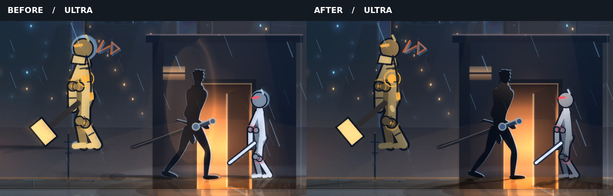

# Rooftop lighting: before and after

For the current renderer, new scene rules, and mobile budget, start with the [graphics engine map](../GRAPHICS-ENGINE-MAP.md). This page records the earlier rooftop lighting comparison.



[Original frame](before.png) · [Rewritten frame](after.png)

Both frames use the production Canvas2D renderer and actor painters at **Ultra**, not an old low-tier frame against a new Ultra frame. Seed `0xa17e`, time `0.24`, camera `(1710, -64)`, zoom `1.7`, viewport `1000 × 520`, DPR 1. The gold heavy is 35 world pixels above the deck. The fixture holds the pose and disables HUD, loose props and combat FX. It uses the native Canvas backend rather than a browser GPU. `before.png` was captured before the engine edits and reproduced byte-for-byte from `b044c1c`.

## What to compare

- **Centre:** the old figure-sized crescent extends above the head and through the air behind the ronin. The new rim follows the head, shoulder and clothing; the door still lights the roof even when nobody stands in it.
- **Right:** the grunt used to get an additive disc after both actors had already been drawn. The new practical light shades its actual helmet, torso and limbs during the body pass. The space between the limbs is untouched. Turning the actor around does not move the lamp.
- **Left:** the old shadow tips are suspended beside the heavy's boots. The new cast path follows the solved joints, scale and facing, projects onto the deck and separates from the airborne body. Contact darkening fades rapidly with altitude.

## Render decisions

1. Sample the stage light field at torso height. Apply a bounded, cached directional gradient to the existing material geometry instead of drawing light over an actor-sized rectangle. Keep weapons, HUD, hit flashes and the scene's atmospheric lighting separate.
2. Build one inexpensive `Path2D` per visible casting figure and replay it under the key and practical projections. Penumbra samples diverge at the tip rather than scaling the entire shadow away from the feet. Diffuse city bounce does not cast a second hard shadow. Low and Medium retain the contact-only path.
3. Keep moon positions in screen coordinates and practicals in world coordinates until projection. Source rectangles for reflections read backing pixels, not CSS pixels. Ultra takes one shared scene capture for bloom and rays. Rays use feathered emitter patches; bloom mixes two aligned resolutions and needs only one full-size additive draw.
4. Fine-pointer, non-touch desktops start at Ultra regardless of viewport size. Existing explicit saved settings and touch limits are preserved. The adaptive ladder starts at the actual selected tier and measures real frames rather than taking five moving averages over four seconds.

Canvas API references used: retaining and replaying paths [1](https://developer.mozilla.org/en-US/docs/Web/API/Path2D), and the affine transform used to project them [2](https://developer.mozilla.org/en-US/docs/Web/API/CanvasRenderingContext2D/transform).

## Reproduce

```sh
node --import tsx .qa/capture-fighters.mts /tmp/fighters.png
SR_TIME_CAPTURE=1 node --import tsx .qa/capture-fighters.mts /tmp/timed.png
node --import tsx --test tests/{surface-light,shadows,ultra-stack,world-lights,perf-core}.test.ts
```

For a baseline rerun, use the same capture script with the base revision's source. The timing mode discards four warm-up frames, then measures twenty full native renders, including a pixel readback to force completion. In the final paired run the median went from **33.7 to 23.2 ms**, and p95 from **38.1 to 30.1 ms**. This is a comparison of this fixed scene on this raster backend, not a browser FPS claim.

The production build and typecheck pass. A fresh Chromium desktop at 1280 × 720 and DPR 1.5 entered gameplay in Ultra; a smoke run drew two enemies with no page or game-loop errors. Pixel regressions check enemy coverage, facing, airborne shadow placement and high-DPR bloom. The full test run had **402 passes and 5 failures**: two blade-cleave cases, a dash-slash elbow constraint, ritual key count and unarmed contact distance. All five also failed on the base revision; no combat assertions were relaxed.

## Impact accents and Ultra lens finish

[Normal frame vs. peak guard-break focus](impact-focus.jpg). Ultra's capture path stretches each feathered light-source patch into a horizontal glint. The stage has at most five sources including the moon, all share the same capture, and no glint is attached to fighters.

Guard breaks, perfect parries, execution separations and boss defeats can request an accent. One beat draws six short marks at the contact and briefly dims the periphery before the HUD; the centre stays clear. The 160–200 ms envelope uses real time, including during hitstop. There is one slot, no queue, and a 1.6–2.4 s lockout. A routine hit cannot request it just because it deals high damage. Turning off screen shake or enabling reduced motion disables the accent; local combat feedback remains.

To reproduce the accent still, add `SR_CAPTURE_BEAT=1` to the capture command. Run `node --import tsx --test tests/impact-focus.test.ts` for the cooldown, coverage, opt-out and lens-budget regressions.

Subsequent work: [RibbonGI — captures, reference comparison and timings](ribbons/README.md) · [Road and sign lighting stability](road-and-sign-stability.md) · [Adaptive graphics presets](graphics-tiers.md).
